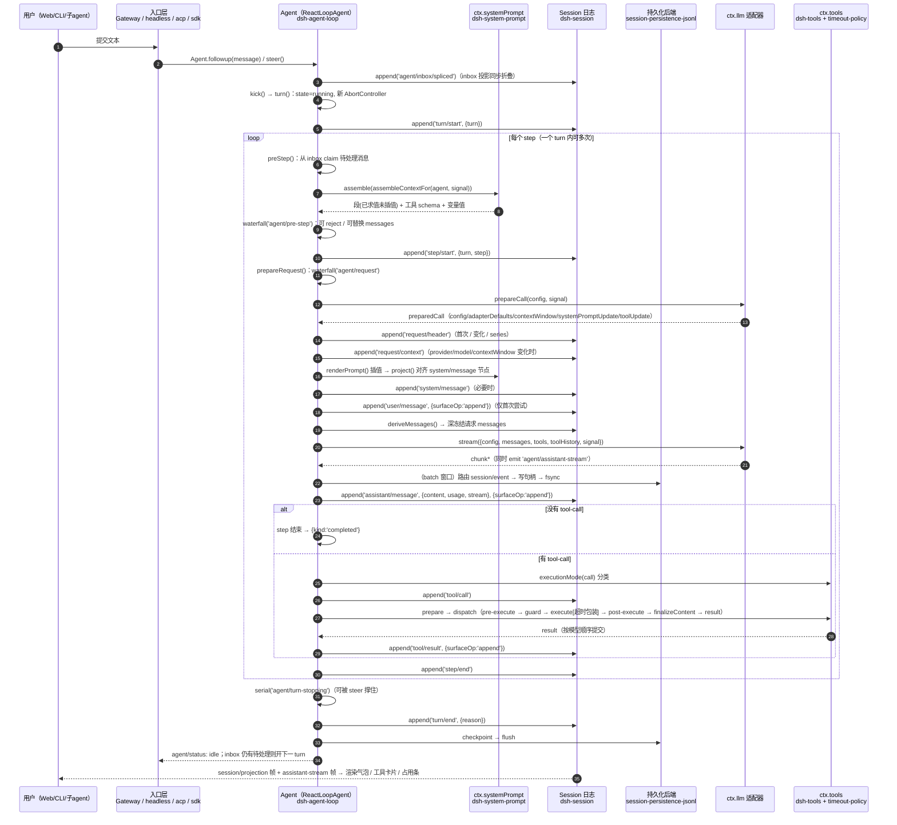

# DeepSeek Harness 内核：Cordis 架构与 Agent 循环运行原理

> 版本：DeepSeek Harness 桌面版 0.2.1-rc.1（Electron 外壳 + asar 内官方运行时）。
> 证据根目录（下文所有相对路径都相对于它）：`.tmp-dsh-recon/asar/@deepseek-ai/`
> 即 asar 内 `dsh/node_modules/@deepseek-ai/<包名>/...` 的展开副本。
>
> 写作纪律：每条关键结论后面都标了证据文件。源码里没写的东西不写；属于推断的地方会写「推断」并给出依据。

---

## 0. 一分钟版心智模型

DSH 不是「单体程序 + 插件挂载点」，而是 **服务图 + 事件溯源日志**：

1. **Cordis 内核**只做三件事：管「谁提供了哪个服务（Context / Service）」、管「谁依赖谁、什么时候能激活（Fiber + inject）」、管「东西怎么拆干净（effect / Disposable / scope）」。
2. **配置文件（entry list）不是启动顺序，而是依赖声明**。一行插件能不能跑，取决于它 `inject` 的服务此刻有没有人提供 —— 这就是 `dsh-base` 里那句「Row order carries no load semantics」的真实含义（见 §A.2）。
3. **Agent 循环**是「调用模型 → 跑工具 → 再调用」的驱动器，它把每一步写进一条**只追加的会话日志**；模型看到的历史、UI 看到的气泡、崩溃后能恢复的内容，全部从这条日志**派生**（见 §B）。
4. 用户看到的一切（气泡、工具卡片、思考流、占用条）都是这条日志的**投影**，不是另一份状态。

证据：`cordis/README.md`（最小例子）、`dsh-session/README.zh.md`（事件溯源）、`dsh-agent-loop/README.zh.md`（循环职责）。

---

## A. Cordis 内核

### A.1 Cordis 是什么，和传统插件系统的差别

Cordis 自述是「需要显式依赖注入、作用域服务、生命周期托管清理、可选配置驱动加载」的 TypeScript 插件框架（`cordis/README.md`）。

与传统插件系统（注册表 + 钩子 + 手写 unload）的三个核心差别：

| 维度 | 传统插件系统 | Cordis |
|---|---|---|
| 依赖关系 | 靠加载顺序 / 手写初始化顺序 | 靠 `inject` 声明 + **服务可用性**，不是行顺序 |
| 清理 | 插件自己写 `dispose()`，容易漏 | 一切副作用注册成 `ctx.effect()`，随 Fiber 销毁逆序回收 |
| 作用域 | 全局单例，改配置要重启 | `ctx.isolate()/extend()` 派生作用域上下文，可为单个 agent 提供不同实现 |

源码位置：`cordis/lib/index.js`（打包后的单文件）。

#### 六个角色

| 概念 | 是什么 | 证据 |
|---|---|---|
| **Context** | 依赖容器 + 服务解析代理。`new Context()` 建根上下文并内置 `reflect/registry/events/logger` 四个服务；`ctx.extend(meta)` 原型继承派生子上下文（不改父级）；`ctx.isolate(name, label)` 派生「同名服务解析到另一标签」的子作用域 | `cordis/lib/index.js:1652`（class Context）、`:1700`（extend）、`:1725`（isolate） |
| **Service** | 挂在 `ctx` 上的命名服务基类。子类 `super(ctx, name)` 即完成注册，而注册动作本身就是一次 effect，因此 **Fiber 卸载 = 服务自动下线** | `cordis/lib/index.js:1742`（class Service）、`:1786`（构造器内调 `ctx.reflect.provide`） |
| **plugin 函数** | 插件可以是 `(ctx, config) => void`、类（构造器）、或 `{ apply, inject }` 对象；`ctx.plugin(plugin, config)` 返回一个 Fiber | `cordis/lib/index.js:1619`（plugin）、`:1573`（inject 简写） |
| **effect** | 「一次注册 = 一次可回收的副作用」。`ctx.effect(execute, label)` 执行 `execute`，其返回 / yield 出的 dispose 函数被收集，销毁时**逆序**执行。DSH 里所有 `ctx.on(...)`、`ctx.tools.register(...)` 不用手写取消，就是靠它 | `cordis/lib/index.js:1169` |
| **scope（作用域）** | 两条正交作用域：① 服务隔离作用域 `ctx.isolate(name, label)`；② 插件作用域，例如 `agent.ctx` 只影响该 agent。agent preset、按 agent 限制工具都用后者 | `cordis/lib/index.js:1725`；`dsh-agent/README.zh.md`（"将注册限定到单个 agent"） |
| **Fiber** | 一个插件实例的生命周期状态机：持 `inject`（依赖表）、`_store`（已解析依赖快照）、`state`、`_disposables`。`state === 2` 表示已激活（多处以此判定服务可用），`uid === null` 表示已销毁 | `cordis/lib/index.js:1008`（class Fiber）、`:1288`（_getState）、`:763`（get(strict) 用 `state !== 2` 过滤） |
| **Disposable / DisposableList** | 统一的可释放物集合；`runDisposable()` 同时接受同步函数与返回 Promise 的异步清理 | `cordis/lib/index.js:964`、`:18` 区域（DisposableList） |

> 新手注意：**Cordis 没有「卸载插件」这个操作，只有「销毁 Fiber」**。销毁 Fiber 会逆序跑完它注册过的所有 effect —— 包括「服务下线」这件事本身（而服务下线又会通知依赖它的 Fiber，见下一节）。

---

### A.2 服务的提供与消费，以及「谁先激活」

#### 三件套

1. **提供**：`ctx.reflect.provide(name, value, check)` 把实现登记进 `store[key]`（key 来自 `ctx[isolate][name]` 这个符号）。`Service` 构造器自动调它。代码 `cordis/lib/index.js:800`。
   - 同名服务二次注册会抛错 `service "..." has been registered at <fiber>`（同一处）。这正是 `dsh-base` README 说「在沙箱化 fs 提供方旁边再挂 `dsh-fs-local` 会让 profile 加载失败」的机制来源。
2. **消费（读取）**：`ctx.get(name, strict = true)` 只返回「提供者 Fiber 仍处激活态」的实现，否则 undefined。代码 `cordis/lib/index.js:763`、`:776`（_getImpl）。
3. **声明依赖**：`inject`。可以是数组 `['loader']`，也可以是对象 `{ serviceName: interceptConfig }`。`Inject.resolve()` 把两者归一化成 `name → config` 的 map，并且沿原型链合并父类 inject。代码 `cordis/lib/index.js:1491`。

#### 「谁先激活」不是排序问题，是求解问题

三段关键代码：

1. 建 Fiber 时先查依赖再刷新状态：`for (const name of Object.keys(this.inject)) this._checkImpl(name); this._refresh();`（`cordis/lib/index.js:1075` 附近）。
2. `_checkImpl(name)` 记录「该依赖当前解析到了哪个实现」；`_refresh()` 把**所有依赖的提供者 uid 串成一个 epoch 字符串**，任何一个依赖缺失就把 epoch 置为 INACTIVE —— `cordis/lib/index.js:1306`、`:1317`。
3. `_setEpoch(epoch)` 发现 epoch 变化就切状态：从 INACTIVE 变成有值 → `_reload()`（真正执行插件体）；从有值变 INACTIVE → `_unload()` —— `cordis/lib/index.js:1330`。

反向通知：服务注册/下线时 `notify([name])` 遍历**所有 runtime 的所有 Fiber**，凡 `inject` 里含这个名字的，重新 `_checkImpl` + `_refresh`：

```
for (const runtime of this.ctx.registry.values()) for (const fiber of runtime.fibers) {
  for (const name of names) { if (!(name in fiber.inject)) continue; ... fiber._checkImpl(name) }
  fiber._refresh()
}
```
证据：`cordis/lib/index.js:832`（notify），调用点在 `provide()`（:818）与 `_updateState()`（:1302）。

所以：

- **行顺序不决定加载顺序** —— 加载时机由「依赖是否齐备」这个布尔条件触发；谁、什么时候来都可以，来了就立刻解锁下游。真正决定顺序的是**服务依赖图**。
- **一行插件可能在整棵树都注册完之后才迟迟激活** —— 只要它依赖的服务由后面的行提供，它就是被 notify 唤醒的。
- 这就解释了 `dsh-base/cordis.patch.yml:12-13` 敢写：
  > `# Row order carries no load semantics (activation is service-availability driven); the grouping is for readers.`

**用户可见推论**：把 profile 里 A 行挪到 B 行前面通常**不会**改变行为；要改行为得改依赖（换实现、禁用某行、改 config）。反之，**关掉一行可能让一串下游永不激活** —— `dsh-base/README.zh.md` 明确警告「跳过组合包不保证剩余组合能够提供所需服务」。

#### 依赖还可携带「拦截配置」（intercept）

`inject` 的值不只是名字：`{ http: { timeout: 100 } }` 会被压进 `ctx[Context.intercept]`，服务方用 `Service[resolveConfig]` 把祖先链上的 intercept 合并成最终配置（近根者先应用）。证据：`cordis/lib/index.js:1021`、`:1810`。

---

### A.3 插件加载器（cordis-plugin-loader）怎么读 YAML entry list

loader 的职责一句话：**拥有 EntryTree，按 name import 模块，套上 config，并让运行中的插件图与 entry 更新保持同步**（`cordis-plugin-loader/README.md` 首段）。

#### entry 字段

| 字段 | 语义 | 证据 |
|---|---|---|
| `id` | 稳定标识，用于 update/remove/定位；嵌套 group 里拼成 `a:b` | `README.md`（Entry Options）；`lib/index.js:330`（get id） |
| `name` | 模块说明符（包名 / 绝对路径 / file URL） | `lib/index.js:453`（tree.import(options.name)） |
| `config` | 传给插件的配置，按插件 Config schema 校验 | `lib/index.js:402`（resolveConfig） |
| `group` | 该行 config 其实是子 entry 列表 | `README.md`；`lib/index.js:337`（group 不继承 disabled） |
| `disabled` | 布尔**或 !!js 表达式**；沿父链继承（父禁用则子也禁用） | `lib/index.js:336`（get disabled）、`:349`（disabledOf） |
| `inject` | 为本行追加必需服务 / 拦截配置 | `README.md`（Entry Options） |

#### !!js 表达式怎么执行

YAML 里的 `!!js` 标量被解析成**惰性表达式节点**（带 `__jsExpr` 属性），不会立刻求值。真正求值用：

```
const evaluate = new Function("ctx", "expr", "with (ctx) { return eval(expr) }")
function interpolate(ctx, value) { if (isJsExpr(value)) return evaluate(ctx, value.__jsExpr); ... }
```
证据：`cordis-plugin-loader/lib/index.js:233`（evaluate）、`:239`（interpolate）、`:246`（isJsExpr）。

要点：
- 求值作用域就是 **loader 的上下文 ctx**，所以能写 `ctx.get('profileContext')`、`process.platform === 'win32'`、`dshHomePath('sessions')`（实例见 `dsh-base/cordis.patch.yml:18`、`:22`、`:141`）。
- **原始表达式节点留在 options 里不回写**，因此写配置时形式不会退化成求值后的布尔值（注释原文 "The raw node stays in the options, so write-back keeps the form"，`lib/index.js:346`）。

#### insert 与 patch 的叠加规则

这两个**不是** loader 的 entry 字段，而是「patch list」的语法 —— 实现在 `dsh-app-boot` 的 `applyEntryPatches()`，注释自称 "THE patch semantics of this include, shared by mounting and offline tooling"：

| patch 形态 | 行为 | 证据 |
|---|---|---|
| `{ insert: [ ...rows ] }`（无 id） | 追加到**根** entry 列表末尾 | `dsh-app-boot/lib/index.js:87` |
| `{ id, insert: [ ...rows ] }` | 追加到该 group 的 `config` 数组末尾 | `dsh-app-boot/lib/index.js:75-87` |
| `{ id, ...overrides }` | 对目标行逐 key **整体赋值**（`target[key] = value`） | `dsh-app-boot/lib/index.js:104-107` |
| `{ id, name: 'X' }` 且实际 name 不符 | 告警并跳过（防止 id 漂移后误改别人） | `dsh-app-boot/lib/index.js:100` |

**"last write wins" 的真实含义**：patch list 按顺序逐条应用，同一个 key 后写覆盖先写。于是：

- 后一层的 `config` 会**整体替换**前一层的 `config`，**不是深合并** —— 这正是 `dsh-base/cordis.patch.yml:6` 说的「A patch replaces the targeted row's whole config rather than merging into it」，也是 `dsh-base/README.zh.md` 里「覆盖会替换整个设置块，必须重述每个想保留的设置」的来源。
- `insert` 是追加语义：后面再 insert 同 id 的一行 = 出现两行同 id，patch 不做去重，由 loader 的 `ensureId` 决定复用还是报错（`cordis-plugin-loader/lib/index.js:161`）。
- 输入**永不被就地修改**：`applyEntryPatches` 先 structuredClone，否则热重载时旧 patch 值会被烙进缓存的解析结果（`dsh-app-boot/lib/index.js:48-63` 的注释与实现）。

#### entry 更新 = 重启，只有一种例外

`Entry.update()` 比较新旧 options 的 diff；只有当「仅 config 变化 + Fiber 已激活 + 上下文未变 + 差异只落在 schema 标了 `volatile()` 的字段」时，才**不重启**，而是把新值原地写进运行中的引用并广播 `loader/volatile-update`。证据：`cordis-plugin-loader/lib/index.js:382`（volatileOnly 判定）、`:395`（_commitVolatile）。

这解释了为什么 `maxParallelToolCalls` 能不重启就改：它的 schema 带 `volatile()`（`dsh-agent-loop/lib/index.js:1554`），而 `agents` 列表不带（`dsh-agent-loop/README.zh.md`「配置声明式 agent」一节）。

---

### A.4 profile 分层机制：bundles → cordis.patch.yml → --patch

#### profile 是什么

> profile 位于 `$DSH_HOME/profiles/<name>`，由**可安装组合包（bundle）**和**自己的 cordis.patch.yml** 组成。
> 证据：`dsh-app-boot/README.zh.md:50`；实机目录 `E:\dsh-data\profiles\desktop\`。

bundle 必须在自己的 `package.json` 里声明 `dsh.bundle.patch`（一个文件，或有序文件列表，均相对包根）：`dsh-package-manifest/README.zh.md:46`（含 `{ bundle: { patch: './cordis.patch.yml' } }` 例子与「按列表顺序作为同一个组合包层应用」）。校验函数 `bundlePatchFiles()` 在 `dsh-app-boot/lib/index.js:517`，路径解析 `bundlePatchPaths()` 在 `:529`。

#### 层的叠加顺序（本题最需要精确的一条）

唯一权威实现是 `readProfilePatches()`：

```
function readProfilePatches(binName, context, initialProfile) {
  const patches = structuredClone([
    ...readBundlePatches(binName, context, initialProfile),   // 1. 各 bundle 的 patch，按 bundles 顺序拼接
    ...initialProfile?.patches ?? loadOptionalPatches(...),   // 2. profile 自己的 cordis.patch.yml
    ...loadOptionalPatches(binName, join(context.home, "cordis.patch.yml")) ?? [], // 3. $DSH_HOME/cordis.patch.yml
    ...context.overlays                                       // 4. --patch 文件（argv 顺序）
  ])
  ... // 5. 遥测开关 patch
}
```
证据：`dsh-app-boot/lib/index.js:1127-1137`、`:1118`（readBundlePatches 用 layers.flatMap 展平）、`:1105`（resolveTelemetryPatch）。

配套：
- `loadProfileDirectory()`：读 manifest 的 `dsh.profile.bundles`，逐个 bundle 解析出 `layers[]`（`packageName/packageDir/patchPaths/patches`），再单独读 profile 的 `cordis.patch.yml` 作为 `patches`。读不出/版本不兼容的 bundle 进 `skippedBundles`，不致命。证据 `dsh-app-boot/lib/index.js:1015-1051`。
- 空根配置：`cordis.yml` 内容就是 `[]`（一切组合都由 patch 叠出）。证据 `dsh/lib/profile-boot-C14i-8IN.js:121-125`（PROFILE_ROOT_CONFIG）；实机 `E:\dsh-data\profiles\desktop\cordis.yml` 亦为 `[]`。
- 启动：`runProfile()` → `composeProfile()` → `boot(NAME, rootConfig, readProfilePatches(...), setup)`；`--patch` 在 `composeProfile()` 里 `patchFiles.flatMap(loadOverlayPatches)` 变成 `overlays`。证据 `dsh/lib/profile-boot-C14i-8IN.js:236-247`、`:302`、`:289-301`（profileContext 提供 name/dir/patchPath/overlays，随后被 !!js 当条件用，见 `dsh-base/cordis.patch.yml:22`）。
- `--patch` 的 CLI 语义：可重复的单值收集器，且刻意**非变参**（避免吞掉内部参数）。证据 `dsh/lib/bin.js:27-28`、`:61`。

**可观察后效**：home 级 patch 压过 profile 级 patch —— `dsh-app-boot/README.zh.md:61` 明说「先应用逐 profile 的文件，再应用 home 级文件，因此后者优先级更高」。

#### 顺带纠正一个容易搞错的归属

问题清单把「profile 分层」也列给了 `dsh-cordis-host-runner`。**它不是干这个的**。它提供的是「运行时检查 + 进程内动态 Cordis 包定义注册表」：Host 半跑在 `node:vm` 里（`vmTimeoutMs` 默认 5000），定义按会话隔离、重启即消失，只有 Host 的包在本进程激活、带浏览器部分的包要等审批。证据：`dsh-cordis-host-runner/README.zh.md:12`、`:40`、`:54-58`。

profile 分层的真实归属：

| 关注点 | 归属 |
|---|---|
| manifest 字段类型（`dsh.bundle.patch`、`engines.dsh`） | `dsh-package-manifest`（**只提供类型，不读文件**） |
| profile/bundle/patch 的读取、组合、校验、`--dump-config` | `dsh-app-boot` |
| launcher 拼层、挂载、fail-loud、信号处理 | `dsh/lib/profile-boot-*.js` + `dsh/lib/bin.js` |
| entry list → 实际插件图 | `cordis-plugin-loader` |
| 运行期动态定义（与分层无关） | `dsh-cordis-host-runner` |

#### 实机对照（本机 Desktop profile）

`E:\dsh-data\profiles\desktop\package.json` 的 `dsh.profile.bundles` 顺序：
`@deepseek-ai/dsh-base` → `dsh-web-app` → `dshmarket` → `@liustack/modlens` → `@linxin666/dsh-web-all` → `@anionex/dsh-turn-rewind` → `@wxg-prc-cpg/dsh-weknora` → `dsh-context` → `dsh-find-plugins` → `agent-team-profile` → `auto-review`。
（这解释了为什么本会话的 `run_code` / `weknora_*` / `modlens_read_image` 等工具存在：它们不来自 base，是外部 bundle 插入的。）

---

## B. Agent 循环（dsh-agent-loop + dsh-agent + dsh-tools）

包分工一句话记住：

- `dsh-agent`：**公开的 Agent 接口 + 注册表 + agent/* 事件**，自己不发模型请求（`dsh-agent/README.zh.md:12`、`:28`）。
- `dsh-agent-loop`：**唯一的默认驱动器**，实现 `ReactLoopAgent`，把自身注册成 `ctx.agents` 背后的 AgentFactory（`dsh-agent-loop/README.zh.md:89`）。
- `dsh-tools`：**工具注册表 + 固定执行流水线**（`dsh-tools/README.zh.md:109`）。

### B.1 一个 turn 的完整生命周期

#### 触发入口

外部（UI / 命令 / 子 agent / goal 驱动器）把文本投给某 agent 的收件箱：

- `followup()`：排队「下一轮提示」并唤醒驱动器；
- `steer()`：提交「下一步输入」并唤醒；
- `inject()`：只加面向模型的上下文，**不唤醒**（落在下一个已被接纳的步骤里）。

证据：`dsh-agent/README.zh.md:47`、`:177`（cancel 默认清空收件箱）。

真实调用点（证明这是统一 seam）：`dsh-headless/lib/index.js:340`、`dsh-acp/lib/index.js:841`、`dsh-goal-round-driver/lib/index.js:164`、`dsh-sdk-jsonrpc-server/lib/index.js:163`（后者用 `session/prompt` RPC 调 `agent.followup(message)`）。

> 诚实标注：浏览器输入框 → Host 的那一跳经过 Gateway/typert 层，我没有在源码里定位到单一权威的 RPC 命名点，故不指名；能确定的是它最终落到上面这组 `Agent.followup/steer` 语义。

#### 关键函数名与文件（全部在 `dsh-agent-loop/lib/index.js`）

| 阶段 | 函数 / 事件 | 位置 |
|---|---|---|
| 驱动器主循环 | `kick()`：`while (await this.turn());` | :887 |
| 开 turn | `turn()`：先 append `turn/start`，再循环 step | :938（append 在 :945） |
| 步骤准入 | `preStep(target, position)`：① 从收件箱 claim；② `ctx.systemPrompt.assemble(...)`；③ `dispatch.waterfall('agent/pre-step', ...)`，默认实现拼上运行时上下文并返回 `{ kind: 'enter', messages }` | :902（assemble :907，waterfall :909） |
| 开步骤 | append `step/start` | :970 |
| 解析路由 | `prepareRequest()`：`waterfall('agent/request')` → `ctx.llm.prepareCall(config, signal)` | :1175（prepareCall :1201） |
| 提示词对齐/落盘 | `ctx.systemPrompt.project(renderedPrompt, {...})` → 若干 `system/message` | :1057、:1061 |
| 用户消息入库 | append `user/message`, `{ surfaceOp: 'append' }`（仅首次尝试） | :1069、:1072 |
| 构造请求 | `buildRequest(config, preparedCall, tools, position, startsSeries, signal)`：写 `request/header`、按需写 `request/context`、`session.deriveMessages()` 深冻结、返回 `{...config, messages, toolHistory, tools, sessionId, signal}` | :1214（header :1226，deriveMessages :1274） |
| 调模型 | `preparedCall?.stream(request) ?? ctx.llm.stream(request)`，`for await (const chunk of stream)` 累积到 `AssistantStreamAttempt`，并 emit `agent/assistant-stream` | :1084-1091 |
| 结算 assistant | append `assistant/message`（含 usage 与紧凑 stream） | :1156 |
| 判断是否结束 | `toolCalls.length === 0 → {kind:'completed'}`；`finish.kind === 'max-tokens' → {kind:'max-tokens'}` | :1163-1165 |
| 跑工具 | `executeToolCalls(ctx, turn, step, toolCalls, signal, acceptContext)` | :1166（定义 :506） |
| 关步骤 | append `step/end` | :994 |
| 轮次将结束钩子 | `dispatch.serial('agent/turn-stopping', ...)`（可被 steer 撑住不结束） | :1001 |
| 关轮次 | append `turn/end`, `{turn, reason}` | :1029 |
| 还有待处理输入？ | `if (!this.inbox.hasPending) return false;` 否则开新 turn | :1037-1041 |

**请求体形状**（新手最常问）：请求 = `header.config`（provider/model/reasoning/maxTokens）+ `deriveMessages()` + `header.tools`；**没有独立的 system 字段** —— 系统提示词是 surface 第 0 号节点（一条 `system/message` 消息）。证据：`dsh-agent-loop/README.zh.md:120`、`dsh-system-prompt/README.zh.md:140`。

#### 系统提示词怎么「组装」出来

`dsh-system-prompt` 是一个注册表 + 一条协作式流水线（`dsh-system-prompt/README.zh.md:100`）：

1. `assemble()`：合并全局层与当前作用域层 → 分离工具 schema → 段按 `order` 升序（同值再按名字码位）排序 → 跑按作用域筛选的 `system-prompt/assemble` waterfall → 处理 `complete: true` 的唯一整段 → 应用运行时上下文抑制器。返回「文本已求值但尚未插值」的段 + 有序工具 schema + 变量值（:110）。
2. `renderPrompt(assembly)`：对未标 `interpolate: false` 的段插值 `{{var}}`、删空段、空行连接；**未知引用 / 已注册但无值 / 格式错的 complete 组都会抛错**（"格式错误的提示词比明确失败更糟"，:110）。
3. 段位次示例：harness 身份 `-1000`、persona 前缀 `0`、第一方指导、harness 源码 `10000`、Web 表层 `10100`、persona 后缀 `10200`（:46-50、:140）。

新手视角：**"system prompt" 不是一个字符串常量，而是几十个插件各自 `ctx.systemPrompt.section({name, order, text})` 拼出来的**；工具 schema 也是同一次组装的产物（"模型获知自己能做什么是一个连贯整体"，:100）。

---

### B.2 工具调用：并发 / 串行、超时、中断

#### 分类：并行安全 vs 独占（一元、fail-closed）

调度器在每个工具启动前问注册表 `ctx.tools.executionMode(exec).kind`：

```
executionMode(exec) {
  const tool = this.resolveExecution(exec.name, exec.agent, exec.parent !== undefined)
  if (!tool?.isConcurrencySafe) return { kind: 'exclusive' }
  try { return tool.isConcurrencySafe(exec.arguments) === true ? { kind: 'parallel' } : { kind: 'exclusive' } }
  catch { return { kind: 'exclusive' } }
}
```
证据：`dsh-tools/lib/types/index.js:694`。注释写明「只有精确 true 才算并行；未知、隐藏、未声明、非法、抛异常一律独占」。

#### 调度：独占做屏障，并行用有界滚动池

`executeToolCalls()` 从模型顺序的第一个调用开始：

- 第一个是 exclusive → 单独成组跑（`runGroup(..., [first], ...)`），构成顺序屏障；
- 第一个是 parallel → 把后面所有调用丢进同一个池，但每个在真正启动前**重新分类**：一旦遇到被判定独占的调用，就等当前池排空，把剩下的留给下一个屏障。

证据：`dsh-agent-loop/lib/index.js:506-533`（executeToolCalls）、`:551`（runGroup）、`:619`（`inFlight.size < maxParallelToolCalls` 门控）。

并发上限：`maxParallelToolCalls`，默认 **10**，带 `volatile()`（`dsh-agent-loop/lib/index.js:1554`、`:1297` 的 `DEFAULT_MAX_PARALLEL_TOOL_CALLS = 10`）。设成 1 = 严格串行（README :48）。

**结果顺序**：调度可重叠，但「策略、结果、结果上下文」都按**模型顺序**提交 —— `commitReady()` 只在 `slots[committed]` 有值时才前进（`:565-576`）。这保证日志与模型看到的历史确定。

#### 工具执行流水线（固定五段）

> `tools/pre-execute`（可扩展的允许/拒绝/询问）
> → 已注册的**单调守卫** `ctx.tools.guard()`（返回理由即拒绝，后续监听器无法翻案）
> → `tools/execute`（环绕分发：超时/重试/指标）
> → `tools/post-execute`（检查/替换、附加上下文）
> → 定义自带的 `finalizeContent` → `tools/result`（只观测）

证据：`dsh-tools/README.zh.md:109`（顺序）、`:89`（各事件职责）。

循环侧以 `TOOL_RUNTIME_SCHEDULER` 的四步调用它：`prepare → dispatch → finish / finalize`（`dsh-agent-loop/lib/index.js:582`、`:586`、`:570`）。

#### 超时：协作式，不是硬杀

- 工具在 `ToolDefinition` 上**自己声明** `timeoutMs`；注册表**从不执行**它（`dsh-tools/README.zh.md:235`）。
- 执行它的是 `dsh-tool-call-timeout-policy`：一个 `tools/execute` 监听器，从注册表读回 `ctx.tools.get(exec.name, exec.agent)?.timeoutMs`，用 `deadline(exec.signal, timeoutMs, TOOL_TIMEOUT)` 造融合信号，**原地换到 exec 上**，`finally` 里换回调用方信号（这样 `post-execute` 永远看不到自己被中止的信号）；超时后把结果替换成 `Error: tool call timed out after <ms>ms`，错误码 `TOOL_TIMEOUT`。证据：`dsh-tool-call-timeout-policy/README.zh.md:69`；多个 `tools/execute` 监听器按注册顺序组合（:73）。
- 硬限制：**忽略 exec.signal 的工具不会被打断**，调用方会一直等（:121）。随附的 bash/read/write/edit 故意不声明超时（:122）。
- 本机：`timeout-policy` 挂载且无 config（`dsh-base/cordis.patch.yml:408-409`）。

#### 中断（interrupt）与取消

- 取消是**协作式**：`agent.cancel(cause)` 中止当前活动，默认**清空**待处理与 steering 工作；`cancel(cause, { keepInbox: true })` 只中止轮次（`dsh-agent/README.zh.md:177`）。没有「只中止一个步骤、轮次继续」的操作。
- 已流式交付的文本**保留**：取消时 `live.interruptedBlocks()` 结算成带 `interrupted: true` 的 `assistant/message`（`dsh-agent-loop/lib/index.js:1097-1112`）。这就是「按停止后那段字不消失、下一次请求也包含它」的机制。
- 未分发就被取消的工具调用补一对合成事件：`tool/call` + `ABORTED_BEFORE_DISPATCH` 结果，让后续历史配对完整（`dsh-agent-loop/lib/index.js:528`、`README.zh.md:128`）。
- 步骤失败也不留悬空调用：有 `tool/call` 无结果的补 `TOOL_OUTCOME_UNKNOWN`，连 `tool/call` 都没有的补 `TOOL_NOT_STARTED`（`README.zh.md:130`，文案见 `dsh-session/README.zh.md:171`）。实现是循环里的 `ToolCallRecovery`（`dsh-agent-loop/lib/index.js:975`）。
- 取消原因会**拷贝**进 `turn/end`，避免把传输层往 `AbortSignal.reason` 上加的东西（Node fetch 会加 stack）写进日志（`dsh-agent-loop/README.zh.md:126`）。

---

### B.3 上下文管理：compaction / token meter / spill

| 机制 | 解决什么 | 改历史吗 | 关键实现 |
|---|---|---|---|
| **token meter** | 「现在多满？」——测量 | 否，只读 | `ctx.tokenMeter.measure(session, requestHeader?)` 回放持久日志得出 `totalTokens/surfaceTokens/nodes[].tokens`；启发式「每 token 4 字符 + 块与角色开销」，有声明时用适配器图片定价。`dsh-token-meter/README.zh.md:12`、`:36`、`:66`（"占用是参考数字，不是计费记录；harness 中没有任何机制依据它做决定"） |
| **compaction**（`dsh-compaction` + `-basic`） | 「太满了，把老历史压成一段摘要」 | **是**（用一条 `user/message` 的 replace 遮蔽旧范围；原始事件仍在日志里） | 见下 |
| **tool-result-pruner** | 单个工具结果过大 | 是（先于大压缩器，把超阈值结果裁成首/尾窗口） | 本机 `thresholdChars: 8192, headChars: 4096, tailChars: 1024`（`dsh-base/cordis.patch.yml:425-430`） |
| **spill** | 超大输出「必须还能取回全文」 | 是（结果变成「有界预览 + 定位信息」） | `ctx.spillStore.saveText()` → `SpillRef{locator, bytes, retrievalHint}`，按会话分组；本机 `maxInlineTokens: 12500`（`dsh-base/cordis.patch.yml:414-417`、`dsh-spill/README.zh.md:58`、`:62`） |

**compaction 的两个要点**：

- 默认阈值：窗口 `W`、请求输出上限 `O`、余量 `B = 65536` tokens，阈值 = `floor(min(W × 0.8, W − O − B))`；保留的近期历史预算是 `W − O` 的 **16%**（`dsh-compaction-basic/README.zh.md:62`、:66）。默认 `thresholdRatio 0.8` / `retainRatio 0.16` 是固定默认（:256）。
- 自动触发挂点：`auto: true` 时一个**串行** `agent/pre-step` 监听器在请求派生前检查压力，越阈值就先剪枝、再摘要最旧的"平衡范围"（:113）。所以压缩只发生在「两次模型调用之间」，永不打断进行中的流。
- 事务性：先追加仅日志的 `compaction/start`（拿锁）→ 摘要 → `compaction/summary` → **唯一一次 surface 变更**（承载摘要的 `user/message` replace）→ `compaction/end` 释放锁；两个标记之间崩溃会留下**可检测的遗留锁**而不是伪造的成功（`dsh-compaction/README.zh.md:73`、`:95-97`）。
- 边界安全：`toolPairingBalancedBefore/After(session, seq)` 保证压缩边界**不会切在一对未闭合的 tool/call 与 tool/result 中间**（`dsh-compaction/README.zh.md:91`）。
- 用户可见：`/compact`（`dsh-command-compact`，本机 `dsh-base/cordis.patch.yml:356`）。**压缩不是模型工具**（`dsh-compaction/README.zh.md:159`）。
- 图片：`dsh-compaction-image-offload` 在能看图的路由抱怨图片预算超了时，把最老图片换占位符后重试（`dsh-base/cordis.patch.yml:432-435`）。

**KV Cache 视角**（新手最易忽略）：上述操作里**只有 replace 会从「第一条被遮蔽的消息」起让缓存失效**；普通追加不会（`dsh-session/README.zh.md:165`）。所以压缩的代价不只是重算，还包括前缀缓存全丢。

---

### B.4 会话持久化：各包职责与落盘位置

| 包 | 管什么 | 证据 |
|---|---|---|
| `dsh-session` | **内存中的事件溯源对象 Session**：`append(type, data, opts)` 只追加、深度冻结、校验无损 JSON；`deriveMessages()` 投影成模型历史（增量+缓存）；`fork()`、`flush()`、surface replace 校验。**它本身不落盘** | `dsh-session/README.zh.md:12`、`:42`、`:50`、`:100` |
| `dsh-session-persistence` | 持久化 **seam**（`persistence.create(header)` / `open(id,'write')` 的抽象句柄约定），无实现 | 循环侧用法见 `dsh-agent-loop/README.zh.md:116` |
| `dsh-session-persistence-jsonl` | 随产品交付的**唯一第一方后端**：每会话一个只追加 JSONL，默认带校验和的 Zstandard 帧 | `dsh-session-persistence-jsonl/README.zh.md:12` |
| `dsh-session-projection` | 把「当前状态」（待办、goal、统计）从事件日志**同步折叠**成 schema 校验过的 JSON，带快照 + 变更通知给客户端 | `dsh-session-projection/README.zh.md:12`、`:69` |
| `dsh-session-format`（+ `-catalog` + 各 `vN-to-vM`） | 格式版本与**相邻迁移链**：一次还原让已解析值流经有状态 Stage；`readHeader()` 不读事件就返回 `current`/`migration-required`/`unsupported`/`malformed` | `dsh-session-format/README.zh.md:12`、`:44` |

#### 磁盘布局（本机实际位置）

配置项：`session-persistence-jsonl.root: !!js dshHomePath('sessions')` —— `dsh-base/cordis.patch.yml:138-141`。本机 `DSH_HOME=E:\dsh-data`，所以根是 `E:\dsh-data\sessions`（已核实存在，里面有 `--C-Users-HUAWEI-Desktop-math~0020AI~0020assistant--` 这类可读项目目录）。

目录形状（`dsh-session-persistence-jsonl/README.zh.md:59-71`）：

```
<root>/
  --<normalized-cwd>--/          # 可读的项目目录（无 cwd 时 _no-cwd）
    <encoded-id>/                # 会话自有目录（id 单射转义成安全路径段）
      session.v3.jsonl.zstd      # 压缩根（当前代际 v3）
      session.v3.jsonl           # compression:'none' 时的纯文本根
```
运行时选**数值最高**的规范代际（将来 v4 即 `session.v4.*`）。写打开历史格式会在同目录发布后继代际，**源文件保持逐字节不变**。

其它存储事实：
- 存储中枢：`storage-json.root: !!js dshHomePath('storages')`（`dsh-base/cordis.patch.yml:182-185`）。
- 会话全文检索默认**关闭**：`session-query-sqlite: { path: ':memory:', openAt: never }`，搜索报 `SESSION_QUERY_SEARCH_DISABLED`、SQLite 根本不打开；所以本机侧边栏搜索只匹配标题/workspace 名（`dsh-base/cordis.patch.yml:157-161`）。
- 持久性检查点：`session-checkpoint-policy`「在每个模型请求前与顶层分发前做持久性检查点」（`dsh-base/cordis.patch.yml:419-421`）。
- 崩溃语义：已提交前缀一定保住；被中断的最终轮次由**读侧**在写句柄上补合成 closer；不完整末尾原始行丢弃；撕裂的 Zstd 帧只取其中完整解码出的记录并截掉撕裂字节（`dsh-session-persistence-jsonl/README.zh.md:77`）。
- 单写者：进程内每后端实例认领，跨进程用内核锁（POSIX flock / Windows 命名信号量，零文件足迹）（:168）。
- 会话**不会自动删除**：日志在 root 下累积，seam 无删除接口（:167）。

#### 新手易错点

`assistant/message` 里内嵌完整的紧凑 provider stream，但 `deriveMessages()` 只把它当回放/诊断数据、不重复生成消息；UI 的「打字机」来自进程本地的 `agent/assistant-stream` 帧（start / chunk / end），那些帧**不进模型历史**（`dsh-agent/README.zh.md:67`、`dsh-agent-loop/README.zh.md:120`）。即「实时事件是呈现数据，不是回放来源」。

---

### B.5 goal 自动续跑 vs ralph

| | **goal**（`dsh-goal` + `dsh-tool-goal` + `dsh-goal-round-driver`） | **ralph**（`dsh-tool-ralph`） |
|---|---|---|
| 作用域 | **同一会话内**续跑 | **每轮一个全新子 agent**，前台串行 |
| 上下文 | 累积（历史渐长，靠 compaction 控） | 每轮只拿「不可变目标 + 当前轮/上限 + 一份有界结构化交接」；父对话与旧子会话绝不作为种子（`dsh-tool-ralph/README.zh.md:36`） |
| 跨轮长期记忆 | 会话日志 | **共享工作区**（"shared workspace is the authoritative state"） |
| 触发 | agent 空闲 + goal 为 active + 续行 armed + 额度未耗尽 | 模型显式调 `ralph({objective, maxRounds?})`，**阻塞到整个运行结算** |
| 终态 | active/paused/blocked/complete（持久 phase；续行开关是进程本地、绝不持久） | complete / blocked / budget-limited |
| 预算 | `maxGoalRounds`，默认 **256**（`dsh-goal/README.zh.md:46`） | `maxRounds`，默认 **256**，同时是部署上限（`dsh-tool-ralph/README.zh.md:43`） |
| 谁决定完成 | 模型自己声明（无独立评估器） | **worker 报告**，非独立认证（:161） |
| 源码事实 | goal 状态只存会话日志（`goal/change` 事件 v1，携带变更后完整快照；clear 写 tombstone），`ctx.goals` 用 `{id, revision}` 比较并设置、拒绝陈旧视图（`dsh-goal/README.zh.md:97`、`:76`） | 固定脚本由部署方拥有：模型只给数据，不能改循环/路由/schema/校验（`dsh-tool-ralph/README.zh.md:61`） |

goal 续行的关键实现（讲解时最有用的一条）：

- 驱动器在 agent **空闲**时**先预留** `roundsStarted + 1`，排入一条带 goal 来源的 `<goal_round>` 提示词，然后才 `agent.followup(message)`；**只有真正进入步骤的 user/message 才消耗额度**，陈旧预留不消耗（`dsh-goal-round-driver/README.zh.md:71`，调用点 `lib/index.js:164`）。
- 竞态防护挂在 `agent/pre-step`：前后都校验「已领取记录 + 当前 goal」，让陈旧/已取消的提示词在进步骤前被拒（:72）。
- **resume / fork / 挂载驱动器都不会自动复活工作**：active 的 goal 保持 disarmed，直到用户显式 resume（`dsh-goal/README.zh.md:72`、`dsh-goal-round-driver/README.zh.md:57`）。
- 额度耗尽不是静默停，而是写稳定 blocker 码 `round-limit`（:53）。

ralph 的路由细节：配置的提供方必须支持结构化输出并报告 `inheritsParentContext: false`，否则**在第 0 轮之前就报错**（`dsh-tool-ralph/README.zh.md:47`）；调用方 agent 是每个子 agent 的父级（保留 cwd 与谱系，不复制对话）（:73）。

---

## C. 时序图：从「点发送」到「看到回复」

### C.1 Mermaid



### C.2 纯文本版（给不看图的人）

1. **用户输入** → 入口层 → `Agent.followup()/steer()` → 变成一对 inbox splice 事件（`agent/inbox/inserted` 等）。
2. **驱动器唤醒**：`kick()` 进 `turn()`，先写 `turn/start`。
3. **准入**：`preStep()` 领消息 → 组装系统提示词 → `agent/pre-step` 瀑布（可拒绝、可换消息）。
4. **定路由**：`agent/request` 瀑布 + `llm.prepareCall()`，于是知道 provider/model/上下文窗口/能否 in-history 更新提示词。
5. **落盘再请求**：写 `request/header`、对齐 `system/message`、首次尝试写 `user/message`，再 `deriveMessages()` 得到冻结的 messages。
6. **流式调用模型**：chunk 进 `AssistantStreamAttempt`，同时以 `agent/assistant-stream` 帧推给 UI（打字机效果来自这里）。
7. **结算**：写 `assistant/message`（含 usage 与紧凑 stream）；取消时写 `interrupted: true` 且保留已交付前缀。
8. **跑工具**（若有）：分类 → `tool/call` → 五段流水线 → 按模型顺序 `tool/result`。
9. **循环或收尾**：还有下一步就回 3；否则 `agent/turn-stopping` → `turn/end`；inbox 仍有待处理就开下一个 turn。
10. **持久化与投影**：`session/event` 被批处理进 JSONL 写句柄并 fsync；`session/projection` 把待办/goal/占用等状态推给客户端。

---

## D. 面向新手的「为什么这样设计」

**Q：为什么不用加载顺序，而要一套服务依赖？**
因为 DSH 有 200+ 行插件，还有用户与第三方 bundle 各自插行。用顺序的话，任何「某平台才有的行」或「某 bundle 才插入的行」都会让顺序变成需要手工维护的偏序。改成服务依赖后，**加载顺序成为求解结果**（`_refresh`/`notify`），条件行可以用 `disabled: !!js` 表达而不扰乱顺序。

**Q：为什么 patch 是「整体替换 config」而不是深合并？**
因为合并无法表达「删掉上层带上来的某个字段」。整体替换 + 必须重述 = 结果可预测、可离线 dump（`dsh --dump-config` 与启动用同一套 `applyEntryPatches`，`dsh-app-boot/lib/index.js:48-55`）。代价是啰嗦，`dsh-base/README.zh.md` 把它列为已知限制。

**Q：为什么系统提示词要当成一条会话消息，而不是请求的一个字段？**
为了让「模型看到的每个字节都能从日志重建」，并让「提示词更新」走两条不同策略：能力路由上可以**在历史里追加**新提示词（保留前缀 KV cache），非能力路由则**合并进头节点**（前缀从第 0 个 token 起失效）。证据 `dsh-agent-loop/README.zh.md:122`、`dsh-system-prompt/README.zh.md:154`。

**Q：为什么取消是协作式、工具不响应就一直等？**
硬杀一个可能正在写盘或发请求的工具会造成不可知副作用。DSH 的选择是：信号一定送到（`exec.signal` 由调用方拥有），但终止权归工具；不响应的代价由部署方承担，并写进限制（`dsh-tool-call-timeout-policy/README.zh.md:121`）。

**Q：为什么 UI 不直接读「当前状态」？**
因为当前状态是日志的函数。`session-projection` 的存在就是让客户端拿「某条 seq 上的正确快照」，而不是自己重放日志（`dsh-session-projection/README.zh.md:12`、`:69`）。

---

## E. 在哪里配置（速查）

| 想改什么 | 改哪里 | 证据 |
|---|---|---|
| 加/禁用插件行、改 config | `$DSH_HOME/profiles/<name>/cordis.patch.yml`（**替换整块 config**） | `dsh-app-boot/README.zh.md:61`；本机 `E:\dsh-data\profiles\desktop\cordis.patch.yml` |
| 对所有 profile 生效 | `$DSH_HOME/cordis.patch.yml`（压过 profile 级） | `dsh-app-boot/lib/index.js:1131` |
| 一次性试验 | `dsh --patch ./x.yml`（可重复，最后应用） | `dsh/lib/bin.js:27`、`:45` |
| 换/加 bundle | profile 的 `package.json` 的 `dsh.profile.bundles`（或 `dsh plugin add`） | `dsh-app-boot/README.zh.md:50` |
| 每 step 并行工具数 | `dsh-agent-loop.maxParallelToolCalls`（默认 10，volatile） | `dsh-agent-loop/README.zh.md:48` |
| run_code 内子调用并发 | `dsh-tools.maxParallelSubCalls`（默认 10） | `dsh-tools/README.zh.md:79` |
| 工具呈现形态 native/ptc | `dsh-tools.mode` | `dsh-tools/README.zh.md:76-78` |
| 提示词身份 / persona / toolOrder | `dsh-system-prompt` config | `dsh-system-prompt/README.zh.md:44-50` |
| 压缩阈值 | `dsh-compaction-basic` 的 `thresholdRatio` / `headroomTokens` / `retainRatio` / `modelPolicies` | `dsh-compaction-basic/README.zh.md:62-66` |
| 会话日志落盘位置 | `dsh-session-persistence-jsonl.root`（本机 = `E:\dsh-data\sessions`） | `dsh-base/cordis.patch.yml:138-141` |
| goal 轮数上限 | `dsh-goal.defaultMaxGoalRounds`（默认 256） | `dsh-goal/README.zh.md:46` |
| ralph 默认/上限轮数 | `dsh-tool-ralph.maxRounds`（默认 256，兼上限） | `dsh-tool-ralph/README.zh.md:43` |
| Windows 用 bash 还是 pwsh 工具 | `dsh-base` 里 `bash-sandbox/tool-bash` 与 `pwsh-sandbox/tool-pwsh` 两组的 `disabled: !!js process.platform === 'win32'` 门控（切换必须成对） | `dsh-base/README.zh.md`「各平台的 shell 工具」、`dsh-base/cordis.patch.yml` |

---

## F. 明确「未在源码中找到依据」或未展开的部分

1. **Web 输入框 → Host 的单一权威 RPC 名称**：只确认 `Agent.followup/steer` 是统一 seam（多处调用点），未定位到唯一命名点，故不指名。
2. **`!!js` 求值的安全边界**：`new Function('ctx','expr', ...eval...)` 是完整 JS 求值，源码注释未声明任何沙箱（`cordis-plugin-loader/lib/index.js:233`）。这与「profile 是你自己的配置」的信任模型一致，但**不是**安全隔离。
3. **`dsh-tools` 的 PTC 模式内部实现**（SDK 生成、run_code 桥接、状态保留）：本报告只写到 README 层结论（`dsh-tools/README.zh.md:128-136`），未逐行读 `lib/types/ptc.js`。
4. **spill / image-offload 的具体裁剪算法**：只引用了本机 config 值与 README 定义，未逐行验证。
5. **`dsh-cordis-host-runner` 的 vm 沙箱强度**：README 只说 Host 半在 `node:vm` 中运行、`vmTimeoutMs` 默认 5000，未评估逃逸面。
6. **状态整数语义**：报告只断言 `state === 2` = 已激活（源码注释与多处判定支持）；`1`/`5` 的具体命名未在源码里找到字符串常量，未展开。