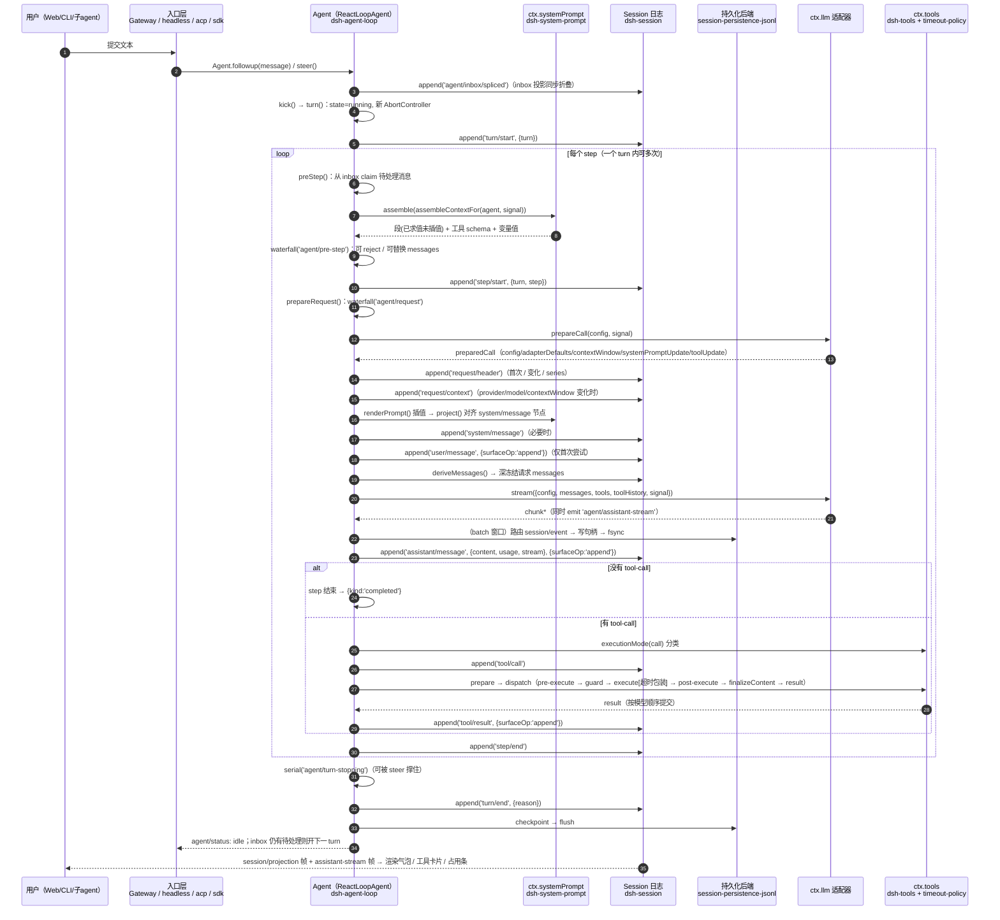

# DeepSeek Harness 桌面版完全指南

> 面向新手，从内核讲到上手。本文档按你提的 8 条逐条展开，第 8 条（精简上手手册）单独放在同目录的 `DSH桌面版上手手册.md`。
> 配套的 6 份原始侦察报告留在 `.tmp-dsh-recon/reports/`（可删），本文全文由它们汇编并交叉核对而来。

## 0. 读之前先对齐事实（这一节决定后面所有内容怎么读）

### 0.1 你这台机器到底是什么版本、什么布局

| 项 | 本机实际值 | 怎么来的 |
|---|---|---|
| 产品 | DeepSeek Harness 桌面版（Electron 外壳） | `F:\DSH\DeepSeek Harness.exe` |
| 版本 | 0.2.1-rc.1（`dsh-desktop` 与 `dsh-desktop-runtime` 同版本） | `F:\DSH\resources\app.asar\package.json` / `...\dsh\package.json` |
| 外壳目录 | `F:\DSH`（Electron 主体 + asar） | 目录实查 |
| 官方运行时 | `F:\DSH\resources\app.asar\dsh\node_modules\@deepseek-ai\*`（**在 asar 单文件归档内部**） | asar 头解析 |
| 你的数据根 | `E:\dsh-data`（环境变量 `DSH_HOME`） | 环境变量 |
| 你的 profile | `E:\dsh-data\profiles\desktop`（环境变量 `DSH_PROFILE_DIR`） | 环境变量 |
| 第三方插件 | `E:\dsh-data\profiles\desktop\node_modules\<包名>`（真实目录，可直接用编辑器打开） | 目录实查 |
| Web GUI | `http://127.0.0.1:29310`（**每次启动的临时端口**，不是固定值） | 运行时上下文 + `--port 0` 源码 |
| 本会话环境 | `workspace-write` 沙箱 + `ask` 审批 | 运行时上下文 |

三个最容易被误解的前提，先纠正掉：

1. **29310 不是固定端口。** 桌面版启动 Host 时传的是 `--port 0`，由操作系统分配，重启就变。所以「端口被占用」在桌面版基本不是有效假设（详见第 7 章）。
2. **官方核心代码你打不开也不是坏了。** 它在 293MB 压缩归档 `app.asar` 里，资源管理器、VS Code 都进不去。要看的方法第 5 章给。
3. **「已安装」不等于「正在生效」。** 本机有 3 处实测失效：modlens（缺 dist 构建产物）、weknora（后端 localhost:8080 不通）、两个 experimental 包（运行面未生效）。第 2.2 节逐个说。

### 0.2 建议的阅读顺序

- **只想马上用起来** → 直接看 `DSH桌面版上手手册.md`。
- **想搞懂它在干什么** → 第 1 章（内核）→ 第 4 章（面板）→ 第 6 章（模式）。
- **想管插件 / 改配置 / 装卸东西** → 第 2 章 → 第 5 章。
- **出问题了** → 第 7 章。
- **想加自己的技能** → 第 3 章（尤其 A.4「Skill 与 Plugin 的本质区别」）。

### 0.3 本文的证据标准

每条结论都标了源码路径与行号。凡是**在源码里没找到依据**的，原文用「未在源码中找到依据」明确标注，不编。子代理的推断被我驳回或修正过的地方，也在文中标了出来（例如：本会话其实**是**启用了 Agent Teams 的——我能 `spawn_teammate` 就是证据，而不是某个报告最初判定的「未生效」）。

---

# 第 1 章 · Cordis 内核架构与 Agent 循环

> 一句话：**Cordis 不是「插件列表」，而是一张服务依赖图**；Agent 循环不是 `while(true){调模型}`，而是一条带瀑布钩子的事件流水线。

## 0. 一分钟版心智模型

DSH 不是「单体程序 + 插件挂载点」，而是 **服务图 + 事件溯源日志**：

1. **Cordis 内核**只做三件事：管「谁提供了哪个服务（Context / Service）」、管「谁依赖谁、什么时候能激活（Fiber + inject）」、管「东西怎么拆干净（effect / Disposable / scope）」。
2. **配置文件（entry list）不是启动顺序，而是依赖声明**。一行插件能不能跑，取决于它 `inject` 的服务此刻有没有人提供 —— 这就是 `dsh-base` 里那句「Row order carries no load semantics」的真实含义（见 §A.2）。
3. **Agent 循环**是「调用模型 → 跑工具 → 再调用」的驱动器，它把每一步写进一条**只追加的会话日志**；模型看到的历史、UI 看到的气泡、崩溃后能恢复的内容，全部从这条日志**派生**（见 §B）。
4. 用户看到的一切（气泡、工具卡片、思考流、占用条）都是这条日志的**投影**，不是另一份状态。

证据：`cordis/README.md`（最小例子）、`dsh-session/README.zh.md`（事件溯源）、`dsh-agent-loop/README.zh.md`（循环职责）。

---

## A. Cordis 内核

### A.1 Cordis 是什么，和传统插件系统的差别

Cordis 自述是「需要显式依赖注入、作用域服务、生命周期托管清理、可选配置驱动加载」的 TypeScript 插件框架（`cordis/README.md`）。

与传统插件系统（注册表 + 钩子 + 手写 unload）的三个核心差别：

| 维度 | 传统插件系统 | Cordis |
|---|---|---|
| 依赖关系 | 靠加载顺序 / 手写初始化顺序 | 靠 `inject` 声明 + **服务可用性**，不是行顺序 |
| 清理 | 插件自己写 `dispose()`，容易漏 | 一切副作用注册成 `ctx.effect()`，随 Fiber 销毁逆序回收 |
| 作用域 | 全局单例，改配置要重启 | `ctx.isolate()/extend()` 派生作用域上下文，可为单个 agent 提供不同实现 |

源码位置：`cordis/lib/index.js`（打包后的单文件）。

#### 六个角色

| 概念 | 是什么 | 证据 |
|---|---|---|
| **Context** | 依赖容器 + 服务解析代理。`new Context()` 建根上下文并内置 `reflect/registry/events/logger` 四个服务；`ctx.extend(meta)` 原型继承派生子上下文（不改父级）；`ctx.isolate(name, label)` 派生「同名服务解析到另一标签」的子作用域 | `cordis/lib/index.js:1652`（class Context）、`:1700`（extend）、`:1725`（isolate） |
| **Service** | 挂在 `ctx` 上的命名服务基类。子类 `super(ctx, name)` 即完成注册，而注册动作本身就是一次 effect，因此 **Fiber 卸载 = 服务自动下线** | `cordis/lib/index.js:1742`（class Service）、`:1786`（构造器内调 `ctx.reflect.provide`） |
| **plugin 函数** | 插件可以是 `(ctx, config) => void`、类（构造器）、或 `{ apply, inject }` 对象；`ctx.plugin(plugin, config)` 返回一个 Fiber | `cordis/lib/index.js:1619`（plugin）、`:1573`（inject 简写） |
| **effect** | 「一次注册 = 一次可回收的副作用」。`ctx.effect(execute, label)` 执行 `execute`，其返回 / yield 出的 dispose 函数被收集，销毁时**逆序**执行。DSH 里所有 `ctx.on(...)`、`ctx.tools.register(...)` 不用手写取消，就是靠它 | `cordis/lib/index.js:1169` |
| **scope（作用域）** | 两条正交作用域：① 服务隔离作用域 `ctx.isolate(name, label)`；② 插件作用域，例如 `agent.ctx` 只影响该 agent。agent preset、按 agent 限制工具都用后者 | `cordis/lib/index.js:1725`；`dsh-agent/README.zh.md`（"将注册限定到单个 agent"） |
| **Fiber** | 一个插件实例的生命周期状态机：持 `inject`（依赖表）、`_store`（已解析依赖快照）、`state`、`_disposables`。`state === 2` 表示已激活（多处以此判定服务可用），`uid === null` 表示已销毁 | `cordis/lib/index.js:1008`（class Fiber）、`:1288`（_getState）、`:763`（get(strict) 用 `state !== 2` 过滤） |
| **Disposable / DisposableList** | 统一的可释放物集合；`runDisposable()` 同时接受同步函数与返回 Promise 的异步清理 | `cordis/lib/index.js:964`、`:18` 区域（DisposableList） |

> 新手注意：**Cordis 没有「卸载插件」这个操作，只有「销毁 Fiber」**。销毁 Fiber 会逆序跑完它注册过的所有 effect —— 包括「服务下线」这件事本身（而服务下线又会通知依赖它的 Fiber，见下一节）。

---

### A.2 服务的提供与消费，以及「谁先激活」

#### 三件套

1. **提供**：`ctx.reflect.provide(name, value, check)` 把实现登记进 `store[key]`（key 来自 `ctx[isolate][name]` 这个符号）。`Service` 构造器自动调它。代码 `cordis/lib/index.js:800`。
   - 同名服务二次注册会抛错 `service "..." has been registered at <fiber>`（同一处）。这正是 `dsh-base` README 说「在沙箱化 fs 提供方旁边再挂 `dsh-fs-local` 会让 profile 加载失败」的机制来源。
2. **消费（读取）**：`ctx.get(name, strict = true)` 只返回「提供者 Fiber 仍处激活态」的实现，否则 undefined。代码 `cordis/lib/index.js:763`、`:776`（_getImpl）。
3. **声明依赖**：`inject`。可以是数组 `['loader']`，也可以是对象 `{ serviceName: interceptConfig }`。`Inject.resolve()` 把两者归一化成 `name → config` 的 map，并且沿原型链合并父类 inject。代码 `cordis/lib/index.js:1491`。

#### 「谁先激活」不是排序问题，是求解问题

三段关键代码：

1. 建 Fiber 时先查依赖再刷新状态：`for (const name of Object.keys(this.inject)) this._checkImpl(name); this._refresh();`（`cordis/lib/index.js:1075` 附近）。
2. `_checkImpl(name)` 记录「该依赖当前解析到了哪个实现」；`_refresh()` 把**所有依赖的提供者 uid 串成一个 epoch 字符串**，任何一个依赖缺失就把 epoch 置为 INACTIVE —— `cordis/lib/index.js:1306`、`:1317`。
3. `_setEpoch(epoch)` 发现 epoch 变化就切状态：从 INACTIVE 变成有值 → `_reload()`（真正执行插件体）；从有值变 INACTIVE → `_unload()` —— `cordis/lib/index.js:1330`。

反向通知：服务注册/下线时 `notify([name])` 遍历**所有 runtime 的所有 Fiber**，凡 `inject` 里含这个名字的，重新 `_checkImpl` + `_refresh`：

```
for (const runtime of this.ctx.registry.values()) for (const fiber of runtime.fibers) {
  for (const name of names) { if (!(name in fiber.inject)) continue; ... fiber._checkImpl(name) }
  fiber._refresh()
}
```
证据：`cordis/lib/index.js:832`（notify），调用点在 `provide()`（:818）与 `_updateState()`（:1302）。

所以：

- **行顺序不决定加载顺序** —— 加载时机由「依赖是否齐备」这个布尔条件触发；谁、什么时候来都可以，来了就立刻解锁下游。真正决定顺序的是**服务依赖图**。
- **一行插件可能在整棵树都注册完之后才迟迟激活** —— 只要它依赖的服务由后面的行提供，它就是被 notify 唤醒的。
- 这就解释了 `dsh-base/cordis.patch.yml:12-13` 敢写：
  > `# Row order carries no load semantics (activation is service-availability driven); the grouping is for readers.`

**用户可见推论**：把 profile 里 A 行挪到 B 行前面通常**不会**改变行为；要改行为得改依赖（换实现、禁用某行、改 config）。反之，**关掉一行可能让一串下游永不激活** —— `dsh-base/README.zh.md` 明确警告「跳过组合包不保证剩余组合能够提供所需服务」。

#### 依赖还可携带「拦截配置」（intercept）

`inject` 的值不只是名字：`{ http: { timeout: 100 } }` 会被压进 `ctx[Context.intercept]`，服务方用 `Service[resolveConfig]` 把祖先链上的 intercept 合并成最终配置（近根者先应用）。证据：`cordis/lib/index.js:1021`、`:1810`。

---

### A.3 插件加载器（cordis-plugin-loader）怎么读 YAML entry list

loader 的职责一句话：**拥有 EntryTree，按 name import 模块，套上 config，并让运行中的插件图与 entry 更新保持同步**（`cordis-plugin-loader/README.md` 首段）。

#### entry 字段

| 字段 | 语义 | 证据 |
|---|---|---|
| `id` | 稳定标识，用于 update/remove/定位；嵌套 group 里拼成 `a:b` | `README.md`（Entry Options）；`lib/index.js:330`（get id） |
| `name` | 模块说明符（包名 / 绝对路径 / file URL） | `lib/index.js:453`（tree.import(options.name)） |
| `config` | 传给插件的配置，按插件 Config schema 校验 | `lib/index.js:402`（resolveConfig） |
| `group` | 该行 config 其实是子 entry 列表 | `README.md`；`lib/index.js:337`（group 不继承 disabled） |
| `disabled` | 布尔**或 !!js 表达式**；沿父链继承（父禁用则子也禁用） | `lib/index.js:336`（get disabled）、`:349`（disabledOf） |
| `inject` | 为本行追加必需服务 / 拦截配置 | `README.md`（Entry Options） |

#### !!js 表达式怎么执行

YAML 里的 `!!js` 标量被解析成**惰性表达式节点**（带 `__jsExpr` 属性），不会立刻求值。真正求值用：

```
const evaluate = new Function("ctx", "expr", "with (ctx) { return eval(expr) }")
function interpolate(ctx, value) { if (isJsExpr(value)) return evaluate(ctx, value.__jsExpr); ... }
```
证据：`cordis-plugin-loader/lib/index.js:233`（evaluate）、`:239`（interpolate）、`:246`（isJsExpr）。

要点：
- 求值作用域就是 **loader 的上下文 ctx**，所以能写 `ctx.get('profileContext')`、`process.platform === 'win32'`、`dshHomePath('sessions')`（实例见 `dsh-base/cordis.patch.yml:18`、`:22`、`:141`）。
- **原始表达式节点留在 options 里不回写**，因此写配置时形式不会退化成求值后的布尔值（注释原文 "The raw node stays in the options, so write-back keeps the form"，`lib/index.js:346`）。

#### insert 与 patch 的叠加规则

这两个**不是** loader 的 entry 字段，而是「patch list」的语法 —— 实现在 `dsh-app-boot` 的 `applyEntryPatches()`，注释自称 "THE patch semantics of this include, shared by mounting and offline tooling"：

| patch 形态 | 行为 | 证据 |
|---|---|---|
| `{ insert: [ ...rows ] }`（无 id） | 追加到**根** entry 列表末尾 | `dsh-app-boot/lib/index.js:87` |
| `{ id, insert: [ ...rows ] }` | 追加到该 group 的 `config` 数组末尾 | `dsh-app-boot/lib/index.js:75-87` |
| `{ id, ...overrides }` | 对目标行逐 key **整体赋值**（`target[key] = value`） | `dsh-app-boot/lib/index.js:104-107` |
| `{ id, name: 'X' }` 且实际 name 不符 | 告警并跳过（防止 id 漂移后误改别人） | `dsh-app-boot/lib/index.js:100` |

**"last write wins" 的真实含义**：patch list 按顺序逐条应用，同一个 key 后写覆盖先写。于是：

- 后一层的 `config` 会**整体替换**前一层的 `config`，**不是深合并** —— 这正是 `dsh-base/cordis.patch.yml:6` 说的「A patch replaces the targeted row's whole config rather than merging into it」，也是 `dsh-base/README.zh.md` 里「覆盖会替换整个设置块，必须重述每个想保留的设置」的来源。
- `insert` 是追加语义：后面再 insert 同 id 的一行 = 出现两行同 id，patch 不做去重，由 loader 的 `ensureId` 决定复用还是报错（`cordis-plugin-loader/lib/index.js:161`）。
- 输入**永不被就地修改**：`applyEntryPatches` 先 structuredClone，否则热重载时旧 patch 值会被烙进缓存的解析结果（`dsh-app-boot/lib/index.js:48-63` 的注释与实现）。

#### entry 更新 = 重启，只有一种例外

`Entry.update()` 比较新旧 options 的 diff；只有当「仅 config 变化 + Fiber 已激活 + 上下文未变 + 差异只落在 schema 标了 `volatile()` 的字段」时，才**不重启**，而是把新值原地写进运行中的引用并广播 `loader/volatile-update`。证据：`cordis-plugin-loader/lib/index.js:382`（volatileOnly 判定）、`:395`（_commitVolatile）。

这解释了为什么 `maxParallelToolCalls` 能不重启就改：它的 schema 带 `volatile()`（`dsh-agent-loop/lib/index.js:1554`），而 `agents` 列表不带（`dsh-agent-loop/README.zh.md`「配置声明式 agent」一节）。

---

### A.4 profile 分层机制：bundles → cordis.patch.yml → --patch

#### profile 是什么

> profile 位于 `$DSH_HOME/profiles/<name>`，由**可安装组合包（bundle）**和**自己的 cordis.patch.yml** 组成。
> 证据：`dsh-app-boot/README.zh.md:50`；实机目录 `E:\dsh-data\profiles\desktop\`。

bundle 必须在自己的 `package.json` 里声明 `dsh.bundle.patch`（一个文件，或有序文件列表，均相对包根）：`dsh-package-manifest/README.zh.md:46`（含 `{ bundle: { patch: './cordis.patch.yml' } }` 例子与「按列表顺序作为同一个组合包层应用」）。校验函数 `bundlePatchFiles()` 在 `dsh-app-boot/lib/index.js:517`，路径解析 `bundlePatchPaths()` 在 `:529`。

#### 层的叠加顺序（本题最需要精确的一条）

唯一权威实现是 `readProfilePatches()`：

```
function readProfilePatches(binName, context, initialProfile) {
  const patches = structuredClone([
    ...readBundlePatches(binName, context, initialProfile),   // 1. 各 bundle 的 patch，按 bundles 顺序拼接
    ...initialProfile?.patches ?? loadOptionalPatches(...),   // 2. profile 自己的 cordis.patch.yml
    ...loadOptionalPatches(binName, join(context.home, "cordis.patch.yml")) ?? [], // 3. $DSH_HOME/cordis.patch.yml
    ...context.overlays                                       // 4. --patch 文件（argv 顺序）
  ])
  ... // 5. 遥测开关 patch
}
```
证据：`dsh-app-boot/lib/index.js:1127-1137`、`:1118`（readBundlePatches 用 layers.flatMap 展平）、`:1105`（resolveTelemetryPatch）。

配套：
- `loadProfileDirectory()`：读 manifest 的 `dsh.profile.bundles`，逐个 bundle 解析出 `layers[]`（`packageName/packageDir/patchPaths/patches`），再单独读 profile 的 `cordis.patch.yml` 作为 `patches`。读不出/版本不兼容的 bundle 进 `skippedBundles`，不致命。证据 `dsh-app-boot/lib/index.js:1015-1051`。
- 空根配置：`cordis.yml` 内容就是 `[]`（一切组合都由 patch 叠出）。证据 `dsh/lib/profile-boot-C14i-8IN.js:121-125`（PROFILE_ROOT_CONFIG）；实机 `E:\dsh-data\profiles\desktop\cordis.yml` 亦为 `[]`。
- 启动：`runProfile()` → `composeProfile()` → `boot(NAME, rootConfig, readProfilePatches(...), setup)`；`--patch` 在 `composeProfile()` 里 `patchFiles.flatMap(loadOverlayPatches)` 变成 `overlays`。证据 `dsh/lib/profile-boot-C14i-8IN.js:236-247`、`:302`、`:289-301`（profileContext 提供 name/dir/patchPath/overlays，随后被 !!js 当条件用，见 `dsh-base/cordis.patch.yml:22`）。
- `--patch` 的 CLI 语义：可重复的单值收集器，且刻意**非变参**（避免吞掉内部参数）。证据 `dsh/lib/bin.js:27-28`、`:61`。

**可观察后效**：home 级 patch 压过 profile 级 patch —— `dsh-app-boot/README.zh.md:61` 明说「先应用逐 profile 的文件，再应用 home 级文件，因此后者优先级更高」。

#### 顺带纠正一个容易搞错的归属

问题清单把「profile 分层」也列给了 `dsh-cordis-host-runner`。**它不是干这个的**。它提供的是「运行时检查 + 进程内动态 Cordis 包定义注册表」：Host 半跑在 `node:vm` 里（`vmTimeoutMs` 默认 5000），定义按会话隔离、重启即消失，只有 Host 的包在本进程激活、带浏览器部分的包要等审批。证据：`dsh-cordis-host-runner/README.zh.md:12`、`:40`、`:54-58`。

profile 分层的真实归属：

| 关注点 | 归属 |
|---|---|
| manifest 字段类型（`dsh.bundle.patch`、`engines.dsh`） | `dsh-package-manifest`（**只提供类型，不读文件**） |
| profile/bundle/patch 的读取、组合、校验、`--dump-config` | `dsh-app-boot` |
| launcher 拼层、挂载、fail-loud、信号处理 | `dsh/lib/profile-boot-*.js` + `dsh/lib/bin.js` |
| entry list → 实际插件图 | `cordis-plugin-loader` |
| 运行期动态定义（与分层无关） | `dsh-cordis-host-runner` |

#### 实机对照（本机 Desktop profile）

`E:\dsh-data\profiles\desktop\package.json` 的 `dsh.profile.bundles` 顺序：
`@deepseek-ai/dsh-base` → `dsh-web-app` → `dshmarket` → `@liustack/modlens` → `@linxin666/dsh-web-all` → `@anionex/dsh-turn-rewind` → `@wxg-prc-cpg/dsh-weknora` → `dsh-context` → `dsh-find-plugins` → `agent-team-profile` → `auto-review`。
（这解释了为什么本会话的 `run_code` / `weknora_*` / `modlens_read_image` 等工具存在：它们不来自 base，是外部 bundle 插入的。）

---

## B. Agent 循环（dsh-agent-loop + dsh-agent + dsh-tools）

包分工一句话记住：

- `dsh-agent`：**公开的 Agent 接口 + 注册表 + agent/* 事件**，自己不发模型请求（`dsh-agent/README.zh.md:12`、`:28`）。
- `dsh-agent-loop`：**唯一的默认驱动器**，实现 `ReactLoopAgent`，把自身注册成 `ctx.agents` 背后的 AgentFactory（`dsh-agent-loop/README.zh.md:89`）。
- `dsh-tools`：**工具注册表 + 固定执行流水线**（`dsh-tools/README.zh.md:109`）。

### B.1 一个 turn 的完整生命周期

#### 触发入口

外部（UI / 命令 / 子 agent / goal 驱动器）把文本投给某 agent 的收件箱：

- `followup()`：排队「下一轮提示」并唤醒驱动器；
- `steer()`：提交「下一步输入」并唤醒；
- `inject()`：只加面向模型的上下文，**不唤醒**（落在下一个已被接纳的步骤里）。

证据：`dsh-agent/README.zh.md:47`、`:177`（cancel 默认清空收件箱）。

真实调用点（证明这是统一 seam）：`dsh-headless/lib/index.js:340`、`dsh-acp/lib/index.js:841`、`dsh-goal-round-driver/lib/index.js:164`、`dsh-sdk-jsonrpc-server/lib/index.js:163`（后者用 `session/prompt` RPC 调 `agent.followup(message)`）。

> 诚实标注：浏览器输入框 → Host 的那一跳经过 Gateway/typert 层，我没有在源码里定位到单一权威的 RPC 命名点，故不指名；能确定的是它最终落到上面这组 `Agent.followup/steer` 语义。

#### 关键函数名与文件（全部在 `dsh-agent-loop/lib/index.js`）

| 阶段 | 函数 / 事件 | 位置 |
|---|---|---|
| 驱动器主循环 | `kick()`：`while (await this.turn());` | :887 |
| 开 turn | `turn()`：先 append `turn/start`，再循环 step | :938（append 在 :945） |
| 步骤准入 | `preStep(target, position)`：① 从收件箱 claim；② `ctx.systemPrompt.assemble(...)`；③ `dispatch.waterfall('agent/pre-step', ...)`，默认实现拼上运行时上下文并返回 `{ kind: 'enter', messages }` | :902（assemble :907，waterfall :909） |
| 开步骤 | append `step/start` | :970 |
| 解析路由 | `prepareRequest()`：`waterfall('agent/request')` → `ctx.llm.prepareCall(config, signal)` | :1175（prepareCall :1201） |
| 提示词对齐/落盘 | `ctx.systemPrompt.project(renderedPrompt, {...})` → 若干 `system/message` | :1057、:1061 |
| 用户消息入库 | append `user/message`, `{ surfaceOp: 'append' }`（仅首次尝试） | :1069、:1072 |
| 构造请求 | `buildRequest(config, preparedCall, tools, position, startsSeries, signal)`：写 `request/header`、按需写 `request/context`、`session.deriveMessages()` 深冻结、返回 `{...config, messages, toolHistory, tools, sessionId, signal}` | :1214（header :1226，deriveMessages :1274） |
| 调模型 | `preparedCall?.stream(request) ?? ctx.llm.stream(request)`，`for await (const chunk of stream)` 累积到 `AssistantStreamAttempt`，并 emit `agent/assistant-stream` | :1084-1091 |
| 结算 assistant | append `assistant/message`（含 usage 与紧凑 stream） | :1156 |
| 判断是否结束 | `toolCalls.length === 0 → {kind:'completed'}`；`finish.kind === 'max-tokens' → {kind:'max-tokens'}` | :1163-1165 |
| 跑工具 | `executeToolCalls(ctx, turn, step, toolCalls, signal, acceptContext)` | :1166（定义 :506） |
| 关步骤 | append `step/end` | :994 |
| 轮次将结束钩子 | `dispatch.serial('agent/turn-stopping', ...)`（可被 steer 撑住不结束） | :1001 |
| 关轮次 | append `turn/end`, `{turn, reason}` | :1029 |
| 还有待处理输入？ | `if (!this.inbox.hasPending) return false;` 否则开新 turn | :1037-1041 |

**请求体形状**（新手最常问）：请求 = `header.config`（provider/model/reasoning/maxTokens）+ `deriveMessages()` + `header.tools`；**没有独立的 system 字段** —— 系统提示词是 surface 第 0 号节点（一条 `system/message` 消息）。证据：`dsh-agent-loop/README.zh.md:120`、`dsh-system-prompt/README.zh.md:140`。

#### 系统提示词怎么「组装」出来

`dsh-system-prompt` 是一个注册表 + 一条协作式流水线（`dsh-system-prompt/README.zh.md:100`）：

1. `assemble()`：合并全局层与当前作用域层 → 分离工具 schema → 段按 `order` 升序（同值再按名字码位）排序 → 跑按作用域筛选的 `system-prompt/assemble` waterfall → 处理 `complete: true` 的唯一整段 → 应用运行时上下文抑制器。返回「文本已求值但尚未插值」的段 + 有序工具 schema + 变量值（:110）。
2. `renderPrompt(assembly)`：对未标 `interpolate: false` 的段插值 `{{var}}`、删空段、空行连接；**未知引用 / 已注册但无值 / 格式错的 complete 组都会抛错**（"格式错误的提示词比明确失败更糟"，:110）。
3. 段位次示例：harness 身份 `-1000`、persona 前缀 `0`、第一方指导、harness 源码 `10000`、Web 表层 `10100`、persona 后缀 `10200`（:46-50、:140）。

新手视角：**"system prompt" 不是一个字符串常量，而是几十个插件各自 `ctx.systemPrompt.section({name, order, text})` 拼出来的**；工具 schema 也是同一次组装的产物（"模型获知自己能做什么是一个连贯整体"，:100）。

---

### B.2 工具调用：并发 / 串行、超时、中断

#### 分类：并行安全 vs 独占（一元、fail-closed）

调度器在每个工具启动前问注册表 `ctx.tools.executionMode(exec).kind`：

```
executionMode(exec) {
  const tool = this.resolveExecution(exec.name, exec.agent, exec.parent !== undefined)
  if (!tool?.isConcurrencySafe) return { kind: 'exclusive' }
  try { return tool.isConcurrencySafe(exec.arguments) === true ? { kind: 'parallel' } : { kind: 'exclusive' } }
  catch { return { kind: 'exclusive' } }
}
```
证据：`dsh-tools/lib/types/index.js:694`。注释写明「只有精确 true 才算并行；未知、隐藏、未声明、非法、抛异常一律独占」。

#### 调度：独占做屏障，并行用有界滚动池

`executeToolCalls()` 从模型顺序的第一个调用开始：

- 第一个是 exclusive → 单独成组跑（`runGroup(..., [first], ...)`），构成顺序屏障；
- 第一个是 parallel → 把后面所有调用丢进同一个池，但每个在真正启动前**重新分类**：一旦遇到被判定独占的调用，就等当前池排空，把剩下的留给下一个屏障。

证据：`dsh-agent-loop/lib/index.js:506-533`（executeToolCalls）、`:551`（runGroup）、`:619`（`inFlight.size < maxParallelToolCalls` 门控）。

并发上限：`maxParallelToolCalls`，默认 **10**，带 `volatile()`（`dsh-agent-loop/lib/index.js:1554`、`:1297` 的 `DEFAULT_MAX_PARALLEL_TOOL_CALLS = 10`）。设成 1 = 严格串行（README :48）。

**结果顺序**：调度可重叠，但「策略、结果、结果上下文」都按**模型顺序**提交 —— `commitReady()` 只在 `slots[committed]` 有值时才前进（`:565-576`）。这保证日志与模型看到的历史确定。

#### 工具执行流水线（固定五段）

> `tools/pre-execute`（可扩展的允许/拒绝/询问）
> → 已注册的**单调守卫** `ctx.tools.guard()`（返回理由即拒绝，后续监听器无法翻案）
> → `tools/execute`（环绕分发：超时/重试/指标）
> → `tools/post-execute`（检查/替换、附加上下文）
> → 定义自带的 `finalizeContent` → `tools/result`（只观测）

证据：`dsh-tools/README.zh.md:109`（顺序）、`:89`（各事件职责）。

循环侧以 `TOOL_RUNTIME_SCHEDULER` 的四步调用它：`prepare → dispatch → finish / finalize`（`dsh-agent-loop/lib/index.js:582`、`:586`、`:570`）。

#### 超时：协作式，不是硬杀

- 工具在 `ToolDefinition` 上**自己声明** `timeoutMs`；注册表**从不执行**它（`dsh-tools/README.zh.md:235`）。
- 执行它的是 `dsh-tool-call-timeout-policy`：一个 `tools/execute` 监听器，从注册表读回 `ctx.tools.get(exec.name, exec.agent)?.timeoutMs`，用 `deadline(exec.signal, timeoutMs, TOOL_TIMEOUT)` 造融合信号，**原地换到 exec 上**，`finally` 里换回调用方信号（这样 `post-execute` 永远看不到自己被中止的信号）；超时后把结果替换成 `Error: tool call timed out after <ms>ms`，错误码 `TOOL_TIMEOUT`。证据：`dsh-tool-call-timeout-policy/README.zh.md:69`；多个 `tools/execute` 监听器按注册顺序组合（:73）。
- 硬限制：**忽略 exec.signal 的工具不会被打断**，调用方会一直等（:121）。随附的 bash/read/write/edit 故意不声明超时（:122）。
- 本机：`timeout-policy` 挂载且无 config（`dsh-base/cordis.patch.yml:408-409`）。

#### 中断（interrupt）与取消

- 取消是**协作式**：`agent.cancel(cause)` 中止当前活动，默认**清空**待处理与 steering 工作；`cancel(cause, { keepInbox: true })` 只中止轮次（`dsh-agent/README.zh.md:177`）。没有「只中止一个步骤、轮次继续」的操作。
- 已流式交付的文本**保留**：取消时 `live.interruptedBlocks()` 结算成带 `interrupted: true` 的 `assistant/message`（`dsh-agent-loop/lib/index.js:1097-1112`）。这就是「按停止后那段字不消失、下一次请求也包含它」的机制。
- 未分发就被取消的工具调用补一对合成事件：`tool/call` + `ABORTED_BEFORE_DISPATCH` 结果，让后续历史配对完整（`dsh-agent-loop/lib/index.js:528`、`README.zh.md:128`）。
- 步骤失败也不留悬空调用：有 `tool/call` 无结果的补 `TOOL_OUTCOME_UNKNOWN`，连 `tool/call` 都没有的补 `TOOL_NOT_STARTED`（`README.zh.md:130`，文案见 `dsh-session/README.zh.md:171`）。实现是循环里的 `ToolCallRecovery`（`dsh-agent-loop/lib/index.js:975`）。
- 取消原因会**拷贝**进 `turn/end`，避免把传输层往 `AbortSignal.reason` 上加的东西（Node fetch 会加 stack）写进日志（`dsh-agent-loop/README.zh.md:126`）。

---

### B.3 上下文管理：compaction / token meter / spill

| 机制 | 解决什么 | 改历史吗 | 关键实现 |
|---|---|---|---|
| **token meter** | 「现在多满？」——测量 | 否，只读 | `ctx.tokenMeter.measure(session, requestHeader?)` 回放持久日志得出 `totalTokens/surfaceTokens/nodes[].tokens`；启发式「每 token 4 字符 + 块与角色开销」，有声明时用适配器图片定价。`dsh-token-meter/README.zh.md:12`、`:36`、`:66`（"占用是参考数字，不是计费记录；harness 中没有任何机制依据它做决定"） |
| **compaction**（`dsh-compaction` + `-basic`） | 「太满了，把老历史压成一段摘要」 | **是**（用一条 `user/message` 的 replace 遮蔽旧范围；原始事件仍在日志里） | 见下 |
| **tool-result-pruner** | 单个工具结果过大 | 是（先于大压缩器，把超阈值结果裁成首/尾窗口） | 本机 `thresholdChars: 8192, headChars: 4096, tailChars: 1024`（`dsh-base/cordis.patch.yml:425-430`） |
| **spill** | 超大输出「必须还能取回全文」 | 是（结果变成「有界预览 + 定位信息」） | `ctx.spillStore.saveText()` → `SpillRef{locator, bytes, retrievalHint}`，按会话分组；本机 `maxInlineTokens: 12500`（`dsh-base/cordis.patch.yml:414-417`、`dsh-spill/README.zh.md:58`、`:62`） |

**compaction 的两个要点**：

- 默认阈值：窗口 `W`、请求输出上限 `O`、余量 `B = 65536` tokens，阈值 = `floor(min(W × 0.8, W − O − B))`；保留的近期历史预算是 `W − O` 的 **16%**（`dsh-compaction-basic/README.zh.md:62`、:66）。默认 `thresholdRatio 0.8` / `retainRatio 0.16` 是固定默认（:256）。
- 自动触发挂点：`auto: true` 时一个**串行** `agent/pre-step` 监听器在请求派生前检查压力，越阈值就先剪枝、再摘要最旧的"平衡范围"（:113）。所以压缩只发生在「两次模型调用之间」，永不打断进行中的流。
- 事务性：先追加仅日志的 `compaction/start`（拿锁）→ 摘要 → `compaction/summary` → **唯一一次 surface 变更**（承载摘要的 `user/message` replace）→ `compaction/end` 释放锁；两个标记之间崩溃会留下**可检测的遗留锁**而不是伪造的成功（`dsh-compaction/README.zh.md:73`、`:95-97`）。
- 边界安全：`toolPairingBalancedBefore/After(session, seq)` 保证压缩边界**不会切在一对未闭合的 tool/call 与 tool/result 中间**（`dsh-compaction/README.zh.md:91`）。
- 用户可见：`/compact`（`dsh-command-compact`，本机 `dsh-base/cordis.patch.yml:356`）。**压缩不是模型工具**（`dsh-compaction/README.zh.md:159`）。
- 图片：`dsh-compaction-image-offload` 在能看图的路由抱怨图片预算超了时，把最老图片换占位符后重试（`dsh-base/cordis.patch.yml:432-435`）。

**KV Cache 视角**（新手最易忽略）：上述操作里**只有 replace 会从「第一条被遮蔽的消息」起让缓存失效**；普通追加不会（`dsh-session/README.zh.md:165`）。所以压缩的代价不只是重算，还包括前缀缓存全丢。

---

### B.4 会话持久化：各包职责与落盘位置

| 包 | 管什么 | 证据 |
|---|---|---|
| `dsh-session` | **内存中的事件溯源对象 Session**：`append(type, data, opts)` 只追加、深度冻结、校验无损 JSON；`deriveMessages()` 投影成模型历史（增量+缓存）；`fork()`、`flush()`、surface replace 校验。**它本身不落盘** | `dsh-session/README.zh.md:12`、`:42`、`:50`、`:100` |
| `dsh-session-persistence` | 持久化 **seam**（`persistence.create(header)` / `open(id,'write')` 的抽象句柄约定），无实现 | 循环侧用法见 `dsh-agent-loop/README.zh.md:116` |
| `dsh-session-persistence-jsonl` | 随产品交付的**唯一第一方后端**：每会话一个只追加 JSONL，默认带校验和的 Zstandard 帧 | `dsh-session-persistence-jsonl/README.zh.md:12` |
| `dsh-session-projection` | 把「当前状态」（待办、goal、统计）从事件日志**同步折叠**成 schema 校验过的 JSON，带快照 + 变更通知给客户端 | `dsh-session-projection/README.zh.md:12`、`:69` |
| `dsh-session-format`（+ `-catalog` + 各 `vN-to-vM`） | 格式版本与**相邻迁移链**：一次还原让已解析值流经有状态 Stage；`readHeader()` 不读事件就返回 `current`/`migration-required`/`unsupported`/`malformed` | `dsh-session-format/README.zh.md:12`、`:44` |

#### 磁盘布局（本机实际位置）

配置项：`session-persistence-jsonl.root: !!js dshHomePath('sessions')` —— `dsh-base/cordis.patch.yml:138-141`。本机 `DSH_HOME=E:\dsh-data`，所以根是 `E:\dsh-data\sessions`（已核实存在，里面有 `--C-Users-HUAWEI-Desktop-math~0020AI~0020assistant--` 这类可读项目目录）。

目录形状（`dsh-session-persistence-jsonl/README.zh.md:59-71`）：

```
<root>/
  --<normalized-cwd>--/          # 可读的项目目录（无 cwd 时 _no-cwd）
    <encoded-id>/                # 会话自有目录（id 单射转义成安全路径段）
      session.v3.jsonl.zstd      # 压缩根（当前代际 v3）
      session.v3.jsonl           # compression:'none' 时的纯文本根
```
运行时选**数值最高**的规范代际（将来 v4 即 `session.v4.*`）。写打开历史格式会在同目录发布后继代际，**源文件保持逐字节不变**。

其它存储事实：
- 存储中枢：`storage-json.root: !!js dshHomePath('storages')`（`dsh-base/cordis.patch.yml:182-185`）。
- 会话全文检索默认**关闭**：`session-query-sqlite: { path: ':memory:', openAt: never }`，搜索报 `SESSION_QUERY_SEARCH_DISABLED`、SQLite 根本不打开；所以本机侧边栏搜索只匹配标题/workspace 名（`dsh-base/cordis.patch.yml:157-161`）。
- 持久性检查点：`session-checkpoint-policy`「在每个模型请求前与顶层分发前做持久性检查点」（`dsh-base/cordis.patch.yml:419-421`）。
- 崩溃语义：已提交前缀一定保住；被中断的最终轮次由**读侧**在写句柄上补合成 closer；不完整末尾原始行丢弃；撕裂的 Zstd 帧只取其中完整解码出的记录并截掉撕裂字节（`dsh-session-persistence-jsonl/README.zh.md:77`）。
- 单写者：进程内每后端实例认领，跨进程用内核锁（POSIX flock / Windows 命名信号量，零文件足迹）（:168）。
- 会话**不会自动删除**：日志在 root 下累积，seam 无删除接口（:167）。

#### 新手易错点

`assistant/message` 里内嵌完整的紧凑 provider stream，但 `deriveMessages()` 只把它当回放/诊断数据、不重复生成消息；UI 的「打字机」来自进程本地的 `agent/assistant-stream` 帧（start / chunk / end），那些帧**不进模型历史**（`dsh-agent/README.zh.md:67`、`dsh-agent-loop/README.zh.md:120`）。即「实时事件是呈现数据，不是回放来源」。

---

### B.5 goal 自动续跑 vs ralph

| | **goal**（`dsh-goal` + `dsh-tool-goal` + `dsh-goal-round-driver`） | **ralph**（`dsh-tool-ralph`） |
|---|---|---|
| 作用域 | **同一会话内**续跑 | **每轮一个全新子 agent**，前台串行 |
| 上下文 | 累积（历史渐长，靠 compaction 控） | 每轮只拿「不可变目标 + 当前轮/上限 + 一份有界结构化交接」；父对话与旧子会话绝不作为种子（`dsh-tool-ralph/README.zh.md:36`） |
| 跨轮长期记忆 | 会话日志 | **共享工作区**（"shared workspace is the authoritative state"） |
| 触发 | agent 空闲 + goal 为 active + 续行 armed + 额度未耗尽 | 模型显式调 `ralph({objective, maxRounds?})`，**阻塞到整个运行结算** |
| 终态 | active/paused/blocked/complete（持久 phase；续行开关是进程本地、绝不持久） | complete / blocked / budget-limited |
| 预算 | `maxGoalRounds`，默认 **256**（`dsh-goal/README.zh.md:46`） | `maxRounds`，默认 **256**，同时是部署上限（`dsh-tool-ralph/README.zh.md:43`） |
| 谁决定完成 | 模型自己声明（无独立评估器） | **worker 报告**，非独立认证（:161） |
| 源码事实 | goal 状态只存会话日志（`goal/change` 事件 v1，携带变更后完整快照；clear 写 tombstone），`ctx.goals` 用 `{id, revision}` 比较并设置、拒绝陈旧视图（`dsh-goal/README.zh.md:97`、`:76`） | 固定脚本由部署方拥有：模型只给数据，不能改循环/路由/schema/校验（`dsh-tool-ralph/README.zh.md:61`） |

goal 续行的关键实现（讲解时最有用的一条）：

- 驱动器在 agent **空闲**时**先预留** `roundsStarted + 1`，排入一条带 goal 来源的 `<goal_round>` 提示词，然后才 `agent.followup(message)`；**只有真正进入步骤的 user/message 才消耗额度**，陈旧预留不消耗（`dsh-goal-round-driver/README.zh.md:71`，调用点 `lib/index.js:164`）。
- 竞态防护挂在 `agent/pre-step`：前后都校验「已领取记录 + 当前 goal」，让陈旧/已取消的提示词在进步骤前被拒（:72）。
- **resume / fork / 挂载驱动器都不会自动复活工作**：active 的 goal 保持 disarmed，直到用户显式 resume（`dsh-goal/README.zh.md:72`、`dsh-goal-round-driver/README.zh.md:57`）。
- 额度耗尽不是静默停，而是写稳定 blocker 码 `round-limit`（:53）。

ralph 的路由细节：配置的提供方必须支持结构化输出并报告 `inheritsParentContext: false`，否则**在第 0 轮之前就报错**（`dsh-tool-ralph/README.zh.md:47`）；调用方 agent 是每个子 agent 的父级（保留 cwd 与谱系，不复制对话）（:73）。

---

## C. 时序图：从「点发送」到「看到回复」

### C.1 Mermaid



### C.2 纯文本版（给不看图的人）

1. **用户输入** → 入口层 → `Agent.followup()/steer()` → 变成一对 inbox splice 事件（`agent/inbox/inserted` 等）。
2. **驱动器唤醒**：`kick()` 进 `turn()`，先写 `turn/start`。
3. **准入**：`preStep()` 领消息 → 组装系统提示词 → `agent/pre-step` 瀑布（可拒绝、可换消息）。
4. **定路由**：`agent/request` 瀑布 + `llm.prepareCall()`，于是知道 provider/model/上下文窗口/能否 in-history 更新提示词。
5. **落盘再请求**：写 `request/header`、对齐 `system/message`、首次尝试写 `user/message`，再 `deriveMessages()` 得到冻结的 messages。
6. **流式调用模型**：chunk 进 `AssistantStreamAttempt`，同时以 `agent/assistant-stream` 帧推给 UI（打字机效果来自这里）。
7. **结算**：写 `assistant/message`（含 usage 与紧凑 stream）；取消时写 `interrupted: true` 且保留已交付前缀。
8. **跑工具**（若有）：分类 → `tool/call` → 五段流水线 → 按模型顺序 `tool/result`。
9. **循环或收尾**：还有下一步就回 3；否则 `agent/turn-stopping` → `turn/end`；inbox 仍有待处理就开下一个 turn。
10. **持久化与投影**：`session/event` 被批处理进 JSONL 写句柄并 fsync；`session/projection` 把待办/goal/占用等状态推给客户端。

---

## D. 面向新手的「为什么这样设计」

**Q：为什么不用加载顺序，而要一套服务依赖？**
因为 DSH 有 200+ 行插件，还有用户与第三方 bundle 各自插行。用顺序的话，任何「某平台才有的行」或「某 bundle 才插入的行」都会让顺序变成需要手工维护的偏序。改成服务依赖后，**加载顺序成为求解结果**（`_refresh`/`notify`），条件行可以用 `disabled: !!js` 表达而不扰乱顺序。

**Q：为什么 patch 是「整体替换 config」而不是深合并？**
因为合并无法表达「删掉上层带上来的某个字段」。整体替换 + 必须重述 = 结果可预测、可离线 dump（`dsh --dump-config` 与启动用同一套 `applyEntryPatches`，`dsh-app-boot/lib/index.js:48-55`）。代价是啰嗦，`dsh-base/README.zh.md` 把它列为已知限制。

**Q：为什么系统提示词要当成一条会话消息，而不是请求的一个字段？**
为了让「模型看到的每个字节都能从日志重建」，并让「提示词更新」走两条不同策略：能力路由上可以**在历史里追加**新提示词（保留前缀 KV cache），非能力路由则**合并进头节点**（前缀从第 0 个 token 起失效）。证据 `dsh-agent-loop/README.zh.md:122`、`dsh-system-prompt/README.zh.md:154`。

**Q：为什么取消是协作式、工具不响应就一直等？**
硬杀一个可能正在写盘或发请求的工具会造成不可知副作用。DSH 的选择是：信号一定送到（`exec.signal` 由调用方拥有），但终止权归工具；不响应的代价由部署方承担，并写进限制（`dsh-tool-call-timeout-policy/README.zh.md:121`）。

**Q：为什么 UI 不直接读「当前状态」？**
因为当前状态是日志的函数。`session-projection` 的存在就是让客户端拿「某条 seq 上的正确快照」，而不是自己重放日志（`dsh-session-projection/README.zh.md:12`、`:69`）。

---

## E. 在哪里配置（速查）

| 想改什么 | 改哪里 | 证据 |
|---|---|---|
| 加/禁用插件行、改 config | `$DSH_HOME/profiles/<name>/cordis.patch.yml`（**替换整块 config**） | `dsh-app-boot/README.zh.md:61`；本机 `E:\dsh-data\profiles\desktop\cordis.patch.yml` |
| 对所有 profile 生效 | `$DSH_HOME/cordis.patch.yml`（压过 profile 级） | `dsh-app-boot/lib/index.js:1131` |
| 一次性试验 | `dsh --patch ./x.yml`（可重复，最后应用） | `dsh/lib/bin.js:27`、`:45` |
| 换/加 bundle | profile 的 `package.json` 的 `dsh.profile.bundles`（或 `dsh plugin add`） | `dsh-app-boot/README.zh.md:50` |
| 每 step 并行工具数 | `dsh-agent-loop.maxParallelToolCalls`（默认 10，volatile） | `dsh-agent-loop/README.zh.md:48` |
| run_code 内子调用并发 | `dsh-tools.maxParallelSubCalls`（默认 10） | `dsh-tools/README.zh.md:79` |
| 工具呈现形态 native/ptc | `dsh-tools.mode` | `dsh-tools/README.zh.md:76-78` |
| 提示词身份 / persona / toolOrder | `dsh-system-prompt` config | `dsh-system-prompt/README.zh.md:44-50` |
| 压缩阈值 | `dsh-compaction-basic` 的 `thresholdRatio` / `headroomTokens` / `retainRatio` / `modelPolicies` | `dsh-compaction-basic/README.zh.md:62-66` |
| 会话日志落盘位置 | `dsh-session-persistence-jsonl.root`（本机 = `E:\dsh-data\sessions`） | `dsh-base/cordis.patch.yml:138-141` |
| goal 轮数上限 | `dsh-goal.defaultMaxGoalRounds`（默认 256） | `dsh-goal/README.zh.md:46` |
| ralph 默认/上限轮数 | `dsh-tool-ralph.maxRounds`（默认 256，兼上限） | `dsh-tool-ralph/README.zh.md:43` |
| Windows 用 bash 还是 pwsh 工具 | `dsh-base` 里 `bash-sandbox/tool-bash` 与 `pwsh-sandbox/tool-pwsh` 两组的 `disabled: !!js process.platform === 'win32'` 门控（切换必须成对） | `dsh-base/README.zh.md`「各平台的 shell 工具」、`dsh-base/cordis.patch.yml` |

---

## F. 明确「未在源码中找到依据」或未展开的部分

1. **Web 输入框 → Host 的单一权威 RPC 名称**：只确认 `Agent.followup/steer` 是统一 seam（多处调用点），未定位到唯一命名点，故不指名。
2. **`!!js` 求值的安全边界**：`new Function('ctx','expr', ...eval...)` 是完整 JS 求值，源码注释未声明任何沙箱（`cordis-plugin-loader/lib/index.js:233`）。这与「profile 是你自己的配置」的信任模型一致，但**不是**安全隔离。
3. **`dsh-tools` 的 PTC 模式内部实现**（SDK 生成、run_code 桥接、状态保留）：本报告只写到 README 层结论（`dsh-tools/README.zh.md:128-136`），未逐行读 `lib/types/ptc.js`。
4. **spill / image-offload 的具体裁剪算法**：只引用了本机 config 值与 README 定义，未逐行验证。
5. **`dsh-cordis-host-runner` 的 vm 沙箱强度**：README 只说 Host 半在 `node:vm` 中运行、`vmTimeoutMs` 默认 5000，未评估逃逸面。
6. **状态整数语义**：报告只断言 `state === 2` = 已激活（源码注释与多处判定支持）；`1`/`5` 的具体命名未在源码里找到字符串常量，未展开。

---

# 第 2 章 · 本机全部已加载插件

> 分两块：2.1 官方 bundle 装载的核心插件（约 200 个可寻址 row）；2.2 你自己装的第三方插件与 profile patch 层。

## 0. 一句话结论

本 profile 的插件树由 **5 层官方 patch** 叠出来，约 **200 个不同 id**：

| 层 | 文件 | 内容 |
|---|---|---|
| 1 | `dsh-base/cordis.patch.yml` | 95 行 insert：所有模式共享的内核、LLM、会话、存储、沙箱、工具、subagent、Web 能力、压缩策略 |
| 2 | `dsh-web-app/cordis.patch.yml` | 87 行 insert（浏览器面：Web 服务、Remote 控制器、约 45 个 dsh-client-ui-* 面板）+ 26 行**按 id 覆盖 base**（其中 23 行是 disable） |
| 3 | `dsh-web-app/presets/{standard,cordis,ptc,minimal}.patch.yml` | 4 个 **agent preset**：把"模型可见的东西"（工具 / 提示 / 委派后端）从宿主面挪到每会话作用域。standard 33 行、cordis 34 行、ptc 34 行、minimal 12 行 |
| 4 | `dsh-experimental-agent-team-profile/cordis.patch.yml` | 4 行 disable（宿主面旧 subagent 工具）+ 3 行 insert（Agent Teams） |
| 5 | `dsh-experimental-auto-review/cordis.patch.yml` | 1 行 insert（Auto 权限模式的逐次 LLM 审批） |
| 末尾 | 用户层 `E:\dsh-data\profiles\desktop\cordis.patch.yml` | 覆盖 UI 偏好与默认模型；bundle 顺序见 ...\desktop\package.json 的 dsh.profile.bundles |

**读懂这张表的关键一句话**：base 里那些 tool-* 行在 web 层被**整体 disable**，改由每个会话挂载的 preset 重新声明。所以"用户到底有没有 bash 工具"不由 base 决定，而由**当前会话选中的 preset** 决定（本 profile 的 agent-preset-registry.selectedDefault 是 cordis，见 `E:\dsh-data\profiles\desktop\cordis.patch.yml`）。

---

## 1. 判定规则（后文"开关"列都按这套语义读）

### 1.1 三种 disabled 写法，含义完全不同

| 写法 | 含义 | 例子 |
|---|---|---|
| disabled: true | **静态关闭**，永远不装 | base tool-plugin-manager（`dsh-base/cordis.patch.yml:16-18`） |
| disabled: !!js process.platform === 'win32' | **平台/环境判定**，装载时求值 | bash-sandbox 在 Windows 关、pwsh-sandbox 在非 Windows 关（:249-258） |
| disabled: !!js "!ctx.get('profileContext')" | **依赖 profile 上下文**：有 profile 就装 | plugin-manager、hmr、config-editor、settings（:20-22、:27-32、:105-111） |

> 桌面版跑的是 profile（profileContext.name === 'desktop'，见 `dsh-base/cordis.patch.yml:120-124`），所以第三类在本机**都是启用**的；第二类里 Windows 分支生效（pwsh-* 装、bash-* 不装）。

### 1.2 preset 作用域的一个注意点

profileContext 由 profile 启动器在宿主 ctx 上 provide（`dsh/lib/profile-boot-C14i-8IN.js:290-304`）。preset 内是否能解析到同一服务取决于 Loader 作用域；源码里的 preset 用同一表达式（`dsh-web-app/presets/cordis.patch.yml:131-136`），但**未在 lib 中找到对 preset 作用域可见性的显式说明**，故本文不推断其运行期结果，只照抄表达式。

### 1.3 UI 配置为什么能持久化

config-editor 把表单写回 **profile patch 文件**（`dsh-config-editor/lib/index.js:18-78`：inject = ['loader','profileContext']，写 profileContext.patchPath）；dsh-settings 建立在它之上（`dsh-settings/lib/index.js:324-347`）。base 注释直说：**"Live Config forms persist through the active profile patch"**（`dsh-base/cordis.patch.yml:102-107`）。
→ "在设置页改一项" = 往 `E:\dsh-data\profiles\desktop\cordis.patch.yml` 里同 id 的 config 补一行；这正是该文件里出现 ui-theme/preference: dark、ui-chat/transcriptView: verbose 的原因。

---

## 2. 总表：按功能域分组（含状态与配置键）

列说明：**层** = base / web / preset / exp；**配置键** = 该行 config schema 的键（括号里是默认值；"—" 表示该包无 Config schema）。

### 2.1 内核与运行时

| id | 包 | 层 | 状态 | 配置键 |
|---|---|---|---|---|
| `timer` | cordis-plugin-timer | base | 开 | — |
| `hmr` | dsh-hmr | base | 开（有 profile 才开） | root: []、base、ignored、debounce(100) |
| `llm` | dsh-llm | base | 开 | — |
| `deepseek-llm-api-extensions` | 同名 | base | 开 | — |
| `session` | dsh-session | base | 开 | — |
| `typert` | dsh-typert-registry | base | 开 | — |
| `typert-loader` | dsh-typert-loader | base | 开（cfg yes） | — |
| `typert-gateway` | dsh-api-gateway | base | 开（cfg yes） | — |
| `remote-access` | dsh-api-remote-access | base | 开 | — |
| `user-questions` | dsh-user-questions | base | 开 | — |
| `agent` | dsh-agent | base | 开 | — |
| `agent-loop` | dsh-agent-loop | base | 开 | maxParallelToolCalls(10)、agents: [] |
| `agent-default-model` | 同名 | base + 用户层 | 开 | provider、model、reasoningEffort |
| `jobs` | dsh-jobs-local | base | 开 | maxConcurrentJobsPerOwner(10)、retainBytes(256KiB)、settledRetainBytes(16KiB)、pumpPollMs |
| `llm-retry` | 同名 | base | 开 | {} （重试策略挂在各 provider 配置下，有校验强制） |
| `config-editor` | 同名 | base | 开 | — |
| `settings` | 同名 | base | 开 | — |
| `working-directory` | 同名 | base | 开 | 目录未抽出（catalog: cfg yes） |
| `tool-working-directory` | 同名 | base | 开 | — |
| `subprocess` | dsh-subprocess-local | base | 开 | — |
| `shell-env` | 同名 | base | 开 | cfg yes |
| `tools` | dsh-tools | base/web | 开（web 覆盖） | mode: !!js process.env.DSH_TOOLS_MODE（native / ptc） |
| `system-prompt` | 同名 | base/web | 开（web 覆盖） | personaPrefix（web：You are a coding agent powered by the {{model}} model.） |
| `fs-sandbox` | 同名 | base | 开 | cfg yes |
| `plugin-package-inventory-deepseek` | 同名 | base | 开 | cfg yes |
| `harness-dev-context` | 同名 | web | 开 | — |

> task_board_* 一类工具**不属于官方 bundle**：来自第三方 @linxin666/dsh-client-ui-task-board（见 §8.6）。

### 2.2 LLM 与账号

| id | 包 | 层 | 状态 | 配置键 / 关键事实 |
|---|---|---|---|---|
| `llm-deepseek` | dsh-llm-deepseek-api-key | base | 开 | apiKeyEnv(DEEPSEEK_API_KEY) + 通用 DeepSeek 字段；key 每请求从凭据库解析，不内联 |
| `llm-deepseek-account` | dsh-llm-deepseek-account | base | 开 | 账号型 provider 的认证与发现（cfg yes） |
| `llm-pi-ai` | dsh-llm-pi-ai | base | 开但**休眠** | providers: {}（默认空 → 0 条路由、模型选择器里不出现额外模型） |
| `authorization` | dsh-authorization | base | 开 | — |
| `deepseek-account` | dsh-deepseek-account-platform | base | 开 | desktopPlatform（desktop + win32/darwin 时注入平台名） |
| `credentials` | dsh-credentials-local | base | 开 | cfg yes（$DSH_HOME/.env 形态） |
| `agent-default-model` | 同名 | base + 用户层 | 开 | profile 覆盖为 provider=deepseek-account、model=deepseek-flash、reasoningEffort=high |
| `plugin-package-inventory-deepseek` | 同名 | base | 开 | 把已装载插件包清单附加到官方 API 请求 |

### 2.3 会话与持久化

| id | 包 | 层 | 状态 | 配置键 / 关键事实 |
|---|---|---|---|---|
| `session-log-deepseek` | 同名 | base | 开 | settings 命名空间 session-log-deepseek；是否随请求上传由 UI 开关控制 |
| `session-title` | 同名 | base | 开 | fallbackMaxWords(5)、fallbackMaxBytes(40)、maxTitleBytes(80) |
| `session-title-llm` | dsh-session-title-first-prompt-llm | base | 开 | targetWords(5)、targetCjkCharacters(10)、maxInputBytes(4096)、maxOutputTokens(4096)、timeoutMs(60000) |
| `session-persistence-jsonl` | 同名 | base | 开 | root: $DSH_HOME/sessions |
| `attachment-local` | 同名 | base | 开 | maxImageBytes(20MiB)、maxImagesPerMessage(20)、maxMessageImageBytes、maxImagePixels、maxImageDimension、normalized*、imageCompressionConcurrency(2) |
| `session-query-sqlite` | 同名 | base/web | 开但**搜索关闭** | path: ':memory:'、openAt: never → 搜索调用返回 SESSION_QUERY_SEARCH_DISABLED，SQLite 不被打开 |
| `session-projection` | 同名 | base | 开 | — |
| `session-projection-cache` | 同名 | base | 开 | writeEveryEvents(200)、writeIntervalMs(5000) |
| storage / storage-json / storage-domain | 各自包 | base | 开 | storage-json.root = $DSH_HOME/storages；storage-domain.backend: json |
| `session-stats` | 同名 | web | 开 | — |
| `session-turn-outline` | 同名 | web | 开 | — |
| `session-reference` | 同名 | web | 开 | maxReferences(3)、candidateLimit(50)、maxReferenceBytes、referenceContextFraction |
| `file-reference-local` | 同名 | web | 开 | maxResults(20)、maxEntries、excludedDirectories |
| `session-log-download` | dsh-session-log-export | web | 开 | cfg yes（/export） |
| `session-checkpoint-policy` | 同名 | base | 开 | — |
| `workspace` | dsh-workspace | web | 开 | — |
| `workspace-changes` | 同名 | web | 开 | cfg yes |
| `workspace-controller` | dsh-api-workspace-controller | web | 开 | cfg yes |
| `workspace-files` | dsh-api-workspace-files | web | 开 | cfg yes |

### 2.4 工具类（模型可见的 dsh-tool-*）

> 这一组在 **base 里全部声明、在 web 层全部被 disable**（`dsh-web-app/cordis.patch.yml:474-577`），真正的挂载点是 preset。"层"列写作 base+preset。

| id | 包 | 工具名 | 配置键 |
|---|---|---|---|
| `tool-fs` | dsh-tool-fs | read、write、edit、read_image | read/readImage/write/edit: true、readLimit(2000 行)、readMaxLineLength(2000)、readMaxBytes(50KiB)、readStreamMinSize |
| `tool-fs-search` | dsh-tool-fs-search | glob、grep | sampleOverCapGlobResults（必填，本机 false）、globMaxResults(100)、grepMaxMatches(250)、timeoutMs(30s)、graceMs、rawOutputMaxBytes(20MB)、stderrMaxBytes(64KiB)、searchMetaMaxBytes、grepMaxLineBytes |
| `tool-bash` | dsh-tool-bash | bash | enableRunInBackground(true)、promoteOnTimeout(true) |
| `tool-pwsh` | dsh-tool-pwsh | pwsh | 同上 |
| `tool-jobs` | dsh-tool-jobs | job_list、job_output、job_kill | waitTimeoutMs(30s)、maxWaitTimeoutMs(600s)、completionDelivery(wakeup)、maxConsecutiveWakes |
| `tool-todo` | dsh-tool-todo | todo_write | allowParallelInProgress（必填，本机 true） |
| `tool-skill` | dsh-tool-skill | skill | catalogDescriptionMaxLength |
| `tool-goal` | dsh-tool-goal | get_goal、update_goal | blockedAfterConsecutiveRounds(3) |
| `tool-ask-user` | dsh-tool-ask-user | ask_user_question | mode(legacy｜timed，默认 legacy)、timeout(120s) |
| tool-subagent / tool-subagent-fork | dsh-tool-subagent | subagent / subagent_fork | provider、toolName、modelSelectionSettings(false)、agentOptions、agentPreset、allowedAgentPresets、maxDepth |
| `tool-subagent-control` | 同名 | send_message、interrupt_agent | — |
| `tool-subagent-list-agents` | .../list-agents | list_agents | — |
| `tool-schedule` | 同名 | schedule_create、schedule_list、schedule_update、schedule_delete | — |
| `tool-web` | 同名 | web_search、web_fetch | search(true)、fetch(true)、searchMaxResults(8)、searchMaxQueries(4)、searchTimeoutMs(本 profile 60s)、fetchTimeoutMs(30s)、fetchMaxOutputChars |
| `tool-workflow` | 同名 | workflow | toolName(workflow)、maxResultChars(50000)、enableRunInBackground(true) |
| `present` | dsh-tool-present | present | maxFiles(8) |
| `tool-cordis` | 同名 | cordis_inspect_list、cordis_inspect_query | —（仅 cordis preset） |
| `tool-working-directory` | 同名 | working_directory | — |
| `mcp-resources` | 同名 | list_mcp_resources、list_mcp_resource_templates | —（无 MCP server 时不出现） |
| `tool-plugin-manager` | dsh-plugin-manager/tools | 装/启/停插件的模型工具 | **base 与 web 均 disable**，见 §5 |
| `tool-plugin-market` | dsh-plugin-market/tools | plugin_market | preset 内 !!js "!ctx.get('profileContext')" |

### 2.5 沙箱与权限

| id | 包 | 层 | 状态 | 配置键 |
|---|---|---|---|---|
| `sandbox` | dsh-sandbox-local | base | 开 | cfg yes：bwrap / landlock-run / Seatbelt / Windows ACL 受限令牌，逐能力探测、fail-closed |
| `sandbox-policy` | 同名 | base | 开 | mode(workspace-write，DSH_PERMISSION_MODE 可覆)、workspaceRoot(process.cwd()) |
| `bash-sandbox` | 同名 | base | **Windows 关** | timeoutMs(60000) |
| `pwsh-sandbox` | 同名 | base | **Windows 开** | cfg yes |
| `approval` | dsh-user-approval | base | 开 | policy(ask｜never，默认 ask；DSH_PERMISSION_MODE=danger-full-access 时 never) |
| `permission` | dsh-permission-presets | base | 开 | presets{read-only, workspace-write, danger-full-access}、defaultPreset |
| `fs-sandbox` | 同名 | base | 开 | cfg yes |
| `fs-observation-policy` | 同名 | base | 开 | —（读后写、版本守卫） |

### 2.6 文件系统

| id | 包 | 层 | 关键事实 |
|---|---|---|---|
| `fs-sandbox` | dsh-fs-sandbox | base | 实现 ctx.fs：读直通，写/改按 per-call 沙箱模式围栏 |
| `fs-observation-policy` | 同名 | base | 观察态 / 读后写 / 版本守卫（fs/* 事件门，无服务 API） |
| `spill-local` | 同名 | base | 溢出内容落本地、按会话私有 |
| `attachment-local` | 同名 | base | $DSH_HOME 内内容寻址的图片存储 |
| `office-to-pdf` | 同名 | web | Office→PDF 转换（供右侧栏文档预览），有界队列 + 缓存 |
| `directory-picker` | dsh-host-directory-picker-auto | web | 开机探测环境后挂 native 或 browse 目录选择器 |
| open-in-app / ui-open-in-app | dsh-host-open-in-app / dsh-client-ui-open-in-app | web | probeTimeoutMs(10000)、iconTimeoutMs(10000)、launchWatchMs(1000) |

### 2.7 Web / API 网关

| id | 包 | 层 | 作用 / 配置 |
|---|---|---|---|
| `webserver` | dsh-host-webserver | web | host(127.0.0.1)、port(3080 回退)、tls、compression(gzip)、compressionLevel(1)、compressionThresholdBytes(1024)；拒绝通配绑定。**本机实际监听 29310**（由 webStartup 注入，3080 只是回退值） |
| `web-runtime` | dsh-web-app | web | openBrowser、printUrl(true)、publicUrl、surfaceContext(true) |
| `web-startup` | dsh-web-app/startup | web | 解析 Web 启动参数，provide webStartup 服务 |
| `connection` | dsh-client-connection | web | trustedHosts；回环 / 绑定地址 / 信任主机三重策略 |
| `modules` | dsh-client-modules | web | 组装 window.__DSH_BOOT__，服务 /plugins/<id>/client.js |
| `file-upload` | dsh-client-file-upload | web | 浏览器上传与暂存回执 |
| `api-remotes` | 同名（目录未抽出） | web | Remote BFF 装配 |
| `session-controller` | dsh-api-session-controller | web | 会话命令 / 冷读 / 实时控制 |
| `job-controller` | dsh-api-job-controller | web | 后台作业观察流 |
| `terminal-controller` | dsh-api-terminal-controller | web | 会话内交互终端（shell 探测、屏幕恢复） |
| account-controller / settings-controller | 各自包 | web | 账号与配置面的 Remote 读写 |
| `plugin-inventory` | dsh-host-plugin-inventory | web | 只读的 Loader 插件状态投影 |
| cordis-host-runner / cordis-client-runner | 各自包 | web | 动态双半插件的宿主/浏览器执行器（cordis_define 卡片背后的运行时） |
| `client-hmr` | 同名 | web | 客户端 bundle 重建后的热重载（平时空转） |
| `ui-theme` | dsh-client-ui-theme | web | preference（本机 dark） |

### 2.8 客户端 UI（dsh-client-ui-*，约 45 行）

中文名取自各包 `locale/zh.js`on 的 meta.title——这是判断"用户看到哪块界面"最直接的证据。

| id | 中文名 | 用户在哪看到 |
|---|---|---|
| `ui-layout` | 应用布局 | 三栏 AppFrame、拖拽分隔条 |
| `ui-renderer` | 界面渲染 | React 插槽与 App 根 |
| `ui-session` | 会话界面连接 | Session Controller 的 React 适配 |
| `ui-sidebar` | 会话侧栏 | 左侧会话树、搜索、分组、状态点 |
| `ui-sidebar-right` | 右侧面板 | 右侧停靠面板 |
| `ui-sidebar-files` | 文件浏览面板 | 右侧"文件"页签 |
| `ui-sidebar-terminal` | 终端面板 | 右侧"终端"页签 |
| `ui-sidebar-browser` | 浏览器面板 | 右侧"浏览器"页签（**仅 desktop 启用**） |
| `ui-sidebar-documentpreview` | （目录未抽出；catalog：预览 Office/表格/Markdown/代码/图片/PDF/HTML/纯文本） | 右侧"文档"页签 |
| `ui-conversation` | 会话界面框架 | 会话外壳、composer、队列 |
| `ui-chat` | 聊天内容展示 | 消息气泡、状态条；transcriptView、performanceUsage（本机 verbose/detailed） |
| `ui-tool` | 工具调用展示 | 工具调用树与按工具的专用视图 |
| `ui-approval` | 操作审批界面 | 需要审批时接管 composer |
| `ui-attachment` | 附件展示 | 输入区/消息内的图片与文件 |
| `ui-brand-official` | DeepSeek 品牌展示 | 侧栏与会话的品牌位 |
| `ui-deliverables` | 文件变更与交付展示 | 每轮结束后的改动文件卡与交付卡 |
| `ui-workspace` | 工作区选择界面 | 侧栏与空态的工作区选择 |
| `ui-workflow-run` | 工作流运行展示 | 会话内 workflow 节点 |
| `ui-input-trigger` | 输入联想服务 | / 与 @ 触发的候选菜单 |
| `ui-commands` | 命令选择界面 | / 命令面板 |
| `ui-skill` | 技能引用与展示 | 技能引用与技能工具行 |
| `ui-subagent` | 子智能体会话界面 | 子智能体会话目录、@ 引用、续聊入口 |
| `ui-reference` | 文件与会话引用界面 | @ 文件/会话引用 |
| `ui-secret-mask` | 凭据遮挡 | 已发送文本里的凭据打码（删该行即关闭） |
| `ui-jobs` | 后台任务界面 | 会话头部的后台作业列表与记录面板 |
| `ui-schedule` | 任务界面 | 任务管理页 + 会话提醒目录 |
| `ui-goal` | 会话目标栏 | 输入框上方 GoalBar |
| `ui-plan` | 计划审阅界面 | 计划模式的 composer 座位、计划卡片、侧栏预览 |
| `ui-user-questions` | 用户问答界面 | ask_user_question 的接管界面与计划审阅 |
| `ui-model-selection` | 模型选择界面 | /model 弹出选择与 composer 座位 |
| `ui-permission` | 权限模式界面 | 通用设置里的新会话默认 + 会话内 /permission |
| `ui-agent-preset` | Agent 预设界面 | 通用设置里的默认预设行、会话内座位、组合编辑器 |
| `ui-message-feedback` | 消息反馈界面 | 消息动作条 Like/Dislike、/feedback 弹窗 |
| `ui-trajectory` | 运行轨迹 | 轨迹事件账本 + 计时总览 |
| `ui-cordis` | 动态插件运行卡片 | cordis_define 卡片与其运行/停止开关 |
| `ui-open-in-app` | 外部应用打开界面 | 会话头 "Open In…" 按钮与文档预览的默认应用 |
| `ui-shortcuts` | 快捷键设置界面 | 快捷键参考/录制 |
| `ui-theme` | 界面主题 | 明暗 / 跟随系统 |
| `ui-settings` | 设置界面框架 | 设置窗口外壳与槽位契约 |
| `ui-settings-general` | 通用设置与欢迎提示 | 设置·通用 |
| `ui-settings-models` | 模型设置界面 | 设置·模型 |
| `ui-settings-account` | （目录未抽出；catalog：DeepSeek 登录 + Platform 账单入口） | 设置·账号 |
| `ui-plugin-manager` | 插件管理界面 | **侧栏 Plugins 页**：安装/启用/停用/重试/组合插件包 |
| `ui-settings-plugins` | 内置插件设置入口 | 设置里的"内置插件"分区与标签页容器 |
| `ui-settings-plugin-inventory` | 内置插件列表界面 | 只读清单（内置 bundle + 各 preset 用的插件） |
| `ui-settings-shell` | 命令执行设置 | 内置插件页·命令执行 |
| `ui-settings-agent-loop` | 智能体运行设置 | 内置插件页·智能体运行 |
| `ui-settings-subagent` | 子智能体设置 | 内置插件页·子智能体 |
| `ui-settings-web-search` | 网页搜索设置 | 内置插件页·网页搜索 |
| `ui-settings-session-log` | 会话日志上传设置 | 内置插件页·会话日志上传（写 session-log-deepseek 命名空间） |
| locale / shortcuts / resources | 语言 / 快捷键路由 / 资源模型 | 基础设施 |

### 2.9 Skill

| id | 包 | 层 | 状态 | 配置键 |
|---|---|---|---|---|
| `skill` | dsh-skill | base | 开 | cfg yes（技能提供者注册表） |
| `skill-filesystem` | 同名 | base | **web 层 disable**（:511-512），改由 preset 挂 | providerName(filesystem)、includeDefaultRoots(true)、dshHome、agentsHome、customSkillDirs[]、watch(true)、watchUsePolling(false)、watchStabilityThresholdMs、watchPollIntervalMs、watchMaxProjects、watchFollowSymlinks(true)、bundledSkillDir |
| `tool-skill` | 同名 | base | **web 层 disable**，由 preset 挂 | catalogDescriptionMaxLength |

cordis preset 额外给 skill-filesystem 追加 customSkillDirs = dsh-agent-preset 自带 skills/ 目录（`presets/cordis.patch.yml:122-126`），即"插件开发与编排参考"那套内置技能。

### 2.10 Subagent / Agent Teams

| id | 包 | 层 | 状态 | 配置键 |
|---|---|---|---|---|
| `subagent` | dsh-subagent | base | 开（宿主面） | maxDepth(1)、maxActiveSubagents(8) |
| `subagent-spawn-in-process` | 同名 | base | 开 | providerName(spawn) |
| `subagent-fork-in-process` | 同名 | base | 开 | providerName(fork) |
| `tool-subagent-control` | 同名 | base | web disable → preset 挂 | — |
| `tool-subagent-list-agents` | .../list-agents | base | web disable → preset 挂 | — |
| tool-subagent / tool-subagent-fork | dsh-tool-subagent | base | web disable → preset 挂 | 见 §2.4 |
| `subagent-model-selection-settings` | dsh-tool-subagent/model-selection-settings | web | 开 | enabled(false)、allowedModels[]（volatile） |
| `agent-team` | dsh-experimental-agent-team | exp | 开 | maxMembers(8)、maxTasks(256)、maxMessageBytes(65536)、disposalTimeoutMs(5000) |
| `tool-agent-team` | dsh-experimental-tool-agent-team | exp | 开 | freshProvider(spawn)、forkProvider(fork) |
| `ui-agent-team` | dsh-experimental-client-ui-agent-team | exp | 开 | — |

tool-agent-team 注册的 9 个工具（`dsh-experimental-tool-agent-team/lib/index.js`）：spawn_teammate、send_message、list_agents、wait_agent、interrupt_agent、team_task_create、team_task_list、team_task_get、team_task_update。

### 2.11 任务 / 作业 / 计划

| id | 包 | 层 | 配置键 / 作用 |
|---|---|---|---|
| `jobs` | dsh-jobs-local | base | 作业注册表（**故意留宿主面**，注释见 `dsh-web-app/cordis.patch.yml:483-493`） |
| `tool-jobs` | 同名 | base（web disable） | job_* 三件套 |
| `schedule` | dsh-schedule | web | deliveryHistoryDays、deliveryHistoryRecords；到期提醒**投递回原会话** |
| `tool-schedule` | 同名 | preset | schedule_* 四件套 |
| `goal` | dsh-goal | base | defaultMaxGoalRounds(256) |
| `goal-round-driver` | 同名 | base | 目标续跑（竞态围栏） |
| command-goal / tool-goal | 各自包 | base（web disable → preset） | /goal 与 get_goal / update_goal |
| `plan-mode` | 同名 | base（web disable → preset） | section（计划模式提示词，yml 内联全文） |
| commands / command-feedback / command-compact | 各自包 | base | 人类命令注册表与 /feedback、/compact |
| ui-jobs / ui-schedule / ui-goal / ui-plan | 各自包 | web | 对应界面（见 §2.8） |

### 2.12 市场与插件管理

| id | 包 | 层 | 状态 | 配置键 / 事实 |
|---|---|---|---|---|
| `plugin-manager` | dsh-plugin-manager | base | 开（有 profile 才开） | pnpmCommand(pnpm)、outputBytes(16384)、lockWaitMs(120000)、inspectTimeoutMs(20000)、githubConnectionTimeoutMs(5000)、idleTimeoutMs(600000)、registry、fallbackRegistries([NPMMIRROR_REGISTRY]) |
| `tool-plugin-manager` | dsh-plugin-manager/tools | base+web+preset | **三处均 disable** | — |
| `plugin-market` | dsh-plugin-market | 目录未抽出 | 未见于本 profile 的 insert 行 | cfg yes；catalog 描述"配置化插件市场索引，服务 Web Discover 页与 plugin_market 工具" |
| `tool-plugin-market` | dsh-plugin-market/tools | preset | !!js "!ctx.get('profileContext')" | — |
| `ui-plugin-manager` | 同名 | web | 开 | cfg yes（侧栏 Plugins 页） |
| `ui-settings-plugin-inventory` | 同名 | web | 开 | 只读清单 |
| `plugin-inventory` | dsh-host-plugin-inventory | web | 开 | 清单的 Remote 投影 |
| `plugin-package-inventory-deepseek` | 同名 | base | 开 | 请求侧的插件包清单扩展 |

> 注意区分：本机 profile 另装了第三方市场类插件（dshmarket、dsh-find-plugins、@liustack/modlens 等，见 `E:\dsh-data\profiles\desktop\package.json:4-11`），**不是**官方 bundle 的一部分。

### 2.13 遥测与日志

| id | 包 | 层 | 状态 | 配置键 / 事实 |
|---|---|---|---|---|
| `otel` | dsh-otel | base | 开 | —（普通事件与 Session-log 两条 OTLP 通道的服务层） |
| `session-telemetry-otel` | 同名 | base | 开 | mode(FEEDBACK_ONLY)、shutdownTimeoutMillis(3000)、maxRequestBytes(4000000)、exporter.url(https://dsh-otel-collector.deepseeksvc.com/v1/logs)、exporter.compression(gzip)、exporter.timeoutMillis(1000)、processor.scheduledDelayMillis(10000)、processor.maxQueueSize(2048)、processor.maxExportBatchSize(2048)、processor.exportTimeoutMillis(1500) |
| `desktop-product-telemetry` | dsh-host-product-telemetry-otel | web | 开（仅 desktop） | serviceName(deepseek-harness-desktop)、serviceVersion($DSH_CLIENT_VERSION)、endpoint($DSH_PRODUCT_ANALYTICS_OTLP_URL)、scheduledDelayMillis(30000)、timeoutMillis(15000)、exportTimeoutMillis(20000)、shutdownTimeoutMillis(2000) |
| `product-analytics` | dsh-client-product-analytics | web | 开（仅 desktop） | enabled(true)、appVersion、environmentQueryTimeoutMillis(5000)、environmentQueryMaxOutputBytes(16384) |
| `session-log-deepseek` | 同名 | base | 开 | 会话日志随官方 API 请求的增量扩展；UI 开关在"内置插件·会话日志上传" |
| `message-feedback` | 同名 | web | 开 | maxNoteBytes(8192) |

session-telemetry-otel 的语义由 base 注释写死（`dsh-base/cordis.patch.yml:205-217`）：**只在用户显式反馈后释放一段会话日志前缀**，普通活动不触发采集；DSH_TELEMETRY_OTLP_URL 改端点；**非空 DSH_TELEMETRY_DISABLED（任何值，含 0/false）整进程退出**——注释同时说明"config 不能关这一行，是启动器把该行 patch 成 disabled"。

### 2.14 压缩与上下文管理（补充分组）

| id | 包 | 层 | 状态 | 配置键 |
|---|---|---|---|---|
| `token-meter` | 同名 | base | 开（宿主面） | {}；拥有 context-meter 投影单元 |
| `compaction-basic` | 同名 | base（web disable → preset） | thresholdRatio、headroomTokens、retainRatio、retainTokens、summarizationProvider、summarizationModel、maxTokens、compactionRetries、maxOverflowRetries、modelPolicies[]、auto |
| `command-compact` | 同名 | base（web disable → preset） | —（/compact） |
| `tool-result-pruner` | dsh-compaction-tool-result-pruner | base（web disable → preset） | thresholdChars(8192)、headChars(4096)、tailChars(1024) |
| `image-offload` | dsh-compaction-image-offload | base | —（超图像预算时把最老图片换占位并重试） |
| spill-policy / spill-local | 各自包 | base | maxInlineTokens(12500) |
| `repeat-tool-reminder` | 同名 | base | thresholds([3,5,8])、include[]、exclude[]、argumentsPreviewChars(500) |
| `timeout-policy` | dsh-tool-call-timeout-policy | base | —（给每次工具调用挂 deadline，超时返回 TOOL_TIMEOUT） |

### 2.15 Web 能力（search / fetch）

| id | 包 | 层 | 配置键 |
|---|---|---|---|
| `web` | dsh-web | base | searchProvider(deepseek-official)、fetchProvider(http) |
| `web-search-deepseek` | 同名 | base | apiKey（secret, volatile）、apiKeyEnv(DEEPSEEK_API_KEY)、baseURL、model、apiVersion、maxTokens、maxUses(5) |
| `web-fetch-http` | 同名 | base | maxResponseBytes(5e6)、maxBodyChars(1e5)、timeoutMs(30000)、maxRedirects(5)、userAgent(deepseek-harness/0.0.1 …) |
| `tool-web` | 同名 | base（web disable → preset） | 见 §2.4 |

---

## 3. 重点插件详解（作用 / 触发 / 配置 / 开关）

### 3.1 工具 · 文件系统 tool-fs

- **作用**：给模型 read / write / edit / read_image 四个文件工具，走 ctx.fs 缝，因此受沙箱与观察策略约束。
- **触发**：模型调用这四个工具时；read 遇图片走 read_image 分支，结果受 readMaxBytes(50KiB)、readLimit(2000 行) 裁剪（`dsh-tool-fs/lib/index.js:1194-1203`）。
- **配置**：read/readImage/write/edit（可单独关）、readLimit、readMaxLineLength、readMaxBytes、readStreamMinSize。
- **开关**：无 UI 页。改 preset（id tool-fs）或在 profile patch 对该 id 写 disabled: true；彻底不给文件能力要同时考虑 fs-sandbox。

### 3.2 工具 · 检索 tool-fs-search

- **作用**：glob（找文件）与 grep（搜内容），底层用打包的 ripgrep。
- **触发**：模型调用 glob/grep；超上限时由 sampleOverCapGlobResults 决定是否采样（本 profile 为 false → 不采样，直接截断），grep 最多 250 条、30s 超时。
- **配置**：见 §2.4。
- **开关**：同 3.1（preset 行 id tool-fs-search）。

### 3.3 工具 · Shell tool-pwsh / tool-bash

- **作用**：Windows 上给 pwsh 工具，其他平台给 bash。
- **触发**：模型调用 pwsh（本机）/ bash；run_in_background 转后台作业，promoteOnTimeout 在超时后把前台命令提升为后台作业并返回 job id。
- **配置**：enableRunInBackground(true)、promoteOnTimeout(true)；执行侧还有 bash-sandbox.timeoutMs(60000) 与对应的沙箱行。
- **开关**：无 UI 页；base 已按平台写好两个条件 disable（`dsh-base/cordis.patch.yml:281-287`），要彻底关 shell 就在 preset 把对应 id 置 disabled: true。

### 3.4 工具 · 后台作业 tool-jobs + jobs-local

- **作用**：job_list / job_output / job_kill 三个工具 + 宿主面的作业注册表。
- **触发**：run_in_background: true 的命令、超时被提升的命令；作业完成时按 completionDelivery(wakeup) 唤醒会话（maxConsecutiveWakes 限制连续唤醒）。
- **配置**：waitTimeoutMs(30s)、maxWaitTimeoutMs(600s)、completionDelivery、maxConsecutiveWakes；注册表侧 maxConcurrentJobsPerOwner(10)、retainBytes(256KiB)、settledRetainBytes(16KiB)。
- **开关**：工具随 preset（id tool-jobs）；注册表（jobs）故意留宿主面，因为"preset 外的作用域看不见它"（`dsh-web-app/cordis.patch.yml:483-491`）。界面开关是会话头部后台任务图标（ui-jobs）。

### 3.5 工具 · 待办 tool-todo

- **作用**：todo_write，把任务清单写进事件溯源会话日志，从而在 UI 显示进度。
- **触发**：多步任务时模型主动调用；allowParallelInProgress: true 允许同时多条 in_progress。
- **配置**：allowParallelInProgress（必填）。
- **开关**：preset 行 id tool-todo。计划模式明确要求**不要**用它做规划（plan-mode.section，`dsh-base/cordis.patch.yml:340`）。

### 3.6 工具 · 问人 tool-ask-user

- **作用**：ask_user_question，在会话里向用户提结构化问题。
- **触发**：模型调用该工具 → UI 由 ui-user-questions 接管 composer；mode: legacy 时无倒计时，timed 时按 timeout(120s) 超时。
- **配置**：mode、timeout。
- **开关**：preset 行 id tool-ask-user；UI 侧可关 ui-user-questions（那时工具仍在，但呈现退化）。

### 3.7 工具 · 网页 tool-web + web + 两个 provider

- **作用**：web_search（DeepSeek 服务端检索）与 web_fetch（匿名公共 HTTP(S) 抓取），正文一律加"外部内容不可信"前缀。
- **触发**：模型调用这两个工具；搜索是一次完整的辅助模型请求（所以本 profile 给 60s），抓取 30s。
- **配置**：工具侧 search/fetch、searchMaxResults(8)、searchMaxQueries(4)、searchTimeoutMs、fetchTimeoutMs、fetchMaxOutputChars；provider 侧见 §2.15。
- **开关**：搜索的 key/端点/请求预算**有 UI 页**——设置 → 内置插件 → 网页搜索（dsh-client-ui-settings-web-search，写 apiKey、baseURL、maxUses，见其 `lib/client.js` 里的 apiKeyHint/baseUrlHint/maxUsesHint）。整体关闭抓取：preset 里 tool-web.config.fetch: false，或把 web 行的 provider 换成更严实现。

### 3.8 工具 · 技能 tool-skill + skill-filesystem

- **作用**：skill 按名称加载一份技能说明；skill-filesystem 从磁盘发现技能（customSkillDirs、$DSH_HOME 与 agents 目录、内置 bundle 自带技能），并 watch 变更。
- **触发**：模型调用 skill({name})；UI 里 @ 与技能引用由 ui-skill 呈现；技能目录变化由 watch 失效重建（watch(true)）。
- **配置**：见 §2.9。
- **开关**：宿主层 skill-filesystem 在 web 被 disable（注释：presets own local discovery，`dsh-web-app/cordis.patch.yml:502-512`）；实际由各 preset 的 skill-filesystem 决定搜索哪些目录，改 preset 的 customSkillDirs 即可增减技能根。

### 3.9 沙箱与权限 sandbox / sandbox-policy / approval / permission

- **作用**：sandbox-local 提供真正的进程级围栏后端（bwrap / landlock-run / Seatbelt / Windows ACL 受限令牌，探测后 fail-closed）；sandbox-policy 决定**每次调用**用哪种模式与工作区根；user-approval 提供一次性审批决策；permission-presets 把"沙箱模式 + 审批策略"打包成一个用户可选项。
- **触发**：任何写文件、跑命令的工具调用都会向 sandbox-policy 要策略；需要更宽权限时向 approval 发请求，UI 由 ui-approval 接管。
- **配置**：mode（默认 workspace-write，DSH_PERMISSION_MODE 可覆写）、workspaceRoot（默认 process.cwd()）、approval.policy（ask / never）、permission.presets（只读 / 工作区写 / 完全访问三档）。
- **开关**：**有 UI**——设置 → 通用里的新会话默认权限，以及会话内 /permission 弹窗（dsh-client-ui-permission-presets）。改默认档位最终落到 profile patch。
- **本机事实**：本次会话文件策略为 workspace-write，且审批不可交互（自动拒绝），与 presets 里 workspace-write + approval: ask 的组合一致。

### 3.10 Subagent：subagent + tool-subagent + 背板

- **作用**：subagent 是提供者注册表（spawn 新建子代理、fork 继承父上下文）；tool-subagent 把某个 provider 暴露成模型工具（本 profile：subagent → spawn、subagent_fork → fork）。
- **触发**：模型调用 subagent / subagent_fork；list_agents / send_message / interrupt_agent 用于查看与续聊；UI 由 ui-subagent 呈现目录与续聊入口。
- **配置**：注册表 maxDepth(1)、maxActiveSubagents(8)；工具侧 provider、toolName、modelSelectionSettings、agentOptions、agentPreset、allowedAgentPresets、maxDepth。模型自选能力在 model-selection-settings：enabled(false)、allowedModels[]。
- **开关**：委派深度 / 并发 / 允许模型**有 UI**——设置 → 内置插件 → 子智能体（dsh-client-ui-settings-subagent，字段 maxDepth、maxActiveSubagents、允许模型清单）。list_subagent_models 工具只在 modelSelectionSettings: true 时出现。

### 3.11 计划任务 schedule + tool-schedule + ui-schedule

- **作用**：宿主级持久提醒：任务存在 Host，到期时**投递回它原本的会话**（不是新会话）。
- **触发**：模型调用 schedule_create/list/update/delete；用户也可在**任务页**管理（ui-schedule：任务管理页 + 会话提醒目录）。投递历史受 deliveryHistoryDays、deliveryHistoryRecords 约束。
- **配置**：仅两条历史保留参数（`dsh-schedule/lib/index.js` 的 Config）；tool-schedule 本身无 schema。
- **开关**：UI 任务可见可管；schedule 行本身无 UI 开关，要停就 profile patch 里 disable（会连带 tool-schedule 失效）。

### 3.12 目标 goal / tool-goal / ui-goal

- **作用**：同一会话内的持久目标（可跨自动续跑轮次），get_goal / update_goal 让模型读写，goal-round-driver 负责一轮轮推动。
- **触发**：用户用 /goal 或模型在有目标时调用 update_goal；界面是输入框上方的 GoalBar。update_goal(action: blocked) 需连续 blockedAfterConsecutiveRounds(3) 才允许。
- **配置**：defaultMaxGoalRounds(256)、blockedAfterConsecutiveRounds(3)。
- **开关**：UI 上可暂停/恢复目标；整体移除就 disable goal / tool-goal / ui-goal。

### 3.13 压缩与上下文 compaction-basic / tool-result-pruner / spill-policy / image-offload

- **作用**：compaction-basic 按 token 计量做阈值压缩（可 LLM 摘要）；tool-result-pruner 先把超大工具结果按 head/middle/tail 裁剪；spill-policy 把超 maxInlineTokens(12500) 的内容落盘并给可恢复路径；image-offload 在图像超预算时把最老图片换占位并重试。
- **触发**：上下文接近阈值（自动）或用户 /compact（一次显式压缩，dsh-command-compact）；工具结果超 thresholdChars(8192) 时裁剪。
- **配置**：见 §2.14。
- **开关**：无设置页；compaction-basic.auto 与阈值只能在 preset 或 profile patch 改。token-meter 与 jobs 一样**必须留宿主面**（`dsh-web-app/cordis.patch.yml:529-537`）。

### 3.14 插件管理 plugin-manager + ui-plugin-manager + 清单

- **作用**：dsh-plugin-manager 是当前 profile 的插件包管理器（装/启/停/重试/组合 bundle，底层调 pnpm）；ui-plugin-manager 是**侧栏 Plugins 页**；ui-settings-plugin-inventory 是设置里的只读清单；plugin-inventory 提供 Loader 状态投影。
- **触发**：用户在 Plugins 页操作时；ui-plugin-manager 通过 pluginManager Remote 调宿主，宿主没有 profile 时自报不可用（`dsh-web-app/cordis.patch.yml:315-319`）。
- **配置**：pnpmCommand、outputBytes、lockWaitMs、inspectTimeoutMs、githubConnectionTimeoutMs、idleTimeoutMs、registry、fallbackRegistries（默认含 npmmirror）。
- **开关**：模型侧 tool-plugin-manager **是关的**（见 §5）；用户侧入口就是侧栏 Plugins 页，装/停 bundle 的等价物是改 dsh.profile.bundles。

### 3.15 遥测：三个必须区分的通道

| 通道 | 何时发出 | 用户可关吗 |
|---|---|---|
| session-telemetry-otel（会话日志） | **只有用户对某条消息显式反馈后**，释放该段日志前缀（FEEDBACK_ONLY） | 只能改 profile patch / 启动器；注释明确"config 不能 disable 该行，是启动器 patch 成 disabled"；进程级开关 DSH_TELEMETRY_DISABLED（非空即退） |
| desktop-product-telemetry + product-analytics（产品事件） | 桌面版产品使用事件，30s 批量导出 | 无设置页；product-analytics.enabled: true 写死在 web patch，需改 profile patch |
| session-log-deepseek + plugin-package-inventory-deepseek（随模型请求） | 作为官方 API 请求的增量扩展随请求上传 | **有 UI**：设置 → 内置插件 → 会话日志上传（dsh-client-ui-settings-session-log，写 session-log-deepseek 命名空间） |

---

## 4. 用户可见的一级开关清单

表里没有的能力，只能改 profile patch。

| 用户想关的东西 | 去哪 | 落到哪一行 |
|---|---|---|
| 某个已装 bundle / 插件包 | 侧栏 **Plugins** 页 | dsh.profile.bundles + 该 bundle 的 patch |
| 新会话默认权限档位 | 设置 → 通用 | permission / ui-permission |
| 本会话权限 | 会话内 /permission | permission.defaultPreset |
| 新会话默认模型 / 供应商 | 设置 → 模型（+ 账号页登录） | agent-default-model、llm-deepseek* |
| 会话内换模型 | /model | 会话状态 |
| 委派深度 / 并发 / 子代理可用模型 | 设置 → 内置插件 → 子智能体 | subagent、subagent-model-selection-settings |
| 并行工具调用数 | 设置 → 内置插件 → 智能体运行 | agent-loop.maxParallelToolCalls |
| 命令执行超时 / 输出上限 | 设置 → 内置插件 → 命令执行 | shell 命名空间（timeoutMs / maxOutputBytes） |
| 网页搜索 key / 端点 / 预算 | 设置 → 内置插件 → 网页搜索 | web-search-deepseek |
| 会话日志随请求上传 | 设置 → 内置插件 → 会话日志上传 | session-log-deepseek |
| 主题 / 快捷键 | 设置 → 外观 / 快捷键 | ui-theme.preference、locale、ui-shortcuts |
| 默认 agent preset | 设置 → 通用 | agent-preset-registry.selectedDefault |
| 后台作业观察 | 会话头部作业徽标（ui-jobs） | 只影响观察，不影响执行 |
| 提醒 / 计划任务 | 任务页（ui-schedule） | schedule |
| 消息反馈 / /feedback | 消息动作条 | message-feedback |
| 会话导出 | /export | session-log-download |

---

## 5. disabled 行全清单与原因

### 5.1 base 层的 disable

| id | 写法 | 原因（源码给的） |
|---|---|---|
| `tool-plugin-manager` | true | 静态关闭：不把"装插件"能力暴露给模型（`dsh-base/cordis.patch.yml:16-18`） |
| `plugin-manager` | !profileContext | 只在 profile 环境装（桌面版**是装的**） |
| `hmr` | !profileContext | 注释：配置默认热重载，模块根需 opt-in，故 root: []（:27-32） |
| config-editor / settings | !profileContext | 表单需写回 profile patch，没有 profile 就没有可写目标（:105-111） |
| bash-sandbox / pwsh-sandbox / tool-bash / tool-pwsh | 平台判定 | Windows 装 pwsh 系、非 Windows 装 bash 系（:249-258、:281-287） |

### 5.2 web 层的 23 个 disable —— **核心架构决策，不是省事**

`dsh-web-app/cordis.patch.yml:457-577` 有完整注释，归纳三句：

1. **agent 面搬到 preset**：一个会话该有哪些工具、提示段、委派后端，由它的 preset 声明；宿主层再留一份会让"每个会话的工具集"取决于进程里恰好装了谁。
2. **服务留宿主面**：jobs（作业注册表）、skill（技能注册表）、goal + goal-round-driver、token-meter、subagents（进程单例，浏览器经 api-proxy 读它）**不能**进 preset，否则 preset 外的作用域看不见它们（:483-491、:517-519、:529-534、:545-550）。
3. **禁用而非删除**：base 被多模式共享，删掉的行会在某次重排后"悄悄复活"（:464-466）。

被 disable 的 23 行：tool-plugin-manager、tool-bash、tool-pwsh、tool-jobs、tool-fs、tool-fs-search、skill-filesystem、tool-skill、command-goal、tool-goal、plan-mode、compaction-basic、command-compact、tool-result-pruner、tool-subagent-control、tool-subagent-list-agents、tool-subagent、tool-subagent-fork、workflow-ptc、tool-workflow、agent-instructions、tool-todo、tool-web。

> 特别注意 agent-instructions（`AGENTS.md` / `CLAUDE.md` 加载器）：**web 层也是 disable 的**，所以桌面版会话读到的工作区指令来自 preset 那一行（standard/cordis/ptc 都有，maxBytes: 65536），而不是 base 的宿主行。

### 5.3 其余条件 disable

| id | 条件 | 在本机结果 |
|---|---|---|
| `ui-sidebar-browser` | profileContext.name !== 'desktop' | desktop → **启用**（注释：Web profile 选择性开启，桌面保留沙箱 HTTP(S) 浏览器页签） |
| desktop-product-telemetry / product-analytics | 同上 | desktop → **启用** |
| tool-plugin-manager（preset 内） | !profileContext | 见 §1.2 |
| tool-plugin-market（preset 内） | 同上 | 见 §1.2 |
| preset minimal 的 pty 行 | 平台判定 | terminal-bash / persistent-bash 在 Windows 关；terminal-pwsh 行也指向 dsh-terminal-bash 且带 platform 判定——**该行在 Windows 同样关**，属源码原样，未做修正 |
| preset ptc 的 workflow-ptc / tool-workflow | 静态 true | PTC 模式不带 workflow 工具 |
| exp-team 的 4 行 | 静态 true | 关掉宿主面旧 subagent 工具，让位给 Agent Teams |

### 5.4 Agent preset 一览（决定"会话里能看见什么工具"）

| preset | 行数 | 与 standard 的差异 |
|---|---|---|
| standard（registry 的 default） | 33 | 基准：persona + agent-instructions + time-context + fs/fs-search/shell/jobs/schedule + skill + goal + plan + compaction + delegation + ask-user + todo + web + present |
| cordis（本 profile 的 selectedDefault） | 34 | 在 standard 基础上 **加** tool-cordis（cordis_inspect_list/query）与 customSkillDirs（dsh-agent-preset/skills）；**没有** host 版 skill-filesystem 默认根那些行（preset 自己带 skill-filesystem 行） |
| `ptc` | 34 | 加 tool-presentation（PTC 呈现），workflow-ptc / tool-workflow 关闭 |
| `minimal` | 12 | 只有 persona + tool-fs + compaction 组 + 持久终端组（pty 面） |

---

## 6. dsh-client-ui-settings-* → 桌面设置页映射

设置窗口骨架由 ui-settings 提供（槽位契约 + 共享表单），各页面注册进去。**注意分两类**：顶层分区 vs 注册进"内置插件"页的分页。

| 包 | 中文名（`locale/zh.js`on 的 meta.title） | 位置 | 页内改的是什么 |
|---|---|---|---|
| `ui-settings` | 设置界面框架 | 窗口外壳 | 不含具体项 |
| `ui-settings-general` | 通用设置与欢迎提示 | **顶层分区·通用** | 欢迎提示版本（welcomeNoticeVersion）、通用项、设置文案 |
| `ui-settings-models` | 模型设置界面 | **顶层分区·模型** | 模型目录与凭据联接（写 llm-deepseek* / 凭据文档） |
| `ui-settings-account` | （目录未抽出；catalog：DeepSeek 登录 + Platform 账单入口） | **顶层分区·账号** | 登录状态、引导进度（本机 profile 有 version/step/purpose/process/completion/usage/developerTools 这些引导字段） |
| `ui-theme` | 界面主题 | 顶层分区·外观 | preference（本机 dark） |
| `ui-shortcuts` | 快捷键设置界面 | 顶层分区·快捷键 | 按键绑定偏好 |
| `ui-settings-plugins` | 内置插件设置入口 | **顶层分区·内置插件**（外壳 + 标签页容器） | 只负责导航与标签栏 |
| `ui-settings-plugin-inventory` | 内置插件列表界面 | 内置插件 → **清单页签** | 只读：全局插件清单 + 各 preset 用了哪些插件 |
| `ui-settings-shell` | 命令执行设置 | 内置插件 → **命令执行** | timeoutMs、maxOutputBytes（shell 命名空间） |
| `ui-settings-agent-loop` | 智能体运行设置 | 内置插件 → **智能体运行** | maxParallelToolCalls |
| `ui-settings-subagent` | 子智能体设置 | 内置插件 → **子智能体** | maxDepth、maxActiveSubagents、允许模型清单 |
| `ui-settings-web-search` | 网页搜索设置 | 内置插件 → **网页搜索** | apiKey、baseURL、maxUses |
| `ui-settings-session-log` | 会话日志上传设置 | 内置插件 → **会话日志上传** | session-log-deepseek 命名空间的开关 |
| `ui-plugin-manager` | 插件管理界面 | **不在设置里**：侧栏 Plugins 页 | 安装/启用/停用/重试/组合插件包 |

证据：各包 `locale/zh.js`on:meta.title；注册关系见 `dsh-web-app/cordis.patch.yml:415-455`（尤其 :426-434：内置插件分区的导航入口 + 各官方配置页"one companion package per host-plane namespace, each registering its page into the Plugins page"）。

---

## 7. 内部管道（无用户开关，合并说明）

以下条目没有用户可见配置，也没有 UI 页，出问题只能看日志：
timer、llm、session、typert、typert-loader、typert-gateway、remote-access、agent、user-questions、deepseek-llm-api-extensions、plugin-package-inventory-deepseek、llm-retry、subprocess、shell-env、session-projection、session-projection-cache、storage / storage-json / storage-domain、otel、session-checkpoint-policy、timeout-policy、repeat-tool-reminder、spill-local、client-hmr、modules、file-upload、api-remotes、connection、resources、locale、shortcuts、session-stats、session-turn-outline、harness-dev-context、mcp-resources（无 MCP server 时不下发工具）。

> 其中 repeat-tool-reminder、timeout-policy、spill-policy、session-checkpoint-policy 虽属"策略类"，但**策略值写在 patch 里**（见 §2.14），没有 UI。

---

## 8. 未取证 / 需注意（诚实标注）

1. **7 个包的目录没有出现在抽取树里**，只能引用官方生成目录 `dsh-agent-preset/skills/cordis-composition-reference/references/packages.md` 的描述，未读其 lib：dsh-api-remotes、dsh-api-session-controller、dsh-client-ui-settings-account、dsh-client-ui-sidebar-documentpreview、dsh-plugin-market、dsh-ptc-runtime-node、dsh-working-directory。
2. **preset 作用域内 ctx.get('profileContext') 的解析结果**未在源码中找到明确说明；本文只照抄表达式，不推断 tool-plugin-manager / tool-plugin-market 在各 preset 里的最终状态。
3. **plugin-market 的宿主行**：base/web 的 insert 里没有 plugin-market，只在 preset 里出现 tool-plugin-market；catalog 说该包有 Config。若要"Discover"市场页，本机实际由第三方 dshmarket 提供。
4. **compaction-basic 各阈值的具体默认数字**由包内 schema 常量给出（thresholdRatioSchema 等），本次只取到键名，未逐个反解常量值。
5. **minimal preset 的 terminal-pwsh 行**指向 dsh-terminal-bash 且带 process.platform !== 'win32' 判定，在 Windows 上两行 pty 后端都关——源码原样，未判断是否为有意设计。
6. **非官方来源的工具**（讲课时不要混进"官方核心插件"）：task_board_*、ralph、fact_register、weknora_*、find_dsh_plugins、modlens_read_image 均来自第三方包（@linxin666/dsh-client-ui-task-board、dshmarket、@wxg-prc-cpg/dsh-weknora、dsh-find-plugins、@liustack/modlens 等）。已用 grep 在 `E:\dsh-data\profiles\desktop\node_modules` 里确认 task_board_create 只出现在 @linxin666/dsh-client-ui-task-board。
7. **dsh-experimental-auto-review / agent-team 的实际生效状态**：两者的 patch 都在本 profile 的 bundle 列表里、行上也无 disable；但 auto-review 的 README 写"dsh 安装随附此层但默认关闭，在 Web 侧栏插件页开启或显式安装之前默认保持三种权限模式"。二者是否存在额外的"bundle 启停状态"存储未在 .plugin-manager 目录中找到（该目录只有 logs/）。因此本文只按 patch 陈述装载关系，不宣布其运行期可见效果。


---

## 2.2 第三方插件与 profile patch 层

## 0. 三句话结论

1. 本机装了 **7 个第三方 npm 插件 + 1 个聚合壳（内含 20 个子面板行）+ 2 个随安装附带的实验包**。它们靠「profile 的 `dsh.profile.bundles` 清单 + 每包自带的 `dsh.bundle.patch`」挂进运行时，用户自己的 `cordis.patch.yml` 是最后一道覆盖层。
2. **两个插件实测不可用**：`@liustack/modlens`（从 git 装的源码包缺 `dist/` 构建产物，工具一调用就抛 `Cannot find module …\dist\main.js`）；`@wxg-prc-cpg/dsh-weknora`（工具注册成功，但没有任何后端地址，默认 `http://localhost:8080` 无服务，实测 `fetch failed`）。
3. **两个实验包（Agent Teams、Auto review）虽然写在 `prof/package.json` 的 bundles 里，运行面并未生效**：本会话工具面仍是 `subagent` / `subagent_fork` / `list_agents`，而不是团队包的 `spawn_teammate` / `team_task_*`。原因未能定位（见 §3.8）。

---

## 1. 机制：这四层怎么叠起来（讲给新手）

一次启动的补丁顺序是源码写死的（`asar/dsh-app-boot/lib/index.js:1118-1136`）：

```text
package.json 的 dsh.profile.bundles（有序）
  -> 每个包的 dsh.bundle.patch 指向的 cordis.patch.yml
  -> profile 自己的 cordis.patch.yml      <- 用户层（§5 逐行解释的就是它）
  -> $DSH_HOME/cordis.patch.yml           <- 本机不存在
  -> 启动时 --patch overlay
  -> （最后）遥测硬关补丁
```

三件事必须记住：

- **插件的入场券只有一行**：`- insert: - id: <行id> / name: <npm 包名>`。`id` 是后续所有覆盖与开关的唯一把手。
- **用户层的 `config` 是整块替换，不是深合并**：想保留的字段要一起写全。原文："patch 是整块替换该行的 config，所以要保留的字段需要一并写出"（`nm/@wxg-prc-cpg/dsh-weknora/README_CN.md:60`）。
- **全有或全无**：DSH loader 把全部 patch 行当一个事务组挂载，任何一个插件 import 或启动失败都会回滚整组并中止启动（`nm/@linxin666/dsh-web-all/README.zh.md:21`）。另一条更温和的路径是"读不出来就跳过并记入 `skippedBundles`"（`asar/dsh-app-boot/lib/index.js:1054-1055`）。

**开关位置统一是两处**：

- UI：设置 -> 插件 -> 插件管理，逐行开关。市场/插件管理器把 `- id: … disabled: true|false` 写进 `prof/cordis.patch.yml`，DSH 的 HMR 约 1 秒重组，不用重启（`nm/dshmarket/README.zh.md:46`）。
- 手工：`prof/cordis.patch.yml` 里加 `- id: <行id>` + `disabled: true`。

---

## 2. 本机实测总表

| # | 包名 | 版本 | 行 id | 运行时状态 | 关键依据 |
|---|---|---|---|---|---|
| 1 | `dshmarket` | 1.66.22 | `dsh-market` | 在跑 | `prof/package.json`、`nm/dshmarket/package.json` |
| 2 | `@liustack/modlens` | 3.27.1 | `modlens` | 挂载了但**坏了** | 调用报 `Cannot find module …\dist\main.js` |
| 3 | `@linxin666/dsh-web-all` | 0.4.6 | `web-ui-*`（20 行） | 12 子面板活跃，degraded 为空 | `GET /api/dsh-web-all/rows` 实测 |
| 4 | `@anionex/dsh-turn-rewind` | 0.3.9 | `turn-rewind` | 在跑（存档目录已生成） | `E:\dsh-data\change-ledger` 存在 |
| 5 | `@wxg-prc-cpg/dsh-weknora` | 0.1.0 | `weknora` | 工具在，**后端不通** | 实测 `fetch failed`；`localhost:8080` 拒绝连接 |
| 6 | `dsh-context` | 0.71.0 | `dsh-context` | 在跑 | 侧栏「上下文洞察」入口，`nm/dsh-context/README.md:13-18` |
| 7 | `dsh-find-plugins` | 0.2.10 | `dsh-find-plugins` | 在跑（工具可用） | 本会话工具面含 `find_dsh_plugins` |
| 8 | `@deepseek-ai/dsh-experimental-agent-team-profile` | 0.2.1-rc.1 | `agent-team` / `tool-agent-team` / `ui-agent-team` | **清单里有，未生效** | 工具面仍是 `subagent`/`subagent_fork`/`list_agents` |
| 9 | `@deepseek-ai/dsh-experimental-auto-review` | 0.2.1-rc.1 | `auto-review` | 未见 Auto 权限模式被选中 | 当前会话策略是 `workspace-write` |

附带一个容易误判的点：本机还有第二个 profile `E:\dsh-data\profiles\web`（dsh-context 0.72.0、dshmarket 1.66.27、**没有**实验包、patch 只有 `dsh-market.allowRestart: false`）。判断桌面端实际跑的是 `desktop`：`E:\dsh-data\pet.json` 写入时间 2026/10/17 17:40:21 紧跟主进程启动 17:40:19，而宠物行只存在于 desktop 的聚合层里。

---

## 3. 逐个插件

### 3.1 dshmarket 1.66.22 —— 插件市场（"应用商店"）

- **是什么**：装在设置页里的插件市场。浏览/搜索 4200+ 社区插件、截图轮播、评论、收藏、分组、备注、一键装卸、逐插件更新、主题一键切换、备份恢复（WebDAV / GitHub Gist）、诊断面板、加载顺序拖拽、AI 修复提示词、脱敏日志导出（`nm/dshmarket/README.zh.md:31-55`）。
- **在系统里干什么**：host 半区真执行安装/卸载/更新（内部走 pnpm），并把"停用某插件"写成 `cordis.patch.yml` 的 `disabled` 行；浏览器半区是设置页的「插件市场」分区与卡片。
- **注册了什么**：一行 loader 条目 `dsh-market`（`nm/dshmarket/cordis.patch.yml`）；浏览器半区注入 `dsh-client-locale` / `dsh-client-ui-settings` / `dsh-client-ui-theme`（`nm/dshmarket/package.json` 的 `dsh.client.inject`）。**不注册模型工具**（`nm/dshmarket/lib` 里 grep 不到 `tools.register`）。
- **触发**：设置 -> 插件市场。
- **配置项**：更新通道（稳定 / Beta / 开发）、GitHub 加速前缀（也可用运维环境变量 `DSHM_GITHUB_PROXY`，后者始终优先，`README.zh.md:43`）。
- **开关位置**：设置 -> 插件 -> 插件管理里关 `dsh-market` 行；或手工 `- id: dsh-market` + `disabled: true`。
- **坑**：要求宿主 dsh web >= 0.1.0-rc.6，宿主太旧它**自我禁用且不报错**（设置里干脆看不到「插件市场」，`README.zh.md:26-28`）；桌面端可能内置比 npm 更旧的 dsh（同上，issue #139）。peerDependencies 锁 `@deepseek-ai/cordis ^4.0.1`、`dsh-settings`、`schemastery ^3.18.1`。

### 3.2 @liustack/modlens 3.27.1 —— 给纯文本模型补视觉（**本机坏**）

- **是什么**：外挂视觉引擎。DeepSeek 主力模型读不了图，modlens 把图交给另一个多模态引擎，返回**结构化证据**（全文转录、按阅读顺序的版面区块、实体与关系、不确定项），而不是一句"我看到一张图"（`nm/@liustack/modlens/README.zh-CN.md:28,51`）。
- **注册了什么**：一个模型工具 `modlens_read_image`（`nm/@liustack/modlens/dsh/index.js:387`，`ctx.tools.register(readImageTool(preferred))`）。另两件事属浏览器半区：粘贴图片时把图转成文件路径塞进输入框；给每条纯文本模型路由生成带 `(modlens vision)` 后缀的模型变体（后者能直接看缩略图，`README.zh-CN.md:40-42`）。
- **触发**：① 直接往输入框粘图；② 切到 `(modlens vision)` 变体再粘；③ 模型自己调用 `modlens_read_image`。
- **配置项**：唯一共享配置文件 `~/.modlens/config.json`（`nm/@liustack/modlens/dsh/index.js:1785-1787`，注释原文 "the one file every harness shares"）。**本机 `C:\Users\HUAWEI\.modlens` 不存在**。
- **开关位置**：`- id: modlens` + `disabled: true`。
- **坑（本机正是踩了这个）**：`prof/package.json` 写的是 `"@liustack/modlens": "git+https://github.com/liustack/modlens.git"`。git 装的是源码，`dist/` 要自己 `pnpm build`，而 `package.json` 的 `bin` 指向 `dist/main.js`。实测调用：

  ```
  modlens failed (exit 1): Error: Cannot find module
  'E:\dsh-data\profiles\desktop\node_modules\@liustack\modlens\dist\main.js'
  ```

  也就是说：**工具在、面板在、模型一调用就崩**。两条修法：在该目录跑 `pnpm install && pnpm build`（需 devDeps），或改装 npm 正式包 `@liustack/modlens@3.27.1`（`package.json` 的 `files` 声明发布物含 `dist`）。
- 其他：`engines.node >= 22.19`。

### 3.3 @linxin666/dsh-web-all 0.4.6 —— 全家桶聚合壳（拆解见 §4）

- **是什么**：一个"载具"。它本身只做两件事：把家族子插件汇总成自己的 `cordis.patch.yml`；提供**永不失败的壳模块**，让每个子插件挂在它后面，从而把"一个插件炸全组回滚"降级成"只降级自己"（`nm/@linxin666/dsh-web-all/README.zh.md:21`）。
- **注册了什么**：20 条 loader 行，id 统一带 `web-ui-` 前缀（目的：能与同名独立插件共存，`cordis.patch.yml:1-7`）；一行自己的 `web-ui-compat` 壳；两条健康路由 `GET /api/dsh-web-all/rows`（哪些行活跃）与 `GET /api/dsh-web-all/degraded`（哪个子插件降级了）。
- **触发**：装上即用，功能按子面板各自触发（§4 表）。
- **开关位置**：设置 -> 插件 -> 插件管理里本包展开为子插件列表，逐行开关。**注意**：聚合包的配置行必须写 `web-ui-` 前缀的 id（如 `web-ui-remote-web-ui`），独立安装的插件仍用原 id（`README.zh.md:78`）；手写覆盖必须保留 `plugin` 键，否则这行什么都不挂载（同上）。
- **坑**：家族包 peer 要求 `@deepseek-ai/dsh >= 0.2.0-rc.2`（`nm/@linxin666/dsh-web-all/package.json` 的 `dsh.engines`）；升级时 `node_modules/@linxin666/*` 常是旧 store 的目录链接、不会自动刷新，Windows 上要 `rmdir` + `mklink /J` 重建（`README.zh.md`「手工升级」）；README 还留了历史坑：0.1.17 及更早把 `settings.plugin.item` 的必填 `key` 传成 `id`，导致 Web GUI 直接 "Failed to load plugins"（issue #513）。

### 3.4 @anionex/dsh-turn-rewind 0.3.9 —— 单轮回退（Turn Rewind / Change Ledger）

- **是什么**：给会话加"每轮一个恢复点"：看改动文件 -> 预演 -> 选"恢复文件并从这里继续 / 只恢复文件 / 只回溯消息"，按最终按钮才执行；执行前先建救援点、执行后哈希校验（`nm/@anionex/dsh-turn-rewind/README.zh.md:13-25`）。**不**自动 commit / stash / reset / 切分支（同文件 27 行）。
- **注册了什么**：一个公共 Cordis 服务 `ctx.provide('changeLedger', this)`（`nm/@anionex/dsh-turn-rewind/lib/index.js:49`）——别的插件可以依赖它；**不注册模型工具**；UI 是每条用户消息下方的第三个纯图标按钮 + 审阅弹窗 + 一行可展开的设置卡片（`README.zh.md:43-47`）。
- **触发**：点消息下方「回退」图标；或别的插件/脚本调 `ctx.changeLedger` API。
- **配置项**：`nm/@anionex/dsh-turn-rewind/lib/settings.js` 定义；「自动（推荐）」模式 = Git 工作区用 Git 原生检查点、普通目录用插件自己的存储（`README.zh.md:34`）；普通目录可写 `.dsh-rewindignore` 追加排除（33 行）。存档落在 `$DSH_HOME/change-ledger`（本机 `E:\dsh-data\change-ledger` 已存在）。
- **开关位置**：`- id: turn-rewind` + `disabled: true`。
- **坑**：子模块、sparse checkout、超限文件、总量超限、特殊文件类型会让"创建恢复点"**直接失败**而不是悄悄跳过（`README.zh.md:73`）；大仓库首次检查点慢（0.3.5 才靠路径身份缓存把 20000 文件从 237s 降到 7s，35 行）。

### 3.5 @wxg-prc-cpg/dsh-weknora 0.1.0 —— 给 Agent 接知识库（**本机后端不通**）

- **是什么**：dsh 自己没有检索/向量/知识库能力（`grep`/`glob` 只看工作区，`web_search` 只看互联网），这个插件把腾讯 WeKnora 知识库接进来：混合检索、按文档通读、以及 WeKnora 自己带引用的成稿答案（`nm/@wxg-prc-cpg/dsh-weknora/README_CN.md:7-8`）。
- **注册了什么**：4 个模型工具，本机工具面都可见——`weknora_list_knowledge_bases`、`weknora_search`、`weknora_read_document`、`weknora_ask`（对应接口表见 `README_CN.md:66-71`）。无 UI 面板。
- **触发**：模型判断需要查文档时调用；Code Mode 下还能写 `await tools.weknora_search({ query })` 一次扇出十个子问题（`README_CN.md:92-93`）。
- **配置项**：默认值由 bundle patch 直接从环境变量取（`nm/@wxg-prc-cpg/dsh-weknora/cordis.patch.yml:8-13`）：`WEKNORA_BASE_URL`（默认 `http://localhost:8080/api/v1`，缺 `/api/v1` 自动补）、`WEKNORA_API_KEY`（走 `X-API-Key`）、`WEKNORA_KNOWLEDGE_BASE_IDS`（逗号分隔）、`WEKNORA_AGENT_ID`。其余字段完整默认值表见 `README_CN.md:108-121`：`tenantId`(未设) / `maxResults`(8) / `maxChunkChars`(1200) / `requestTimeoutMs`(30000) / `chatTimeoutMs`(300000) / `resourceUrls`(handle) / `toolPrefix`(weknora) / `tools.*`(全部 true)。
- **开关位置**：`- id: weknora` + `disabled: true`。
- **本机实测**：环境变量里没有任何 `WEKNORA_*`；`E:\dsh-data` 下的设置文档也没有 weknora 配置（只有两个 profile 的 `package.json` 提到包名）；`http://localhost:8080/api/v1/knowledge-bases` 拒绝连接；实调 `weknora_list_knowledge_bases` 返回 `GET /knowledge-bases failed: fetch failed`。**结论：工具齐备、后端缺位，现在调用只会失败。**
- **坑**：只读（不入库/不改分块/不删）；三个工具只需 `retrieve` 能力的 Key，`weknora_ask` 额外要 `chat`；平台级 Key 必须配 `tenantId`（`README_CN.md:97-101`）；片段按 `maxChunkChars` 截断并显式告知模型 `truncated: true`；配置不合法会在**插件加载阶段**就失败并逐条列出问题，而不是等模型第一次调工具（`README_CN.md:62-64`）；自身零运行时依赖、只要 Node >= 20.11（`README_CN.md:149-151`）。

### 3.6 dsh-context 0.71.0 —— 上下文洞察与管理

- **是什么**：把"这次对话到底把上下文花在哪了"做成可看的仪表盘，并给出跨会话总览（`nm/dsh-context/README.md:13-18`）。
- **注册了什么 / 用户看到什么**（五个面）：① 侧栏一级面板「上下文洞察」：KPI 带、7 天 token/成本柱、8 周活动热力图、构成环、可筛选会话卡片，点卡片直接进会话；② 每会话的 Context 标签页：统计/构成/逐请求趋势/事件/文件活动；③ Fleet 标签页：当前 agent、它的父级、所有子代理各一张实时卡；④ 右侧栏 Context 面板（与聊天并排）；⑤ `/context` 斜杠命令：居中构成弹窗。**不注册模型工具**（本会话工具面无任何 context 工具，与 README 的 UI-only 描述一致）。
- **触发**：点侧栏入口、切标签页、敲 `/context`。
- **配置项**：一张「偏好」卡（`README.md:54`）：视图位置、趋势粒度与模式、File Activity 排序、以及注入每个会话的**系统提示前缀/后缀**。
- **开关位置**：`- id: dsh-context` + `disabled: true`。
- **坑**：本机两个 profile 版本漂移（desktop 0.71.0 / web 0.72.0），跨 profile 对照截图会对不上；README 未声明 `engines.dsh` 下限（未找到依据）。

### 3.7 dsh-find-plugins 0.2.10 —— 给模型一个"找插件"的工具

- **是什么**：把 `find_dsh_plugins` 交给模型，聚合 dsh.so、dsh.works、plugin-radar、awesome-dsh-plugin、npm、GitHub topic 六个来源，按「相关度 x 可信度 x 新鲜度」排序，而不是按 star 或字面名匹配（`nm/dsh-find-plugins/README.md:7-30`）。
- **注册了什么**：一个模型工具 `find_dsh_plugins`（本会话工具面可见）；无 UI 面板。
- **触发**：你问"有没有能 X 的插件"，或模型判断需要扩展能力时。
- **配置项**：未见 schema（无配置项）。
- **开关位置**：`- id: dsh-find-plugins` + `disabled: true`。
- **坑**：必须和宿主**共享同一个 `@deepseek-ai/dsh-tools` 实例**，所以只能走 `peerDependencies`——写成 `dependencies` 会在 profile 里塞第二份副本、覆盖运行时版本、导致服务激活失败（`README.md:43-45`）；要求 Node >= 22。

### 3.8 @deepseek-ai/dsh-experimental-agent-team-profile 0.2.1-rc.1 —— Agent Teams（**本机未生效**）

- **是什么**：纯 patch 组合包（运行时内容就是它的 `cordis.patch.yml`），把"团队协作 + 团队工具 + 团队 Web UI"一次性打开（`asar/dsh-experimental-agent-team-profile/README.zh.md:9-10`）。
- **注册了什么**（`asar/dsh-experimental-agent-team-profile/cordis.patch.yml` 全文 32 行）：关掉 4 行 `tool-subagent-control` / `tool-subagent-list-agents` / `tool-subagent` / `tool-subagent-fork`；插入 `agent-team`（`maxMembers: 8`、`maxTasks: 256`、`maxMessageBytes: 65536`、`disposalTimeoutMs: 5000`）、`tool-agent-team`（`freshProvider: spawn`、`forkProvider: fork`）、`ui-agent-team`。对应工具面是 `spawn_teammate` / `wait_agent` / `team_task_*`（工具标题映射见 `asar/dsh-client-ui-tool/lib/client.js:157`）。
- **触发**：装好后让 Lead 把任务拆给 teammate；Web 侧栏插件页「智能体团队」开关同时控制工具与 UI（README.zh.md:35-40）。
- **开关位置**：设置 -> 插件 -> 插件管理里本包一行（`package.json.icon` 声明的图标禁用时也显示）。
- **本机状态**：`prof/package.json` 的 bundles 里确实有它（倒数第二项），但本会话工具面是 `subagent` / `subagent_fork` / `list_agents` / `send_message`，**没有** `spawn_teammate` / `wait_agent` / `team_task_*`。而 `tool-subagent-list-agents` 若被真禁用，`list_agents` 就不该出现——所以这层没被应用。
- **未定位的原因**：loader 有"读不出/不兼容的 bundle 跳过并记入 `skippedBundles`"的路径（`asar/dsh-app-boot/lib/index.js:1054-1055`），但本机 profile 层、`$DSH_HOME/cordis.patch.yml`（不存在）、Electron 侧状态文件里都没有它的痕迹，也没有可读的启动日志。**"为什么被跳过"在可读源码/日志中找不到依据**，需一次带诊断的启动日志确认。

### 3.9 @deepseek-ai/dsh-experimental-auto-review 0.2.1-rc.1 —— 逐调用自动审查（EXP）

- **是什么**：给权限选择器加一个带 `EXP` 标记的「自动审查」模式：**每次**原生或 PTC inner 工具调用执行前，用当前 agent 自己的模型审一遍——低风险（项目内普通改动、精确清理本 Session 创建的对象）直接放行；中风险（不可逆删除既有对象、生产操作、外部写入、安全控制变更）要人明确授权动作/目标/范围；高风险（跨信任边界泄露敏感信息）**一律拒绝**；效果不明确也拒（`asar/dsh-experimental-auto-review/README.zh.md:20-27`）。
- **注册了什么**：一行 `auto-review`（其 `cordis.patch.yml` 只有 3 行）；运行时向权限机制贡献一个 preset，并挂一个**置前**的 pre-execute listener；依赖 approval / LLM / permission / Session / tools 五个服务（`README.zh.md`「理解实现」）。
- **触发**：在 composer 菜单或 `/permission` 选择器里选「自动审查」并确认当前会话风险对话框，或用 `/permission auto`。**通用设置与"未来会话默认值"都不提供 Auto**（`README.zh.md:14`）。
- **开关位置**：插件页一行开关；或 `- id: auto-review` + `disabled: true`。
- **本机状态**：本会话文件策略是 `workspace-write`（不是 Auto 的"Full access 沙箱 + `ask` 审批"），且本会话审批提示被禁用——**没有观测到 Auto 模式被选中**。该行是否已挂载无法从工具面判断（它不注册工具）。
- **坑（README 明说）**：实验功能，可能**误放行不安全动作**、也可能误拒有用操作，并**消耗额外 token**（`README.zh.md:9`）；卸载时会把存活的 Auto 会话迁到 Full access + `never` 策略（`README.zh.md`「理解实现」末段）——即权限被**放大过**，别在敏感机器上随手开。

---

## 4. @linxin666/dsh-web-all 到底注入了什么（逐行拆解）

来源：`nm/@linxin666/dsh-web-all/cordis.patch.yml`（149 行，注释说明由 `scripts/aggregate.mjs` 从 `aggregate.yml` 生成，别手改）。活跃名单来自实测 `GET http://127.0.0.1:29310/api/dsh-web-all/rows`。

| 行 id | 挂载的包 | 干什么（`package.json` description 摘要） | 状态 |
|---|---|---|---|
| `web-ui-compat` | `@linxin666/dsh-web-all` 自身 | 永不失败的壳模块：失败隔离 + 健康路由 | 活跃（壳，不在 rows 列表里） |
| `web-ui-settings` | `dsh-client-ui-web-ui-settings` | 设置页里的**一个一级分区**，托管家族各插件的开关与配置表单 | 活跃 |
| `web-ui-plugin-manager` | `dsh-client-ui-plugin-manager` | 官方插件页的**更新检查**：比对注册源版本、按声明的 DSH 最低版本设闸、走官方安装通道更新 | 活跃 |
| `web-ui-market` | `dsh-client-ui-market` | 工坊浏览卡：从 dsh-market.com 逛皮肤/宠物/社区插件并安装（资产进 DSH home，插件走插件管理器） | 活跃 |
| `web-ui-task-board` | `dsh-client-ui-task-board` | **Host 权威任务看板**：真会话执行、Host 侧 cron 调度、可选跨平台防休眠 | 活跃（工具面有整套 `task_board_*`） |
| `web-ui-task-board-github` | `dsh-client-ui-task-board-github` | 看板的 GitHub Issues 同步 provider | 活跃（工具面有 `task_board_github_*`） |
| `web-ui-git-graph` | `dsh-client-ui-git-graph` | 空会话时的分支选择器 + Git 图谱，host 侧真 git 操作带守卫 | 活跃 |
| `web-ui-remote-web-ui` | `@linxin666/dsh-remote-web-ui` | 手机远程控制 Web UI（依赖 `cloudflared` / `qrcode.react`） | 活跃 |
| `web-ui-update` | `@linxin666/dsh-update` | 自更新入口 | 活跃 |
| `web-ui-ssh` | `@linxin666/dsh-ssh` | SSH 终端运维（带 `ssh2` / `@xterm/*` / `cpu-features` 原生依赖） | 出厂 `disabled: true` |
| `web-ui-liangshen` | `@linxin666/dsh-liangshen` | 「梁神」agent preset + composer 拨杆；宿主半区激活时把内置 preset 声明给 registry | 活跃 |
| `web-ui-skill-explorer` | `dsh-client-ui-skill-explorer` | 技能中心：按来源浏览/开关/新建/删除 skill | 出厂 `disabled: true` |
| `web-ui-usage` | `@linxin666/dsh-usage` | 用量统计 | 活跃 |
| `web-ui-session-archive` | `@linxin666/dsh-session-archive` | 会话归档（`$DSH_HOME/dsh-session-archive` 已存在） | 活跃 |
| `web-ui-model-capabilities` | `dsh-client-ui-model-capabilities` | 给自定义 pi-ai provider 逐模型声明「能否吃图 / 支持哪些推理力度」，写官方 `llm-pi-ai` 命名空间 | 活跃 |
| `web-ui-i18n` | `@linxin666/dsh-i18n` | 向 locale catalog 注册俄语并集中携带家族插件的俄语词典（**直挂**，宿主半区为空） | 活跃但不在 rows 列表内 |
| `web-ui-community-plugins` | `dsh-client-ui-community-plugins` | `community.json` 社区插件索引数据源（工坊商店与 dsh-market.com 清单的唯一来源） | 活跃（外部行，直挂） |
| `web-ui-pet` | `@linxin666/dsh-pet` | 桌面宠物：多宠物注册表、随模型活动反应、命名/抚摸/投喂/好感度 | **被用户 patch 关掉**（§5 第 8 条） |
| `web-ui-preset-center` | `dsh-client-ui-preset-center` | 社区 agent preset 管理器：安装/声明/禁用/卸载 dsh-market.com 下载的 preset | 活跃（外部行，直挂） |
| `web-ui-skin-center` | `dsh-client-ui-skin-center` | 皮肤中心：皮肤是纯资产目录（内置 + `$DSH_HOME/skins`），页面内即时试穿/一键应用（不刷新、不改 patch、不重启） | 活跃，但**未应用任何皮肤**（§5 第 9 条） |

**12 项活跃子面板**（rows 实测）：settings、plugin-manager、market、task-board、task-board-github、git-graph、remote-web-ui、update、liangshen、usage、session-archive、model-capabilities；`degraded` 为空数组（没有子插件降级）。

两点需要纠正任务书里的猜测：**本机没有 doctor 与 describe-image 行**（149 行 patch 内无此 id，rows 也不返回）；并存的"市场"有两套——独立包 `dshmarket`（行 `dsh-market`）与聚合层的 `web-ui-market`（不同包、不同功能，前者是安装器，后者是工坊浏览卡）。

---

## 5. 你的 cordis.patch.yml：9 行逐行是什么、UI 上看到啥

文件：`prof/cordis.patch.yml`（1505 字节，最后修改 2026/10/17 21:20:16）。每一条都是"按 id 命中某一行、整块替换它的 config"。

| # | 行 id | 你写的值 | 这一行改了什么 | UI 上的表现 |
|---|---|---|---|---|
| 1 | `ui-settings-general` | `welcomeNoticeVersion: 2026-08-13.1` | 记录"欢迎提示已阅到哪个版本"。该插件的 Config 只有这一个字段：`z.object({ welcomeNoticeVersion: z.string().volatile() })`（`asar/dsh-client-ui-settings-general/lib/index.js:4`） | 版本 2026-08-13.1 的欢迎/更新提示不再弹。`volatile` 表示这类字段改了即时生效、不需要重挂载插件（`asar/dsh-settings/lib/schema.js:39-48`：select fields whose nearest volatile ancestor makes them editable without remounting） |
| 2 | `agent-default-model` | `provider: deepseek-account`、`model: deepseek-flash`、`reasoningEffort: high` | 新会话的默认模型三元组。schema 是 `provider: z.string().required().volatile()`、`model: …required().volatile()`、`reasoningEffort: z.string().volatile()`（`asar/dsh-agent-default-model/lib/index.js:22-24`），装配时原样喂给模型选择（同文件 8-10 行） | 开新对话时顶部就是 DeepSeek Flash（账号通道）、推理力度 High，不用每次手选 |
| 3 | `ui-theme` | `preference: dark` | 内置主题偏好。合法值只有 `light` / `dark` / `system`，默认 `system`（`asar/dsh-client-ui-theme/lib/index.js:5-9,17`）；同插件还管 `fontSize`（默认 14，范围 10-22） | 界面固定深色、不跟随系统——这条把你从"跟随系统"改成了"锁深色" |
| 4 | `ui-settings-account` | `version: 1`、`step: done`、`purpose: development`、`process: detailed`、`completion: completed`、`usage: detailed`、`developerTools: true` | 这是**首次启动引导问卷的进度存档**：`step` 取 `welcome/credit/purpose/process/done`，`purpose` 取 `office/development/both`，`process` 取 `compact/standard/detailed`，`completion` 取 `completed/skipped/api-key`，`usage` 取 `compact/detailed`，`developerTools` 默认 `false`（`asar/dsh-client-ui-settings-account/lib/index.js:18-47`） | 引导流程被标记为**已完成**（用途=开发、流程=详细、账号步骤=已完成、用量展示=详细），不会再次弹新手引导；`developerTools: true` 会放出开发者向选项，例如会话视图里的 `trajectory` 轨迹视图（`asar/dsh-client-ui-conversation/lib/client.js:19560`）、preset 选择器里"需要编码工具"的内置 preset（`asar/dsh-client-ui-agent-preset/lib/client.js:1301`） |
| 5 | `ui-chat` | `transcriptView: verbose`、`performanceUsage: detailed` | 聊天区两个展示偏好。`transcriptView` 合法值 `compact/standard/detailed/verbose`（默认 `detailed`；旧值 `normal`/`expanded` 只读兼容）；`performanceUsage` 只有 `compact/detailed`（默认 `detailed`）（`asar/dsh-client-ui-chat/lib/index.js:15-19,35-46`） | 聊天记录展开成**最详细**形态（工作细节全展开、不折叠），性能/用量也按详细显示；代价是每屏信息量大 |
| 6 | `ui-settings` | `enabled: true` | 把设置界面这一行显式置为启用 | 设置入口在。这条基本是冗余的安全声明（默认即启用） |
| 7 | `agent-preset-registry` | `default: standard`、`selectedDefault: cordis` | preset 注册表两个字段：`default` 是**发布默认**（`z.string().required()`），`selectedDefault` 是**用户选择**（`volatile()`）；实际生效值 = `selectedDefault ?? default`（`asar/dsh-agent-preset-registry/lib/index.js:442-443,464`） | 新会话默认套用 **cordis** preset，而不是发布默认的 standard。也就是说这行是"用户覆盖"，`default: standard` 只是把发布默认一并写出，防止整块替换把原值弄丢 |
| 8 | `web-ui-pet` | `visible: false`、`size: 160`、`right: 24`、`bottom: 120`、`petId: whale-girl`、`enabled: false`、`decorationEnabled: false` | 宠物插件自己的表单字段：`visible`/`enabled`/`decorationEnabled` 默认都是 `true`，`size` 是 32 到上限的整数（`nm/@linxin666/dsh-pet/lib/index.js:6391-6425`） | **宠物被关掉并隐藏**；`size/right/bottom/petId` 只是把位置和"鲸鱼女孩"的设定留着，将来把 `enabled`/`visible` 改回 `true` 就原地复原。注意插件**仍在加载**（启动时照样写了 `E:\dsh-data\pet.json`，时间 17:40:21），只是自己不上屏——真要省资源应改用 `disabled: true` |
| 9 | `web-ui-skin-center` | `skin-custom-theme: { applied: false }` | 皮肤中心里"自定义主题"命名空间的开关：`SKIN_CUSTOM_THEME_NS = "skin-custom-theme"`，`applied` 为 `z.boolean().default(false).volatile()`（`nm/@linxin666/dsh-client-ui-skin-center/lib/index.js:3902-3944,3983`） | 表示**没有应用自定义皮肤**，界面用内置默认主题。等于把默认值又写了一遍，是一条无害的显式声明；当前生效的皮肤记录另存在 `E:\dsh-data\skin-center-active.json` |

> 提醒：`config` 是整块替换。第 8、9 条这种"把默认值也抄一遍"的写法是**对的习惯**——否则插件后续新增字段会被整块顶掉。

---

## 6. 三项能力的可用性判定（这台机器上）

| 能力 | 判定 | 证据 |
|---|---|---|
| **modlens 视觉桥** | 不可用：工具在，执行必崩；且没有配任何视觉引擎 | 包是从 git 装的源码（`prof/package.json`：`git+…modlens.git`），`dist/` 不存在，`bin` 指向 `dist/main.js`（`nm/@liustack/modlens/package.json`）；实调报 `Cannot find module …\modlens\dist\main.js`。另外 `~/.modlens/config.json` 不存在，即**也没有配引擎**——即使补上 `dist/`，还需一个引擎（复用本机 `.claude` / `.codex` / `.config\opencode` 登录态，或自己填 OpenAI 兼容 key / 免费 Gemini key） |
| **weknora RAG 检索** | 不可用：后端缺位 | 无 `WEKNORA_*` 环境变量、无设置覆盖；`localhost:8080` 拒绝连接；实调 `weknora_list_knowledge_bases` -> `fetch failed`。补法：设 `WEKNORA_BASE_URL` / `WEKNORA_API_KEY`（必要时 `WEKNORA_KNOWLEDGE_BASE_IDS`），或在 `prof/cordis.patch.yml` 覆盖 `- id: weknora` 的 `config` |
| **dsh-context 上下文能力** | 可用：纯本地、无外部依赖 | 只读宿主已有的会话与请求统计，不调外部服务、不注册模型工具；0.71.0 已安装、侧栏入口存在（`nm/dsh-context/README.md:13-18`）。唯一"配置"是那张偏好卡（视图位置 / 趋势粒度 / 系统提示前缀后缀） |

---

## 7. 坑与风险清单（按严重度）

1. **modlens 必崩**（git 源码包缺构建产物）——§3.2、§6。
2. **weknora 必失败**（无后端）——§3.5、§6。
3. **启动是全有或全无**：一个插件炸，整组回滚、`dsh web` 起不来；聚合包用"壳模块 + degraded"把这风险隔离掉，非聚合插件没有这层保护（`nm/@linxin666/dsh-web-all/README.zh.md:21`）。
4. **Auto review 是"放大权限"的实验功能**：它用 Full access 沙箱 + `ask` 审批策略跑被放行的调用，可能误放行（`asar/dsh-experimental-auto-review/README.zh.md:9,20-27`）。
5. **两个 profile 并存且版本漂移**：desktop 的 `dsh-context 0.71.0` / `dshmarket 1.66.22` 与 web 的 `0.72.0` / `1.66.27` 不同；`@linxin666/*` 的 node_modules 条目常是旧 store 的目录链接，升级需手工重建（Windows：`rmdir` + `mklink /J`）。
6. **聚合行必须用 `web-ui-` 前缀 id**，且手写覆盖必须保留 `plugin` 键，否则该行不挂载任何东西（`README.zh.md:78`）。
7. **原生依赖**：`@linxin666/dsh-ssh` 带 `ssh2`/`cpu-features`/`nan`/`@xterm/*`，`dsh-remote-web-ui` 带 `cloudflared`，另有 `lightningcss-win32-x64-msvc`——换机器/换 Node 版本时最容易装不上（目前 ssh 行本来就关着）。
8. **实验包写了却没生效**（§3.8）：若确实想用 Agent Teams，先解决这条，别在工具面上找不存在的 `spawn_teammate`。

---

## 8. 证据索引与明确留白

- 补丁合成顺序：`asar/dsh-app-boot/lib/index.js:1118-1136`；bundle 跳过路径：同文件 `1054-1055`。
- `volatile` 语义：`asar/dsh-settings/lib/schema.js:39-48,73-79`。
- 清单与开关：`prof/package.json`、`prof/cordis.patch.yml`、`prof/cordis.yml`（内容为空数组 `[]`，说明组合在运行时算，不要手改）。
- 聚合层：`nm/@linxin666/dsh-web-all/cordis.patch.yml`（20 条 insert + 2 条出厂 `disabled: true`）、`GET /api/dsh-web-all/rows`、`GET /api/dsh-web-all/degraded`。
- 两个实验包：`asar/dsh-experimental-agent-team-profile/cordis.patch.yml`、`asar/dsh-experimental-auto-review/cordis.patch.yml` 及各自 `README.zh.md`。
- 引导问卷字段：`asar/dsh-client-ui-settings-account/lib/index.js:18-47`（从 asar 内直接读取）。
- 实调证据：`modlens_read_image` 报 `Cannot find module …\dist\main.js`；`weknora_list_knowledge_bases` 报 `fetch failed`。
- **明确留白（未在源码/日志中找到依据）**：① 实验团队包为何未生效（§3.8）；② `auto-review` 行当前是否已挂载（§3.9）；③ `dsh-context` 的 `engines.dsh` 下限（§3.6）。


---

# 第 3 章 · 全部可用 Skill

## 0. 一句话结论

**Skill 不是代码，是一份「按需下发的说明书」。** 它躺在文件系统上，由 provider 扫出来只上报
「名字 + 一句描述」进模型上下文；模型或用户真要用时，才把整篇正文注入进对话。
真正让它在会话里「活起来」的是三个 Cordis 插件：注册表（`dsh-skill`）、文件系统提供者
（`dsh-skill-filesystem`）、面向模型的消费者（`dsh-tool-skill`，它同时提供 `skill` 工具）。
【A】`dsh-skill/README.md`、【A】`dsh-skill-filesystem/README.md`、【A】`dsh-tool-skill/README.md`

**Plugin 不是说明书，是跑在 Cordis 容器里的代码模块。** 它装在 profile 的 `node_modules`，
由 `cordis.patch.yml` / bundle 层里的 plugin row 声明、在宿主进程内 in-process 执行。
【P】`cordis.yml`、【P】`package.json`、【A】`dsh-plugin-manager/README.md`

---

# A. 机制

## A.1 Skill 到底是什么

### A.1.1 磁盘形态：目录包 + SKILL.md

一个 skill 是**被扫描根的直接子项**，两种合法形态：

| 形态 | 路径 | 说明 |
|---|---|---|
| 目录包 | `<root>/<name>/SKILL.md` | 正文在 SKILL.md，可带 `references/`、`scripts/`、`assets/` 等同级资源 |
| 平铺文件 | `<root>/<name>.md` | 单文件 skill |

- 只认**一层深度**：`<root>/<name>/SKILL.md` 与 `<root>/<name>.md`；嵌套的 `**/SKILL.md` 故意不发现（避免把仓库里任意文档当 skill）。【A】`dsh-skill-filesystem/README.md`「Skill format」「Known Limitations」（"Discovery is one level deep"）
- 实测印证：本会话 19 个 skill 全部是「目录包 + SKILL.md」；`office` 还有 `references/sidecar.md`，
  `prd-writer` 有 `references/template.md`、`references/epic-sizing.md`，`security-best-practices` 有 11 个
  `references/<语言>-<框架>-<栈>-security.md`，`diagnose-windows-sandbox-acl` 有 `scripts/*.ps1`。

### A.1.2 frontmatter：DSH 到底读哪几个键

`SKILL.md` 开头是 YAML frontmatter。DSH **只解析这 6 个键**：

| 键 | 必需 | 作用 |
|---|---|---|
| `name` | 是 | 必须是 kebab-case；这是 `skill` 工具和 `/name` 的唯一标识 |
| `description` | 是 | 模型 catalog 里唯一能看到的内容（会被截断到 `catalogDescriptionMaxLength`，默认 500，最小 3） |
| `whenToUse` | 否 | 可选；**不进入模型 catalog**（catalog 模板只渲染 name + description），Skill Center 面板的行里展示 |
| `metadata` | 否 | 自由结构化数据，原样保留 |
| `disable-model-invocation` | 否 | `true` ⇒ 模型 catalog 与 `skill` 工具都看不到它，只剩用户 `/name` 一条路 |
| `user-invocable` | 否 | `false` ⇒ 用户 `/` 菜单和 `/name` 都不认它 |

两个 invocation 键接受 YAML 布尔，也接受大小写不敏感的 `true/false/yes/no/on/off/1/0`；
**写法非法或非布尔 ⇒ 整个 skill 被丢弃并告警**，不会「悄悄放行」。
证据：【A】`dsh-skill-filesystem/README.md`「Skill format」（逐个列了这些键 + 严格布尔语法）；
catalog 模板只渲染 name + description 见【A】`dsh-tool-skill/lib/index.js:966-1014`。

> **教学要点（很值得讲给新手）**：`grill-master`、`spec-writer`、`slice-the-spec`、`spec-to-plan`、`prd-writer`
> 的 frontmatter 里都有一个 `triggers:` 列表（如 `/grill`、`/spec`），但 **`triggers` 不在上面 6 个键里**
> （【W】`.agents/skills/grill-master/SKILL.md:5-9`）。DSH 的 `/name` 手势只按 **skill 名字**匹配
> （正则见 A.3.2），所以打 `/grill` 不会加载 `grill-master`，只有 `/grill-master` 才会。
> `triggers` 字段对 DSH 是**惰性数据**——它就在顶层放着，DSH 不读它。

### A.1.3 发现：5 个扫描根 + 优先级

`dsh-skill-filesystem` 按 rank 从小到大扫描，rank 小者胜（同名去重 "first-wins"）：

| rank | source | 路径 |
|---|---|---|
| 100 | `project-dsh` | `<projectRoot>/.dsh/skills` |
| 200 | `project-agents` | `<projectRoot>/.agents/skills` |
| 300 | `custom` | 配置 `customSkillDirs` |
| 400 | `user-dsh` | `<dshHome>/skills`（跳过其 `.system` 子目录） |
| 500 | `user-agents` | `<agentsHome>/skills` |
| 600 | `bundled` | 配置 `bundledSkillDir`（内置 skill 用这一档） |

- `projectRoot` = 最近的含 `.git` 的祖先目录；没有就用当前 cwd。【A】`dsh-skill-filesystem/README.md`「Roots and priority」
- 代码印证：【A】`dsh-skill-filesystem/lib/index.js:149-187`（`roots()` 里逐条 push，rank 常量 + `skipSystem: true`）。
- 默认值：`dshHome` = `$DSH_HOME` 或 `~/.dsh`（本机 `DSH_HOME=E:\dsh-data`），`agentsHome` = `$DSH_AGENTS_HOME` 或 `~/.agents`，`customSkillDirs` 默认 `[]`，`watch` 默认 `true`。

**本会话实测的落点（已核对磁盘）**：

| 落点 | 实际存在的 skill |
|---|---|
| `project-agents`（rank 200）→ 【W】`.agents/skills/` | grill-master、prd-writer、slice-the-spec、spec-to-plan、spec-writer、ui-ux-pro-max、math-ai-change-safety、math-ai-frontend-qa、math-ai-model-quality-eval（共 9 个） |
| `user-agents`（rank 500）→ `C:\Users\HUAWEI\.agents\skills\\` | developing-with-streamlit、security-best-practices（共 2 个） |
| `bundled`（rank 600）→ office 系列 assetRoot | office、office-docx、office-xlsx、office-pptx、office-render、office-export-pdf、office-recalculate（共 7 个，由 `dsh-skill-office` 作为 provider 注册） |
| `bundled`（rank 600）→ `dsh-sandbox-windows-acl` 的 assets | diagnose-windows-sandbox-acl（1 个） |

**两个容易踩的坑（都用证据排除了）**：

1. `<projectRoot>/.dsh/skills` 在本仓库**不存在**（`Test-Path` 返回 False）。
2. 【W】`.claude/skills/` 下有 6 个 SKILL.md，且与 `.agents/skills/` 下的同名文件**逐字节相同**（SHA256 前 8 位完全一致）；
   但 `.claude/skills` **不是 DSH 的扫描根**：默认 `customSkillDirs` 为空，而本机 profile / bundle 里
   唯一设置 `customSkillDirs` 的是 `cordis` preset（指向 `dsh-agent-preset/skills`），
   本会话用的 `standard` preset 没有加任何自定义目录。
   证据：【A】`dsh-web-app/presets/standard.patch.yml:37-40`（只挂 provider，无 config）、
   【A】`dsh-web-app/presets/cordis.patch.yml:122-126`（唯一带 `customSkillDirs` 的行）、
   【P】`cordis.patch.yml`（全文无 skill 行）。
   ⇒ **`.claude/skills` 是给 Claude Code 兼容用的平行副本，对 DSH 无作用。** 想改 skill 内容要改 `.agents/skills`。

### A.1.4 内置 skill 也是同一套协议

- `dsh-skill-office`：一个 provider，注册 **7 个** skill（1 个路由 `office` + 6 个实操），
  `assetRoot` 指向打包的 `assets/`；`node`/`cli` 是可配字段，操作型 skill 加载时会把
  **绝对解释器路径与 LibreOffice Kit CLI 路径**追加进正文。【A】`dsh-skill-office/README.md`「Summary」「Mount and configure」；
  代码：【A】`dsh-skill-office/lib/index.js:101` `ctx.skills.registerProvider(() => provider)`。
  桌面端挂载点：【A】`dsh-desktop-host/lib` 里 `import * as officeSkills from "dsh-skill-office"`（第 9 行）+
  `assetRoot: join(dirname(config.source), "office-skills")`（第 84 行）。
- `dsh-sandbox-windows-acl`：不只是一个沙箱后端，它还顺手注册了 `diagnose-windows-sandbox-acl` 这个 skill，
  所以 Windows 上只要挂了 local sandbox，这个诊断 skill 就在目录里。
  代码：【A】`dsh-sandbox-windows-acl/lib/types-Cl_DXjhk.js:1138` `yield ctx.skills.registerProvider(() => provider)`。
- `dsh-skill-badge`：官方 powered-by-dsh 徽章 skill（名字 `dsh-badge`），需要显式插入 plugin row，默认 composition 不声明；
  **本会话目录里没有它**，说明这一行没开。【A】`dsh-skill-badge/README.md`「Enable the plugin」

## A.2 它是怎么被"看到"的：渐进式披露（progressive disclosure）

分三层，成本逐层升高。

### 第 1 层：catalog（只有名字 + 一句描述）

在 **每个 `agent/pre-step`**，`dsh-tool-skill` 做这几件事：

1. 取当前会话的 skill catalog 快照（`ctx.skills`，各 provider 结果合并去重）；
2. 校验 `skill` 工具在这个 scope 里**确实可见**（被别人同名遮蔽就不发）；
3. 过滤出 `modelInvocable` 的条目；
4. 把条目算一个 **digest**，和会话日志里最新一条 `skill-catalog` 消息比对；
5. digest 变了才发消息——发出去是一条 **durable 的 user-role 消息**，不是往 system prompt 里拼接。

【A】`dsh-tool-skill/lib/index.js:930-965`（pre-step 决策逻辑）、`:966-1014`（两个模板函数）。

实际注入的文本（可直接引用来教学，【A】`dsh-tool-skill/lib/index.js:966-989`）：

```markdown
<system-reminder>
A skill is a reusable set of task-specific instructions. The following skills are available in this session:

<available_skills>
- `<name>`: <normalized-and-capped-description>
</available_skills>

If the user names a skill, or the task clearly matches a skill's description, call the `skill` tool with the exact skill name before taking task actions. Load all applicable skills, then follow their full instructions. This catalog contains summaries only; do not infer or follow a skill's instructions until it has been loaded.
A user may also invoke a skill directly; its <skill_content> block then appears in this conversation. Follow it, and do not call the `skill` tool again for that skill.
</system-reminder>
```

三条设计意图（都能从代码/README 读出）：

- **为什么用 `<system-reminder>` 包一层却没进 system prompt**：README 明确说 catalog 是 "durable user-role message"，
  目的是把它放在可复用前缀之后，让 KV cache 前缀保持稳定；后续变化是 append-only 的新消息。
  【A】`dsh-tool-skill/README.md`「KV Cache effect」
- **为什么 diff 用 digest 而不是比渲染文本**：按 published entries 算 digest，
  这样改一句 `<system-reminder>` 的措辞不会触发重发。【A】`dsh-tool-skill/lib/index.js:947`；README「Design concept」
- **为什么目录变更是「完整替换」而不是增量**：替换目录带一句 `This complete catalog replaces every earlier available-skills list`；
  全部删空时也发一条空目录并明说 `Do not use names from earlier skill catalogs`，防止模型用过期的名字。
  【A】`dsh-tool-skill/lib/index.js:990-1014`

**成本**：输入 token 随 skill 数量 × `catalogDescriptionMaxLength`（默认 500）线性增长；
目录为空或工具被遮蔽时，一条都不发。【A】`dsh-tool-skill/README.md`「Token effect」

### 第 2 层：`skill` 工具按需取正文

工具定义（模型看到的 schema 描述，【A】`dsh-tool-skill/lib/index.js:789-793`）：

- 工具描述：`Load the full instructions for a skill. Call it before acting on a task that names or clearly matches a skill in the session skill catalog.`
- 参数 `name`：`The exact skill name from the available skills list.`

调用后返回的是**规范化的 `<skill_content>` 块**（工具结果、以及用户 `/name` 注入，**共用同一个渲染函数**，
所以模型看到的形状完全一致）。渲染函数【A】`dsh-skill/lib/index.js:57-70`：

```markdown
<skill_content name="<escaped-name>">
<skill_resources>
<resource-guidance>
</skill_resources>

<skill_instructions>
<provider-owned-instruction-body>
</skill_instructions>
</skill_content>
```

`<skill_resources>` 那几行按 provider 给的资源基址生成四种话术之一（【A】`dsh-skill/lib/index.js:71-81`）：

- 目录基址：`Base directory for this skill: <path>` + `Resolve relative paths mentioned by this skill against the base directory before using them.`
- URL 基址：`Base URL for this skill: <url>` + 类似的相对路径提醒
- 不透明：`Resources for this skill: <description>`
- 都没有：`Resources for this skill are managed by provider "<provider>".`

> 这是给新手讲「references/ 怎么用」的关键：skill 正文里写 `references/template.md` 是**相对 skill 目录**的，
> 模型必须先看 `<skill_resources>` 拿到基址，再去 read 那个文件。本会话 `office` 的正文就是用
> `../office/references/sidecar.md` 这种相对路径指到兄弟目录（`assets/office/SKILL.md`）。

**"绝不缓存正文"**：`get()` 每次都让 provider 重新读文件；registry 只缓存「目录」，
且只在 provider 调 `invalidate()` 时失效（无 TTL）。【A】`dsh-skill/README.md`「Loading and staleness」「Invalidation」；
【A】`dsh-skill-filesystem/README.md`「The catalog and the body have separate lifecycles」

**失败语义**（模型会看到的确切错误）：【A】`dsh-tool-skill/README.md`「Observable success and failures」

| 情况 | 报错 |
|---|---|
| 名字不合 kebab-case 语法 | `Error: invalid skill name "<name>"`（【A】`dsh-tool-skill/lib/index.js:867`） |
| 名字合法但没这个 skill / 已消失 | 报 unknown / no longer available |
| 存在但 `disable-model-invocation: true` | 报 not available for model invocation |

### 第 3 层：正文里的 references/scripts 再按需读

正文自己是「步骤 + 该读哪个文件 + 该怎么验」的说明书，模型照做时再逐个子文件去 read。
典型例子：`office` 只有 15 行，作用纯粹是**路由**——要 Word 就加载 `office-docx`，
要出图就加载 `office-render`，并且明确 `Do not reload skills`。

### 变化检测（不用重启）

- 存在的根被 Chokidar 以 depth 1 监视：新增/改名/删除 skill、或改它的 frontmatter ⇒ 下一次模型 step 就能看到新目录；
  `references/`、`scripts/`、`assets/` 下的改动**不触发**目录刷新（因为正文反正每次现读）。
- 第一方 `write`/`edit` 工具改了可能影响 skill 的文件时，会走 `fs/observed` 事件**同步**让 provider 失效，
  所以模型自己的写入能立刻被自己看到；外部 IDE/Git/shell 的改动靠宿主 watcher。
- 尚未存在的根用 `fs.watchFile` 逐段探测直到出现。

证据：【A】`dsh-skill-filesystem/README.md`「Change detection」「Watching and invalidation」；
代码：【A】`dsh-skill-filesystem/lib/index.js:138-140`（`observeHostMutation`）。

## A.3 自动触发 vs 手动触发：源码里到底有没有「自动触发」

**结论：没有「按任务内容自动匹配并加载 skill」的代码。** 存在的只有两条路径，而且**都是显式的**。

### A.3.1 路径一：模型自己决定调 `skill` 工具（"语义触发"）

机制上这就是一次普通工具调用——**没有任何匹配器参与**。唯一的"触发"是一句写在 catalog 末尾的自然语言规则：
`If the user names a skill, or the task clearly matches a skill's description, call the skill tool with the exact skill name before taking task actions.`
（【A】`dsh-tool-skill/lib/index.js:978`）

也就是说：**"自动触发"= 模型读了 19 条 description 之后自己判断要不要 load**。description 写得准不准，直接决定命中率。
配套的防呆规则还有一条：catalog 明确要求 `do not infer or follow a skill's instructions until it has been loaded`
（禁止靠摘要臆测正文）。

### A.3.2 路径二：用户 `/name` 显式点名（"手势触发"，这是真正的代码路径）

`dsh-tool-skill` 注册了一个 `agent/pre-step` 监听器，扫描**本 step 认领的、来源确实是用户的消息**里的 `/name` token：

```js
// 【A】dsh-tool-skill/lib/index.js:1101
const SKILL_GESTURE = /(^|\s)\/([a-z0-9]+(?:-[a-z0-9]+)*)(?=\s|$)/g;
```

- 匹配规则：斜杠前面必须是行首或空白，名字必须是 kebab-case，后面必须是空白或行尾。
  注释明确写了为什么：这样 `/usr/bin`、`5/8` 这种不会被误判（【A】`dsh-tool-skill/lib/index.js:1094-1100`）。
- 只扫 `message.source.kind === "user"` 的文本块，其它来源**无法伪造**一次手势
  （【A】`dsh-tool-skill/lib/index.js:1109-1122`）。
- 命中且该名字是 `userInvocable` 的 skill ⇒ 直接把同一段 `renderSkillContent` 输出作为
  **user-role instructions context** 注入，追加在其它注入之后（【A】`dsh-tool-skill/lib/index.js:911`；README「Invocation boundary」）。
- 未知名、或被 `user-invocable: false` 禁掉的，**原样当普通文字**处理。

配套 UI：【A】`dsh-client-ui-skill/README.md` —— 在输入框打斜杠会弹建议列表（数据来自 `skills/list` Remote，
只列 user-invocable 的），选中或手打 `/name` 发送出去的都是**字面文本**，宿主两条路径同样处理；
会话里这次加载显示为可展开的 **`Instructions` 卡片**。与宿主命令同名的，仍然解析为命令
（客户端先裁决，不会变成 prompt）。

### A.3.3 两条路径的差异一览

| 维度 | 模型自动判断（A.3.1） | 用户 `/name`（A.3.2） |
|---|---|---|
| 触发者 | 模型 | 用户 |
| 有无代码匹配 | **无**，靠 description 语义 | 有，正则 `SKILL_GESTURE` |
| 能否加载 `disable-model-invocation` 的 skill | 不能（不在 catalog，工具也拒） | **能**，这是它唯一的入口（【A】`dsh-tool-skill/README.md`「Invocation boundary」） |
| 能否加载 `user-invocable: false` 的 skill | 能 | 不能 |
| 注入形状 | `skill` 工具结果里的 `<skill_content>` | 同一段 `<skill_content>`，作为 user-role 注入 |
| 模型要不要"再 load 一次" | — | 不要；catalog 明确说不要再为它调 skill 工具 |

### A.3.4 调用策略矩阵（谁看得见）

注册表保留全部 4 种组合，两个"面"各自取自己那份目录：【A】`dsh-skill/README.md`「What the registry gives you」

| `modelInvocable` | `userInvocable` | 模型 catalog / `skill` 工具 | 用户斜杠菜单与 `/name` |
|---|---|---|---|
| true | true | 有 | 有 |
| true | false | 有 | 无 |
| false | true | 无 | 有（带 user-only 前缀标记，【A】`dsh-client-ui-skill/README.md`） |
| false | false | 无 | 无 |

> **注意**：`disable-model-invocation` 与 `user-invocable` 是**两个独立开关**，不是一件事的正反面；
> 都能设成 false 把 skill 变成"谁也调不到的死文件"。

## A.4 Skill 与 Plugin 的本质区别

一句话：**Skill 是给模型的「说明书/流程知识」，Plugin 是跑在 Cordis 里的「代码模块」。**

### A.4.1 五维对比

| 维度 | Skill | Plugin |
|---|---|---|
| **装载位置** | 文件系统扫描根：`<project>/.dsh/skills`、`<project>/.agents/skills`、`customSkillDirs`、`<dshHome>/skills`、`<agentsHome>/skills`、bundled 目录；或 provider 在内存里 `ctx.skills.register(...)`。【A】`dsh-skill-filesystem/README.md`「Roots and priority」；【A】`dsh-skill/README.md`「Embedded skills」 | profile 的 `node_modules`（`E:\dsh-data\profiles\desktop\node_modules`），由 bundle 层 + `cordis.patch.yml` 的 plugin row 声明并 mount 进 Cordis 容器。【P】`package.json`（`dsh.profile.bundles`）、【P】`cordis.yml`、【P】`cordis.patch.yml`；【A】`dsh-plugin-manager/README.md`「Use this package」 |
| **生效方式** | 纯数据注入：catalog 一段摘要 + 按需一段正文进对话，**不改进程行为**。【A】`dsh-tool-skill/README.md`「What the model gets」 | 提供 Cordis service / 注册工具 / 挂 Remote / 加 UI 面板，**改进程行为**。【A】`dsh-skill/README.md`「When to choose it」（"the plugin adds a service"）、【A】`dsh-client-ui-plugin-manager/README.md`「Summary」 |
| **权限** | 无特权。skill 只是文字；它让你去跑 `scripts/xxx.ps1` 时，**那条命令本身仍要过沙箱/审批**。例：`diagnose-windows-sandbox-acl` 的 SKILL.md 明写「request approval for that one command and run it unconfined」，且「Unconfined does not elevate the Windows token」（【A】`dsh-sandbox-windows-acl/assets/diagnose-windows-sandbox-acl/SKILL.md`） | 代码在**宿主进程内 in-process** 执行，**在工作区沙箱之外**；安装/管理动作要 `danger-full-access` 或逐次审批。原文：`installed Host code executes in-process outside the workspace sandbox`（【A】`dsh-plugin-manager/README.md:31`） |
| **可卸载性** | 删目录/删文件即可；watcher 让下一个 step 消失，**不用重启**。也可只在 frontmatter 写 `disable-model-invocation: true` 软关掉。【A】`dsh-skill-filesystem/README.md`「Change detection」 | 关掉 = 在 `cordis.patch.yml` 写 `disabled: true` 覆盖；卸载 = 改 `dsh.profile.bundles` + `pnpm remove`。**无 HMR 时运行中的 composition 要重启才变**（"restart-required"）。【A】`dsh-plugin-manager/README.md`「Use this package」「Known Limitations」 |
| **失败影响** | 隔离：非法条目**跳过并告警**，registry 保留上一份好目录，会话照常；模型只看到「少了一个 skill」，无法区分「不存在」和「写错了」。【A】`dsh-skill-filesystem/README.md`「Observable success and failures」「Known Limitations」；【A】`dsh-skill/README.md`（"an invalid name returns no skill rather than throwing"） | 可波及：坏 bundle 会以 `error` 留在 `listBundles` 里且**不能被启用**；装失败要回滚 `package.json` + `pnpm-lock.yaml`；未声明兼容性的插件被 startup 拒；版本豁免要人签字 `acceptRisk`（警告"可能崩溃或丢数据"）。【A】`dsh-plugin-manager/README.md:42`、「Version compatibility and exemptions」、「Failure behavior」 |

再补一条容易混的：**skill 可以"由 plugin 提供"**（`dsh-skill-office`、`dsh-sandbox-windows-acl`、`dsh-skill-badge`
都是 plugin 形态的 skill provider）。所以「skill vs plugin」不是互斥分类：
**plugin 是装载机制，skill 是内容形态**。一个 plugin 可以只是"把 7 篇说明书塞进 catalog"，不注册任何工具。

### A.4.2 UI 上分别在哪看

| 看什么 | 在哪 | 证据 |
|---|---|---|
| **Skill** | ① 输入框打斜杠的建议列表；② 会话里加载后的可展开 `Instructions` 卡片 | 【A】`dsh-client-ui-skill/README.md`「Summary」「Use this package」 |
| **Skill（管理面板）** | 侧边栏 **"Skill Center"**（与 Plugins / Schedule / 任务板并列的中心页面）：按来源分层列出、搜索、改 `disable-model-invocation` 开关、编辑 SKILL.md、删除进 `.trash`；**Create** 标签页在 `~/.dsh/skills` 或 `.dsh/skills` 下生成标准 SKILL.md。**这是第三方插件且默认关闭**（row `web-ui-skill-explorer` 带 `disabled: true`），要在 Plugins 里开。 | `E:\dsh-data\profiles\desktop\node_modules\@linxin666\dsh-client-ui-skill-explorer\README.md`「What it does」；关闭标记见 `E:\dsh-data\profiles\desktop\node_modules\@linxin666\dsh-web-all\cordis.patch.yml:118-121` |
| **Plugin** | 侧边栏 **Plugins** 页：开关 bundle 与其 plugin row、安装/卸载、看 pnpm 输出、给注册了配置页的插件改配置。 | 【A】`dsh-client-ui-plugin-manager/README.md`「Summary」（"the **Plugins** entry in the Web sidebar"） |
| **Plugin（只读清单）** | 设置里的插件清单（"Settings keeps the read-only inventory"） | 【A】`dsh-client-ui-plugin-manager/README.md`「Summary」；对应包【A】`dsh-client-ui-settings-plugin-inventory/` |

> 讲给新手的一句话：**"我想让模型多会一件事" → 装/写 skill（改文件，秒生效）；
> "我想让程序多一个能力（工具 / 面板 / 服务）" → 装 plugin（动依赖，可能要重启）。**

---
# B. 本会话实际可用的 Skill

> 任务书列了 19 条（原文写"15 个"是估数）。**本会话 catalog 的实际条目数是 19**，
> 与系统提示里的 `<available_skills>` 完全一致，下文逐条覆盖，一条不漏。

## B.0 速查表

| # | skill | 来源根（rank） | 一行用途 |
|---|---|---|---|
| 1 | developing-with-streamlit | user-agents (500) | Streamlit 全套开发/美化/部署，按版本发现官方参考文档 |
| 2 | security-best-practices | user-agents (500) | 按语言+框架做安全最佳实践审查，出报告 |
| 3 | grill-master | project-agents (200) | 反复盘问，直到达成可测试的共识 |
| 4 | prd-writer | project-agents (200) | 交互式写「企业级、agent 可执行」的 PRD |
| 5 | spec-writer | project-agents (200) | 从对话+仓库上下文写结构化 PRD |
| 6 | slice-the-spec | project-agents (200) | PRD → 垂直切片的 Kanban 待办（HITL/AFK 标注） |
| 7 | spec-to-plan | project-agents (200) | PRD → `./plans/` 下的分阶段实施计划 |
| 8 | ui-ux-pro-max | project-agents (200) | UI/UX 设计智能库（样式/配色/字体/UX 规则 + 检索脚本） |
| 9 | math-ai-change-safety | project-agents (200) | 本项目跨层改动的安全落地与审查 |
| 10 | math-ai-frontend-qa | project-agents (200) | 本项目 Vue 学生端流程的 QA |
| 11 | math-ai-model-quality-eval | project-agents (200) | 本项目视觉/数学/RAG/Agent 质量评估 |
| 12 | office | bundled (600) | Office 任务路由（选对下面 6 个之一） |
| 13 | office-docx | bundled (600) | Word 创建/读取/编辑/校验 |
| 14 | office-xlsx | bundled (600) | Excel 读取/创建/编辑/校验 |
| 15 | office-pptx | bundled (600) | PowerPoint 创建/读取/编辑/校验 |
| 16 | office-render | bundled (600) | 用 LibreOffice Kit 出图做视觉检查 |
| 17 | office-export-pdf | bundled (600) | Office → PDF |
| 18 | office-recalculate | bundled (600) | 刷新电子表格公式缓存并核验 |
| 19 | diagnose-windows-sandbox-acl | bundled (600) | Windows 沙箱 ACL 拒绝的诊断 + 修复 |

**共同前提**：19 个 skill 的 frontmatter 里都没有 `disable-model-invocation: true` 或 `user-invocable: false`，
因此它们既在模型 catalog 里，也都能被斜杠菜单与 `/name` 手动点名。

---

## B.1 developing-with-streamlit

- **文件**：`C:\Users\HUAWEI\.agents\skills\developing-with-streamlit\SKILL.md`（24 行）+ `scripts/discover.py`
- **description 要点**（原文摘）："Use for ALL Streamlit tasks: creating, editing, debugging, beautifying, styling, theming, optimizing, or deploying Streamlit apps. Also custom components, st.components.v2, HTML/JS/CSS work. Discovers and loads version-matched reference docs from the user's installed Streamlit (>=1.57)." 后面还挂了一串触发词（streamlit、dashboard、app.py、beautify、CSS、theme、session state、cache、fragment、slow rerun、deploy…）。
- **另有一个非 DSH 键**：`allowed-tools: Bash(python (dollar){CLAUDE_SKILL_DIR}/scripts/discover.py:*)` —— DSH 不解析它（见 A.1.2）。
- **内部步骤**：
  1. 跑发现脚本：`python <SKILL_DIR>/scripts/discover.py --project-dir <USER_PROJECT_DIR>`；
  2. 脚本要么在 stdout 打印**一个路径**（exit 0）——那是用户装的 Streamlit(>=1.57) 自带的 SKILL.md，读它，它再指向 `references/` 里的分主题文档（dashboard、theme、layout、session state、custom components…）；
  3. 要么在 stderr 打印 `ERROR:` 块（非 0）——按提示处理后重跑；
  4. `--project-dir` 必须传：脚本要相对它解析 `.venv`、`../.venv`、`Pipfile`、`poetry.lock`、`pdm.lock`、`uv.lock`，以匹配**用户实际装的版本**。
- **真实调用例**：
  - 用户："我这个 Streamlit 页面太丑了，帮我把主题改成深色，加个圆角卡片布局。"
  - 模型：`skill("developing-with-streamlit")` → 用**用户的 python** 跑 `discover.py --project-dir <项目根>` → 拿到该版本自带的 SKILL.md → 按它指向的 theme/layout 参考文档写 `config.toml` 与 CSS。
  - 产出：改好的 `app.py` / `.streamlit/config.toml`，API 与用户安装的版本严格对齐（不是模型记忆里的旧版）。

## B.2 security-best-practices

- **文件**：`C:\Users\HUAWEI\.agents\skills\security-best-practices\SKILL.md`（86 行）+ `references/` 11 篇 + `LICENSE.txt`
- **description 原文**（注意它是**强触发条件**）："Perform language and framework specific security best-practice reviews and suggest improvements. Trigger only when the user explicitly requests security best practices guidance, a security review/report, or secure-by-default coding help. Trigger only for supported languages (python, javascript/typescript, go). Do not trigger for general code review, debugging, or non-security tasks."
- **内部步骤**：
  1. 先**识别本项目全部语言与框架**（前后端都要，别只看一半）；
  2. 按 `<language>-<framework>-<stack>-security.md` 到 `references/` 找文档，**把相关的全读**；也可退回 `<language>-general-<stack>-security.md`；
  3. 三种模式：① 默认 = 从此只写 secure-by-default 代码；② 被动 = 干活路上发现高危就打标记告诉用户；③ 出报告 = 按严重度分节、每条给数字 ID、关键项给一句话影响说明，写进 `security_best_practices_report.md`（引用代码**必须带行号**）；
  4. 修复：一次只修一条，写清"依据哪条最佳实践"，考虑回归风险，遵循用户既有的 commit / 测试流程；
  5. Overrides 段：项目文档要求绕过某条实践时可以绕过、"不要跟用户吵"，并建议把理由写进项目文档。
- **两条硬性告诫**：公网资源 ID 别用自增小整数（用 UUID4 / 随机 hex）；**别把"没有 TLS"报成漏洞**，也**别乱加 HSTS / secure cookie**（非 TLS 部署会直接打挂）。
- **实测存在的 references（11 篇）**：`python-fastapi-web-server-security.md`、`python-django-…`、`python-flask-…`、`javascript-typescript-vue-web-frontend-security.md`、`javascript-typescript-react-…`、`javascript-typescript-nextjs-…`、`javascript-general-web-frontend-…`、`javascript-express-…`、`javascript-jquery-…`、`golang-general-backend-…`
  ⇒ **本仓库（FastAPI + Vue 3）正好同时命中后端 `python-fastapi-web-server-security.md` 与前端 `javascript-typescript-vue-web-frontend-security.md`。**
- **真实调用例**：
  - 用户："帮我审一下 `app/api/` 的认证和 CORS，出一份安全报告。"
  - 模型：load skill → 判定 Python+FastAPI / TypeScript+Vue → 读那两篇 references → 扫代码 → 写 `security_best_practices_report.md`（执行摘要 + 按严重度分节 + 编号 + 行号 + 修复建议）→ 报告路径，问是否逐条修。
  - 产出：`security_best_practices_report.md` + 口头摘要。

## B.3 grill-master

- **文件**：【W】`.agents/skills/grill-master/SKILL.md`（78 行）；`metadata: {author: kambleakash0, version: 1.0.0}`，另有惰性的 `triggers: /grill, /grill-master, /grill-me`
- **description 原文**："Relentlessly interview the user when they want to learn about a topic, plan, or design until you both reach a shared, testable understanding, before any planning or implementation."
- **内部步骤（7 步）**：
  1. 用 2–3 句复述目标，请用户确认或纠正；
  2. 找出设计/逻辑树的**主干分支**（领域、目标、数据模型、接口、UX、约束、边界、集成、风险）；
  3. **每个分支一次只问一个聚焦问题**，把假设显式化，追问边界与失败模式；
  4. **能用代码答的绝不问用户**：查仓库/知识库，先简述事实，再用它问下一个问题；
  5. "未知的未知"环节：问"最不确定什么 / 最可能在哪被后来的事打脸 / 哪个假设最容易错"；
  6. 问题自然变少时，用自己的话总结（目标/关键决定/约束/遗留问题/风险），请用户**明确确认**；
  7. 只有用户确认后，才建议切到规划/实现 skill（如 `/spec-writer`），可把总结当上下文带过去。
- **6 条硬规则**：确认前不许出任何文档/计划/PRD/架构；一次一个问题；用户在盘问中途要计划就礼貌拒绝继续盘问；优先查仓库而不是让用户回忆；推断必须说出口；"够清楚"就停，不追求完美。
- **真实调用例**：
  - 用户："`/grill-master` 我想给错题本加个「按知识点自动聚类」。"
  - 模型：load skill → "我先复述一下……对吗？" → 一次一问（谁用？聚类粒度？`app/data/` 里已有标签体系能否复用？Qdrant 要不要重算？失败边界？）→ 中间自己去读 `app/services/` 与迁移文件 → 最后给总结请确认 → 确认后才建议 `/spec-writer` 或 `/spec-to-plan`。
  - 产出：一份被用户口头确认的共识摘要；**不产出任何文件**（这正是它的设计目的）。

## B.4 prd-writer

- **文件**：【W】`.agents/skills/prd-writer/SKILL.md`（215 行）+ `references/template.md`（16 节模板）+ `references/epic-sizing.md`（史诗切分尺度）；`metadata: {author: thomasrohde}`
- **description 原文**："Write enterprise-ready, agent-executable Product Requirements Documents (PRDs) through interactive guided sessions with ambiguity tracking. Produces PRDs that coding agents can execute with low drift, low rework, and strong governance."
- **核心哲学**：PRD 要同时是三样东西——**产品契约**、**给编码 agent 的执行契约**、**治理工件**。弱 PRD 会把歧义推进 agent 循环，变成漂移、重试、噪音 PR。
- **内部步骤（5 个 Phase）**：
  - **P1 理解项目**：4 轮访谈、每轮 1–2 问 —— ① 基础（做什么/给谁/为什么现在）② 范围与边界（in/out of scope、禁止的做法）③ 技术上下文（已有仓库、栈是否已定、合规安全约束）④ 交付形状（如何分期、谁审批、done 长什么样）。
  - **P2 逐节起草**：解释该节 → 用 AskUserQuestion 收集 → 起草 → 请用户确认。用户说"不知道/先跳过"就**打歧义标签**继续，不阻塞。
  - **P3 歧义追踪**：维护内部 tracker，文末**必须**加 `## Appendix: Unresolved Ambiguity Log` 表（`# / Section / Topic / What's Missing / Impact / Suggested Next Step`），定稿前把表拿给用户问"能不能现在解决几条"。
  - **P4 写文件**：存成 `PRD.md`（或用户指定位置），用 `references/template.md` 的 16 节结构。
  - **P5 建议配套文件**：`AGENTS.md` / `PLAN.md` / `IMPLEMENT.md` / `DECISIONS.md` / `STATUS.md`，问用户要不要一起搭。
- **模板 16 节**：Document Control、Executive Summary、Problem Statement、Scope、Personas and Scenarios、Functional Requirements、Non-Functional Requirements、Tech Stack Decision、Architecture and Repo Boundaries、Build/Run/Validate Contract、Security/Risk/Compliance、Observability and Operational Readiness、Phase Plan、Epic Cards、Open Questions and Decision Log、Definition of Done。
  其中 **Tech Stack 是一等章节**（要写备选方案、被否原因、以及 agent 不许擅自替换的护栏）；**Build/Run/Validate Contract 要求给出 setup / run / lint / test / build / security scan 的精确命令**；**Phase Plan 的每条史诗必须是 `- [ ] E0: 名称 — 目标` 复选框**，让 PRD 兼作进度板。
- **反模式清单**（会当场驳回）："用什么栈你定"、"顺手重构一下"、"测试看着加"、"production ready" 但没有安全/可观测性要求、纯主观验收标准、没有 non-goals、没有命令级验证、一个巨型实现阶段。
- **真实调用例**：
  - 用户："`/prd-writer` 我要给这个数学助手加一个「个性化周报」。"
  - 模型：load skill → 只问 Round 1 三问 → 逐节推进（Functional Requirements 每条扩成「唯一 ID + 描述 + 理由 + Must/Should/Could + 验收标准 + 可测性说明」；Phase Plan 先读 `references/epic-sizing.md` 控粒度）→ 末尾给歧义表让用户裁决 → 落盘 `PRD.md`。
  - 产出：`PRD.md`（16 节 + 歧义附录）+ 可选配套文件。

## B.5 spec-writer

- **文件**：【W】`.agents/skills/spec-writer/SKILL.md`（140 行）；`metadata: {author: kambleakash0}`
- **description 原文**："Create a comprehensive Product Requirements Document from conversation and repo context. Use when the user wants a PRD, product spec, feature requirements, or similar documentation."
- **与 prd-writer 的定位差异**：prd-writer 是"重流程 + 治理 + 歧义台账"；**spec-writer 是"轻量、8 步走完、10 节模板"**，前提是歧义已经用 `/grill-master` 盘出去了（若想法还模糊，它会把用户推回 grill-master）。
- **内部步骤（8 步，可压缩）**：
  1. 收一段**长而具体**的问题描述（问题 / 给谁 / 为什么现在 / 已有想法或约束；鼓励粘文档而不是重打）；
  2. 探仓库、**交叉验证用户的断言**（哪里一致、哪里矛盾、哪里沉默）；
  3. 列 2–3 个备选方案 + 取舍（复杂度/交付时间/风险/UX），确认哪个作为主方案；
  4. 需要时做深度实现访谈（流程、状态、输入输出、失败模式、权限、性能）；
  5. 敲死 in scope / out of scope（含 MVP vs 全量、phase 划分）；
  6. 轻量勾画模块与架构，**标出可独立测试的深模块**（方便后面 TDD）；
  7. 按 10 节模板写 PRD；
  8. 可选：按仓库约定落成 GitHub issue 或 markdown。
- **10 节模板**：Summary / Problem Statement / Goals and Non-Goals / User Stories（长编号清单，`As an <actor>, I want <feature>, so that <benefit>`）/ Functional Requirements / Non-Functional Requirements / Implementation Notes and Architecture / Out of Scope / Risks and Open Questions / Success Metrics。
- **真实调用例**：
  - 用户："帮我写个 spec，把错题本改成支持「同类题推荐」。"
  - 模型：load skill → 要一段长描述 → 读 `app/api/`、`app/data/`、`frontend/src/api/` 核对现状（"你提到已有 Qdrant 相似度检索，代码里确实有，但只在 X 路径用"）→ 给 3 个备选（复用现有向量 / 新知识图谱 / 混合）→ 定方案 → 写 10 节 PRD。
  - 产出：一份可直接喂给 `/slice-the-spec` 或 `/spec-to-plan` 的 PRD。

## B.6 slice-the-spec

- **文件**：【W】`.agents/skills/slice-the-spec/SKILL.md`（113 行）
- **description 原文**："Turn a PRD into a Kanban-ready backlog of vertically sliced issues, with clear dependencies and HITL/AFK flags."
- **三个必须先讲清的概念**：
  - **垂直切片 / 曳光弹（tracer bullet）**：一条薄但**打通所有层**（数据 → 领域 → API → UI）的端到端功能，而不是"先把数据库表建好"这种横向切片；
  - **HITL**（Human-In-The-Loop）：需要人做决定（设计评审、干系人签字、高风险重构）；
  - **AFK**（Away-From-Keyboard）：安全到可以交给 agent 自主实现并合并。**优先 AFK，但人的判断必须显式标 HITL。**
- **内部步骤（6 步）**：定位并读懂 PRD（多份先确认用哪份）→ 探代码库（现有架构、集成点、既有模式如 feature flag / 后台任务）→ 起草少量垂直切片 → 每片定义 `标题 / 类型(HITL|AFK) / 描述（引用具体 user story 与 PRD 章节）/ 验收标准 / Blocked by`，并保证**至少有一条无阻塞、立刻能开工** → 把切片表拿给用户盘（粒度是否合适 / 依赖对不对 / 要不要合并拆分 / HITL 标得对不对），迭代到批准 → 生成 GitHub-ready 的 issue 正文（含上下文、任务、验收标准、PRD 链接、HITL/AFK 标记）。
- **规则**：**少而精**（几条高杠杆，不要几十个微 issue）；每条 issue 拿到 PRD + 仓库就能干；优先"点亮一条窄但真实的路径"；不许把人的决策藏进 AFK 里。
- **真实调用例**：
  - 用户："PRD 写完了，帮我拆成能并行的 issue。"
  - 模型：load skill → 读 `PRD.md` → 扫 `app/`、`frontend/`、`agent_core/` → 提 4 条切片：①「错题相似度打分服务（AFK）」②「同类题推荐 API + 契约测试（AFK）」③「错题本页面推荐区（HITL：需设计确认）」④「推荐效果埋点与周报联动（HITL）」→ 问粒度/依赖 → 批准后逐条输出 issue 正文。
  - 产出：可直接建单的 issue 正文列表 + 依赖关系说明。

## B.7 spec-to-plan

- **文件**：【W】`.agents/skills/spec-to-plan/SKILL.md`（147 行）
- **description 原文**："Turn a PRD into a multi-phase implementation plan using tracer-bullet vertical slices."
- **内部步骤（7 步）**：确认 PRD 在上下文里（不在就请用户粘/给路径）→ 轻量扫仓库 → **先定"耐久架构决定"**（路由形态、表结构、核心模型、认证授权、第三方边界）→ 起草垂直切片（每片可独立演示/验证；**不写易变细节**如文件名/函数签名；**要写耐久决定**如路由路径、schema 形状、模型名）→ 分成 **2–5 个阶段**（前面的阶段先去风险、先能演示、先立模式）→ 把阶段号/标题/覆盖的 user story 拿给用户盘并迭代到批准 → 落到 `./plans/<feature>.md`（目录不存在就建）。
- **计划模板结构**：`# Plan: <Feature Name>` + `> Source PRD: <link>` + `## Architectural decisions`（Routes / Schema / Key models / Auth / Third-party services）+ `## Phases`，每阶段 `#### What to build`（讲端到端行为，不讲逐层实现）+ `#### Acceptance criteria`。
- **规则**：停在计划层，不写具体文件改动（那是 `/tdd` 之类执行 skill 的活）；按风险与价值排序；保持垂直；把耐久决定写在头部让下游的人和 agent 复用。
- **真实调用例**：
  - 用户："按这份 PRD 出个分阶段计划，我想先看两周能不能出个能演示的版本。"
  - 模型：load skill → 读 PRD → 扫代码 → 头部写死决定（如"路由 `/api/v1/error-book/recommend`；新增表 `recommendation_cache`；认证沿用既有 `get_current_user` 依赖"）→ 切 3 阶段（Phase 1 打通一条推荐链路并演示 → Phase 2 补缓存与降级 → Phase 3 埋点与周报）→ 用户确认 → 写 `plans/error-book-recommend.md`。
  - 产出：一个 `./plans/*.md` 计划文件。

## B.8 ui-ux-pro-max

- **文件**：【W】`.agents/skills/ui-ux-pro-max/SKILL.md`（659 行，45 KB，主体就是规则库）；文中引用 `scripts/search.py`
- **description 要点**（原文很长，关键部分）："UI/UX design intelligence for web and mobile. Includes 50+ styles, 161 color palettes, 57 font pairings, 161 product types, 99 UX guidelines, and 25 chart types across 10 stacks … Actions: plan, build, create, design, implement, review, fix, improve, optimize, enhance, refactor, and check UI/UX code …"
- **何时用 / 何时不用（原文判据）**：
  - **Must Use**：设计新页面（Landing/Dashboard/Admin/SaaS/App）、做或重构 UI 组件、选配色/字体/间距/布局体系、审查 UI 代码的可访问性与一致性、做导航/动画/响应式、做产品级设计决策；
  - **Skip**：纯后端逻辑、只涉及 API/数据库、与界面无关的性能优化、基建/DevOps、非可视脚本；
  - 一句话判据：**"这个任务会改变功能看起来 / 感觉起来 / 怎么动 / 怎么交互吗？"会，就用。**
- **优先级表（1→10）**：① 可访问性 CRITICAL（对比度 4.5:1、alt、键盘导航、aria-label）② 触控与交互 CRITICAL（44×44px、8px 间距、loading 反馈、别只靠 hover）③ 性能 HIGH（WebP/AVIF、懒加载、CLS<0.1）④ 样式选择 HIGH（匹配产品类型、SVG 图标不用 emoji）⑤ 布局与响应式 HIGH（移动优先、无横向滚动、禁缩放）⑥ 字体与色彩 MEDIUM（正文 16px、行高 1.5、语义色 token）⑦ 动画 MEDIUM（150–300ms、动效要有意义、尊重 reduced-motion）⑧ 表单与反馈 MEDIUM（可见 label、错误就近、渐进披露）⑨ 导航（可预测返回、底部导航≤5、深链）⑩ 图表与数据 LOW（图例、tooltip、别只靠颜色）。
- **使用流程（4 步）**：
  1. 分析需求（产品类型 / 目标人群 / 风格关键词 / 技术栈）；
  2. **必须先跑设计系统生成**：`python3 skills/ui-ux-pro-max/scripts/search.py "<产品> <行业> <关键词>" --design-system [-p "项目名"]`，它并行查 product/style/color/landing/typography 并用 `ui-reasoning.csv` 推理，返回 pattern + style + colors + typography + effects + 反模式；
  2b. 想跨会话复用就加 `--persist`，生成 `design-system/MASTER.md` 与 `design-system/pages/<page>.md`（页面级覆盖优先于 MASTER）；
  3. 需要细节再按域查：`--domain product|style|color|typography|chart|ux|google-fonts|landing|react|web|prompt`；
  4. 按栈查实现规范：`--stack react-native`（原文只列了 `react-native` 一个可用 stack）。
- **⚠️ 现实校验（必须告诉用户）**：这份 SKILL.md 的 Step 1 / Step 4 写死了 **React Native**（"React Native (this project's only tech stack)"、`--stack react-native`），
  而**本仓库前端是 Vue 3**。所以它在本项目里真正有用的是**设计知识部分**（10 类规则、配色/字体/风格建议），
  而不是它的 stack 规范；文中那串 `skills/ui-ux-pro-max/scripts/search.py` 相对路径是从另一个项目布局照搬的，
  **本仓库不存在该脚本**（见附录 C.4）。
- **真实调用例**：
  - 用户："`/ui-ux-pro-max` 学生端 Dashboard 看着不专业，帮我重做视觉。"
  - 模型：load skill → 判定 = Dashboard + 教育工具类 + 目标人群大学生 → 查 Quick Reference 的 ①可访问性 ⑤布局 ⑥字体与色彩 ⑨导航 ⑩图表 → 给出配色 token / 字号阶 / 间距体系 / 卡片与图表规范 → 落地成 `frontend/` 里的 CSS 变量与组件改动 → 按文末 Pre-Delivery Checklist（视觉质量/交互/明暗模式/布局/可访问性）自检。
  - 产出：带理由的设计系统建议 + 实际前端改动（本项目应配合 `$math-ai-frontend-qa` 验收）。

## B.9 math-ai-change-safety

- **文件**：【W】`.agents/skills/math-ai-change-safety/SKILL.md`（29 行）—— 本项目自建，结构固定为 `Input / Execute / Output / Verify / Do Not`
- **description 原文**："Safely implement or review cross-layer changes in this Math AI Assistant that affect FastAPI APIs, Pydantic schemas, SQLAlchemy/Alembic data, memory/error-book/profile state, Qdrant, Agent tools, or frontend contracts. Use for architecture-impact analysis, API compatibility reviews, migration planning, and student-data consistency validation."
- **Input**：收集期望行为、受影响角色、触达路径、兼容性预期、是否涉及生产存量数据；**动手前先看** route、请求/响应模型、service、repository/model、migration、前端 client、tests。
- **Execute 4 步**：
  1. 沿 `frontend/src/api/` → `app/api/` → `app/services/` → `app/data/`（及相关 `agent_core/`、`tools/`、`prompts/`、Redis、Qdrant）画出影响面，说明受影响的契约与所有权边界；
  2. **保持公共 API 行为**；新增字段要显式 Pydantic 校验；**同一次改动里更新所有第一方调用方**；学生范围数据必须有鉴权归属检查；
  3. 持久化改动要讲清 SQL 真源、向量副作用、幂等键、失败/重试行为、修复路径；schema 改动**先查模型兼容与存量数据约束，再写 Alembic revision**；
  4. 加聚焦回归测试：优先覆盖最可能断的边界（鉴权/隔离、事件重复投递、旧 payload 兼容、空库升级、SQL/Qdrant 分叉）。
- **Output**：影响面图、兼容性决定、不变量、改动的测试、迁移命令（若有）、残余运维风险。
- **Verify**：跑受影响的 pytest；迁移/服务改动在栈可用时验证**空 PostgreSQL 升到 head**；`scripts/verification/verify_memory_pipeline.py` 只能在一次性隔离环境跑；前端契约变了就跑前端 test/build。
- **Do Not**：不许加运行时裸 SQL 迁移；不许悄悄改变 API 字段语义；不许用默认用户/共享 session；不许为了测试去改 `data/math_ai.db` 或 Qdrant 存储；不许在没有审计与明确授权时做破坏性数据修复。
- **真实调用例**：
  - 用户："给错题本接口加个 `difficulty` 字段，前端也要用。"
  - 模型：load skill → 读错题路由、`app/services/`、`app/data/models`、`frontend/src/api/` 与相关测试 → 说明影响面（Pydantic 响应模型 / Alembic 迁移 / 前端类型 / 旧客户端兼容）→ 加显式字段 + 迁移 + 更新第一方调用方 → 补"旧 payload 兼容"与"用户隔离"两条 pytest → 跑 `python -m pytest tests -q` 与 `npm run build`。
  - 产出：跨层改动 + 影响面报告 + 测试证据 + 迁移命令。

## B.10 math-ai-frontend-qa

- **文件**：【W】`.agents/skills/math-ai-frontend-qa/SKILL.md`（30 行）
- **description 原文**："Verify Vue 3 student-facing flows in this Math AI Assistant, especially chat/math rendering, error book, knowledge learning, profile, and dashboard UI. Use after frontend changes, API-client contract changes, responsive layout work, or when diagnosing a visual or interaction regression; combine Vitest/build evidence with browser-based runtime QA."
- **Input**：列出改动的 route/component/store/API 调用、主任务、期望的 loaded/empty/error 三态、目标视口尺寸；**起服务前先读**相关路由与既有 API client。
- **Execute 5 步**：
  1. 做 QA 清单：把**每一条用户可见的声明与控件**都映射到一个功能检查和视觉状态；除改动流程外必须覆盖一个失败态或空态；
  2. 在 `frontend/` 跑 `npm run test`（有覆盖时）再 `npm run build`；
  3. 起正常 Vite 应用，用内置 `browser:control-in-app-browser` 做运行时验证；**检查桌面 + 390px 宽移动视口**、路由跳转、loading/error 处理、键盘/焦点，以及涉及时的 KaTeX/Markdown 渲染；
  4. 把前端实际发出的 payload 与渲染字段，对照 FastAPI 的请求/响应模型；
  5. 行为确定时补一个聚焦的 Vitest 组件/store 测试；提交级 Playwright **只在仓库明确引入 `\@playwright/test` 且有稳定 mock 后端之后**才提议，不为一次性检查加浏览器依赖。
- **Verify 门槛**：生产 build 必须成功；**没有通过可见用户输入实际点过的交互不许签收**；视觉中心型的改动**没看过渲染结果不许签收**。
- **Do Not**：不许拿 DOM 变更或 mock store 当 UI 证据终稿；不许只靠截图证明功能行为；不许在共享环境改用户数据；不许声称有 Playwright 覆盖而实际没跑。
- **真实调用例**：
  - 用户："我把对话页的公式渲染改了，帮我验一下。"
  - 模型：load skill → 列出 chat 路由/消息组件/KaTeX 管线 → `npm run test` + `npm run build` → 起 Vite → 浏览器里发一条含 LaTeX 的消息、切到 390px、制造一次网络失败 → 截图/记录观察 → 对照 API 模型确认字段 → 报告。
  - 产出：QA 清单 + 命令与结果 + 视口覆盖 + 失败态结论 + 契约不一致项。

## B.11 math-ai-model-quality-eval

- **文件**：【W】`.agents/skills/math-ai-model-quality-eval/SKILL.md`（30 行）
- **description 原文**："Evaluate a Math AI Assistant behavior involving Qwen-VL-style visual question understanding, Qwen-Max-style mathematical answers, classification, RAG retrieval, agent planning, tool calls, or learning recommendations. Use when changing prompts/models/tools/retrieval, investigating answer quality, or creating repeatable AI quality regression cases."
- **Input**：拿一份**有代表性、不含敏感信息**的评测集或可复现的失败样例；定义用户意图、给定图像/文本、期望数学结果、必须满足的解释性质、允许用的工具/来源、期望的学习数据副作用。
- **Execute 5 步**：
  1. **先定失败边界**：视觉抽取 / 归一化 / 检索 / agent 规划与工具调用 / 数学推理 / 流式与格式渲染 / 记忆与画像推荐；
  2. 建小矩阵：正常、歧义或噪声、畸形、**错但看起来对**四类；**图像得出的断言与数学断言分开，检索证据单独放**；
  3. 逐项打分：抽取保真、最终答案正确、推理可验证性、检索接地、工具/计划正确性、中文数学与 LaTeX 渲染、安全性、**有无跨用户记忆泄漏**；
  4. 解析/路由/元数据/工具调用/答案结构优先用**确定性断言**；开放式数学质量用人审 golden answer；**不许用一次成功 prompt 就宣称模型质量**；
  5. 稳定用例固化成 pytest，放 `test_vision_tool*`、`test_classifier.py`、`test_task_planner.py`、`test_rag_*`、`test_v3_prompt_system.py` 附近。
- **Verify**：默认 mock 掉模型/网络跑定向测试（除非明确授权做集成评测）；跑真模型要记录模型/配置、时间戳、输入、成本与延迟约束，并脱敏学生数据与密钥。
- **Do Not**：流畅≠正确；不许把 prompt 和代码一起未度量地改；不许把真实学生图像/会话存进 fixture；不许未经数学验证就把模型输出当真源。
- **真实调用例**：
  - 用户："换了视觉解析的 prompt 之后判题好像变差了，帮我评估。"
  - 模型：load skill → 要一组非敏感样例 → 归类失败在"视觉抽取"还是"数学推理" → 建 8 条矩阵（含一条"错但看起来对"）→ 逐条打分表 → 对稳定项写 pytest（mock 模型）→ 报告。
  - 产出：评测表（case / 证据 / 通过判据 / 观察结果 / 根因边界 / 后续测试）+ 新增回归用例。

## B.12 office

- **文件**：【A】`dsh-skill-office/assets/office/SKILL.md`（15 行）+ `references/sidecar.md`
- **description 原文**："Create, edit, inspect, or convert Office documents, spreadsheets, presentations, and PDFs. Load to choose the relevant workflow."
- **它是一条纯粹的路由规则**（全文就 4 条）：
  - 创建/读取/编辑：Word → `office-docx`，PowerPoint → `office-pptx`，Excel → `office-xlsx`；
  - 要图片、要视觉检查、或任务本质是**布局/间距/尺寸/对齐**：→ `office-render`（**即使没明说要视觉检查**）；
  - 刷公式结果：`office-recalculate`；
  - Office → PDF：`office-export-pdf`。
  - 另两句重要纪律：**尊重用户"跳过渲染"的要求**；新建文件/改内容/写公式/顺手加粗表头这类"附带格式"不需要渲染；**`Do not reload skills`**。
- **真实调用例**：
  - 用户："把这份题库统计做成 Excel，要能求和。"
  - 模型：load `office`（路由）→ 判定 Excel 创建 → load `office-xlsx` → 建工作簿（含 `=SUM(...)`）→ 因为"要能求和"意味着要看**算出来的值**，再 load `office-recalculate` 刷新并核验 → `present` 交付。
  - 产出：`report.xlsx`（公式已算出、已重开核验）。

## B.13 office-docx

- **文件**：【A】`dsh-skill-office/assets/office-docx/SKILL.md`（40 行）
- **description 原文**："Create, read, edit, and validate Word documents (.docx)."
- **步骤梗概**：
  1. **环境**：用 `load_workspace_dependencies` 返回的 Python 路径 + 自带库（默认 `python-docx`）；**不要装包、不要去系统里找 Python**；只有工具不可用才退回已配置环境；
  2. **文件卫生**：脚本/中间件/成品都放任务工作区；**运行时和 skill 目录是只读资源**；脚本按任务命名（`edit_docx.py`），**别叫 `inspect.py` / `docx.py` / `zipfile.py`**（会遮蔽要导入的库）；
  3. **编辑**：按文本或位置定位目标，只读它的 runs 与格式；**别写 `paragraph.text =`**（会把 run 级格式全毁）；除非要求原地改，一律存新文件；只在改动涉及其它结构时再读那些结构（重建文档会丢不支持的特性）；
  4. **排版**：标题/正文用段落样式；表格尺寸按所在节算，注意合并单元格与嵌套表；**中日韩文本可能需要在 `run.font.name` 之外显式设 `w:eastAsia`**；
  5. **不做假的修订**：python-docx 不分页不渲染；普通替换/变色/批注**不要**伪装成 tracked changes；真要修订就保留原 package part；直接写 OOXML part 时必须**新建 ZIP 并逐个复制未改成员**（追加同名成员会把包弄坏）；
  6. **校验并交付**：重开保存的文件，核对要求的内容、相关格式，以及必须保留的未改内容；然后 `present({"files":[{"path":"report.docx"}]})`（present 只暴露原文件路径、不复制字节，所以文件要留在原地）。
- **何时升级到 `office-render`**：用户要图/要视觉检查；或**改动本身就是样式、字体颜色、间距、尺寸、文本对齐**——这时即使没人说"检查一下"，也要 load `office-render` 看那一页（除非用户明确跳过）。
- **真实调用例**：
  - 用户："生成一份《本周学习报告》Word，两页以内，标题加粗，中文字体用宋体。"
  - 模型：load `office` → `office-docx` → `load_workspace_dependencies` 拿 Python → 写 `build_report.py`（`add_heading` / `add_paragraph(style=...)`，中文 run 显式设 `w:eastAsia`）→ 运行 → 用 python-docx 重开核验 → `present` 交付。
  - 产出：`学习报告.docx`（+ `build_report.py`）。

## B.14 office-xlsx

- **文件**：【A】`dsh-skill-office/assets/office-xlsx/SKILL.md`（52 行）
- **description 原文**："Read, create, edit, and validate Excel workbooks, data, and formulas (.xlsx)."
- **步骤梗概**：
  1. 环境同 B.13，默认自带 `openpyxl` + `pandas`；脚本别叫 `openpyxl.py` / `pandas.py`；
  2. **读与改**：改已有工作簿用 `openpyxl`；**要保住公式必须 `data_only=False`**；动手前先看 sheet 名、受影响单元格的类型/公式/样式/合并区/引用区；保存后**重开**核验；
  3. **pandas ≠ 工作簿**：DataFrame 直接覆盖写回会丢 sheet/公式/图表/格式；分析结果要用 openpyxl 写回**目标区域**；`XlsxWriter` 只能新建、不能读改；
  4. **类型语义**：数字/日期/布尔/标识符要保成目标单元格类型；格式不等于类型转换；
  5. **写公式 ≠ 算出结果**：openpyxl/XlsxWriter 不求值；`data_only=True` 读到的是**可能缺失或过期**的缓存值。需要刷新就 load `office-recalculate`；**不许把公式换成常量、也不许把过期值当新算结果报**；
  6. **格式兼容**：不要把 `.xls` / `.xlsb` / 加密 / 启用宏的文件改名成 `.xlsx`；`keep_vba=True` 只能保住 VBA 包内容，既不能执行也不能编辑宏；
  7. **校验**：重开核对 sheet 名/值/类型/公式/样式/合计（**这些检查不算求值、也不判断外观**）；`present` 交付。
- **何时必须渲染**：用户要图/要视觉检查；或**任务主目标就是外观**（单元格填充色、文本对齐、间距、尺寸）——即使没说"检查一下"也要 `office-render`。**但**新建工作簿、纯数据/公式改动**不因为**顺手加粗表头、加个数字格式就必须渲染（原文专门强调了这点）。
- **真实调用例**：
  - 用户："这是 30 道题的得分 CSV，帮我做成 Excel，加个平均分公式，表头加粗，列宽调大。"
  - 模型：load `office` → `office-xlsx` → `openpyxl` 建表 + `=AVERAGE(...)` + 表头 `Font(bold=True)` + `column_dimensions` 宽 → 因为用户要"看到平均分"，再 load `office-recalculate` → 用 `data_only=True/False` 两种方式重开核验 → `present`。
  - 产出：`scores.xlsx`（公式在、缓存值已算）。

## B.15 office-pptx

- **文件**：【A】`dsh-skill-office/assets/office-pptx/SKILL.md`（64 行）
- **description 原文**："Create, read, edit, and validate PowerPoint presentations (.pptx)."
- **步骤梗概**：
  1. 环境同上（默认 `python-pptx`）；脚本别叫 `pptx.py` / `zipfile.py`；
  2. 改已有演示：先看 layout、文本 run、图片、表格、图表；**只改要求的内容**，保住混合文本格式，存新文件；**重建幻灯片会丢掉不支持的动画、SmartArt 等扩展内容**；
  3. 新建：用 `python-pptx` 做可编辑文本/表格/图表；**用本地图片资源，不要网络图片 URL**；显式设幻灯片尺寸、字号、图表数据；
  4. 版式检查：文字/图片是否溢出；标题串起来是否成一条主线；**图表标签要和源数据一致**；"段落居中"不等于"文本框居中"——要真正居中得同时把文本框相对 `presentation.slide_width` 居中再重开核验；原生图表的**内嵌工作簿也是交付物**，里面必须是正确数据；
  5. 交付前用 python-pptx 重开核对页数/内容/格式/图表数据/备注；然后 `present`。
- **何时 load `office-render`**：要图/要视觉检查；以及外观导向的样式、间距、尺寸、对齐改动（除非用户明确跳过）。
- **真实调用例**：
  - 用户："做一份 5 页的季度学习总结 PPT，第 2 页放柱状图，标题居中。"
  - 模型：load `office` → `office-pptx` → 写 `edit_pptx.py`（16:9、`CategoryChartData` + `add_chart`、标题段落与文本框双居中）→ 运行 → python-pptx 重开核验 → 因"标题居中"属外观诉求，load `office-render` 出第 1 页图确认真的居中 → `present`。
  - 产出：`quarterly.pptx`（+ 脚本）。

## B.16 office-render

- **文件**：【A】`dsh-skill-office/assets/office-render/SKILL.md`（31 行）
- **description 原文**："Render requested document images or inspect visual layout with LibreOffice Kit."
- **前置**：用安装好的 **LibreOffice Kit CLI**，绝对 node 与 CLI 路径由正文（加载时注入）给出；Bash 里 `'<node>' '<cli>'`，PowerShell 里 `& '<node>' '<cli>'`。**sidecar 缺失时**按 `../office/references/sidecar.md` 处理：**先问用户是否愿意下载，同意后才装**；**不许**调系统 `soffice`、**不许** `npx`、**不许**装替代渲染器绕过。
- **能力自检**：只为"看"而生成图片前，先确认当前模型**能读图**；不能就做完内容与结构检查，然后如实说"视觉检查不可用"，**不许**生成读不了的预览、不许反复重试读图、不许换模型。用户明确要的图片导出仍然可以交付。
- **命令**：
  `
  "<node>" "<cli>" render --input <final-file> --output-dir <new-directory> --pages "1,3,4"
  "<node>" "<cli>" render --input <final-workbook.xlsx> --output-dir <new-directory> --sheet <exact-name> --range <A1-range>
  `
- **目录纪律**：只检查用的预览要建**私有、随机命名**的临时父目录（POSIX `mktemp -d "./.dsh-office.XXXXXXXX"`；PowerShell 用 `.dsh-office-` + GUID），并把**尚未创建**的子目录作为 `--output-dir`；路径全部加引号；检查完**只删那个父目录**（渲染失败也要删）；**绝不用固定目录名、绝不删工作区**；回复里不许链接或嵌入已删除的预览。
- **读输出**：读返回的 JSON manifest（图片路径、页数、碎片矩形、缺字体诊断），再用会话的读图工具看；检查裁切、对齐、标题、表宽、对比度、图表标签、数字格式。**"命令成功"或"图读成功了"都不等于预览可用**；不许靠猜的文本几何判断溢出。
- **空白 / 失败预览的铁律**：有内容的文档渲染出全透明或纯白 = 渲染器失败；需要像素判断时先把 RGBA 合成到白底。**只检查一次，不许重读同一张图**；出现空白就**立刻停止本任务的视觉检查**（这条覆盖前面"改完再渲一次"的建议）——不许换范围/换页/换 DPI/换格式/导出诊断再试。之后只能给出**恰好一句**状态：英文 `Content and structure checks passed; visual inspection was not completed.` 或中文「内容与结构检查通过；视觉检查未完成。」；**不许**加渲染说明、不许解释为什么停、不许描述像素、**不许说"全部检查通过"**。
- **现实提醒**：LibreOffice 输出可能与 Word/PowerPoint/Excel 不同；图片**不证明**动画/媒体播放、**不刷新**源工作簿的公式缓存、**不保证**原生应用保真度。
- **真实调用例**：
  - 用户："这份 PPT 第 3 页文字好像压到图表了，帮我看看。"
  - 模型：load `office` → `office-render`（路由规则：视觉检查）→ 建 `.dsh-office-<guid>/render` → `render --input deck.pptx --output-dir …/render --pages "3"` → 读 manifest → 读图 → 报"第 3 页标题框与图表重叠约 X"→ 删父目录。
  - 产出：结论（文字）+ 必要的源文件修改；**不交付**预览图（除非用户要）。

## B.17 office-export-pdf

- **文件**：【A】`dsh-skill-office/assets/office-export-pdf/SKILL.md`（18 行）
- **description 原文**："Convert an Office document to a requested PDF with LibreOffice Kit."
- **步骤**：同一套 LibreOffice Kit 前置与 sidecar 纪律 → `convert --input <final-office-file> --output <new-file.pdf>`（在工作区生成**新** PDF，保住源文件，路径加引号）→ 校验：命令结果、输出非空、文件签名以 `%PDF-` 开头，**只报这个程度的验证**；除非用户要求更深检查，**不要**去找 PDF 阅读器、不要生成图片、不要装工具。
- 电子表格的 PDF 分页跟随工作簿的打印设置；**只在被要求时**改这些设置。失败就保住源文件并如实说明；**不许**对没改过的源反复转换、**不许**用转换去排查失败的预览。只做 PDF 导出就到此为止；**只有**用户另外要图片/视觉检查时才 load `office-render`。
- **真实调用例**：
  - 用户："把这个 docx 转成 PDF 发我。"
  - 模型：load `office` → `office-export-pdf` → `convert --input report.docx --output report.pdf` → 检查非空 + `%PDF-` → `present` 交付。
  - 产出：`report.pdf`。

## B.18 office-recalculate

- **文件**：【A】`dsh-skill-office/assets/office-recalculate/SKILL.md`（18 行）
- **description 原文**："Refresh spreadsheet formula caches and verify calculated values with LibreOffice Kit."
- **步骤**：同一套 CLI 前置 → `recalculate --input <workbook.xlsx> --output <recalculated.xlsx>`（保住原工作簿，在工作区写新文件）→ **核验**：用 `load_workspace_dependencies` 的 Python + openpyxl，**同时以 `data_only=False` 与 `data_only=True` 打开**，确认公式还在、缓存结果符合期望逻辑与合计、单元格类型正确、要求保留的 sheet/样式/数据没变。
- **边界**：重算**不**验证业务逻辑、**不**保证 Excel 专有特性兼容。引擎不可用或命令失败：保住工作簿、如实说"计算值无法刷新"；**不许**把公式换成常量、**不许**把过期/缺失缓存当新结果交付。
- **真实调用例**：
  - 用户："这个 xlsx 里公式算出来是空的，帮我补上数。"
  - 模型：load `office` → `office-recalculate` → `recalculate --input in.xlsx --output out.xlsx` → openpyxl 双模式打开核验 `=SUM(B2:B3)` 仍在且缓存等于期望值 → `present`。
  - 产出：`out.xlsx`（公式 + 已算缓存）+ 核验结果。

## B.19 diagnose-windows-sandbox-acl

- **文件**：【A】`dsh-sandbox-windows-acl/assets/diagnose-windows-sandbox-acl/SKILL.md`（63 行）+ `scripts/diagnose-windows-sandbox-acl.ps1`
- **description 原文**："Use on Windows for unexpected DSH sandbox access denials: workspace writes or listing fail, or an ordinarily readable path cannot be read. One bundled command inspects the path and every ancestor and repairs the ACL problems it proves in that same run. Expected confinement denials need no ACL repair."
- **何时用**：**意外的**拒绝——工作区写入/列目录失败、或本该能读的路径读不了。**预期的**拒绝不要修（工作区外写入、`read-only` 下任何写入、管道隔代子进程的 `spawn EPERM`、ConstrainedLanguage 报错）。
- **一条命令，既诊断也修复**（没有"模式"开关，不许拆成两步）：
  `
  & '<skill-dir>\scripts\diagnose-windows-sandbox-acl.ps1' -Path '<失败路径>' -AllowRoot '<被授权目录>' -Out '<恢复信息目录>'
  exit $LASTEXITCODE
  `
  它读该路径与**每一级祖先**，并在同一次运行里修好它证明的问题：缺 `WRITE_DAC` / `WRITE_OWNER` 的目录补当前登录用户的完全控制；移除 `S-1-15-2-*` 形式的 AppContainer 包 ACE（祖先前先）；若目录处于沙箱无法 provision 的状态，还会在同一轮里对该子树做有界搜索（会报 `truncated`）。每项改动**先备份再复读验证**。`-AllowRoot` 限定只改该目录及其**内部**。
- **必须**：**在沙箱外（要审批）跑一次**——脚本要写权限，受限 token 写不了，**受限运行永远没用**；`-Out` 要持久、属用户，**不要**放 skill 资源目录（skill 卸载会被删）；一次只传一个路径。
- **审批文案纪律**（写提示的极好范例）：**用用户的语言写人话**：说清碰哪个文件夹、会把登录用户的完全控制加在哪里、会移除哪些外来包条目、文件内容与所有者不变、打印的恢复命令能撤销每一项；**不许**在请求里出现错误码、`WRITE_DAC` / `WRITE_OWNER`、`S-1-15-2-*`、`icacls`、ACL/ACE 这些词——要写"Windows 文件权限"。一次只问一条命令。
- **读结果**：所有记录都会进 stdout、`-Out/acl-report-*.jsonl` 和最后一行 `RECAP`；**工具输出只留尾巴，所以先读 RECAP**。**只信 `verification` 记录，不信 `completed` 动作**。按 `details.nextAction` 决定：`verify_original_confined_operation`（修好且已验证 → 回到受限环境重试原操作）/ `stop`（没修成或被拒 → 报告并停）/ `restore_pending_then_stop`（回滚未验证 → 按打印顺序执行恢复命令后停）。
- **停止后仍欠用户一个决定**：要说清阻塞对象与缺的权限、改了什么回滚了什么、恢复命令顺序、报告路径；并请用户把会话临时切到**完全权限**（full access），以及把会话作为反馈发出去。正文给了中英双语话术模板。
- **Never**：手工改 ACL、改所有者、删 deny ACE、递归替换子权限；**不要**提权/UAC/`runas` 跑脚本；**不要**为了够到祖先而放宽 `-AllowRoot`；**不要**重复一次被拒或失败的调用。
- **真实调用例**：
  - 场景：本会话里 `pwsh` 写工作区某子目录报"file access denied"（沙箱拒绝），而那是本会话**工作区内**的合法写入 ≡ **意外**拒绝。
  - 模型：load `diagnose-windows-sandbox-acl` → 用一句中文人话请求批准"运行这条 PowerShell 修文件权限" → 沙箱外跑那**一条**命令 → 读 `RECAP` → 若 `nextAction=verify_original_confined_operation`，回到受限模式重试原写入。
  - 产出：修好的 ACL + `acl-report-*.jsonl` + 每个改动的 `acl-backup-<id>.json` / `.ps1` 与 `ROLLBACK` 命令。

---

## 附录 A：本会话 Skill 装载链路（可当架构图讲）

```
                      ┌──────────────────────────────────────────────┐
磁盘扫描根             │ dsh-skill-filesystem (provider, rank 100→600) │
 .dsh/skills           │  读 SKILL.md frontmatter → 候选(name, desc, …) │
 .agents/skills  ────► │  监听目录 → invalidate()                      │
 ~/.dsh/skills         └──────────────┬───────────────────────────────┘
 ~/.agents/skills                     │ ctx.skills.registerProvider()
 内置 office assets                   ▼
 内置 windows-acl assets  ┌────────────────────────────┐
 插件内存注册 ──────────► │ dsh-skill (registry)       │ 合并 / 去重 / 校验 / 缓存目录
                          └───────────┬────────────────┘
                                      │ list() / get()
                                      ▼
                          ┌────────────────────────────────────────┐
                          │ dsh-tool-skill (消费者)                 │
                          │  agent/pre-step: digest 变了 → 追加一条  │
                          │    user-role <available_skills> 消息    │
                          │  注册 skill 工具 → <skill_content>      │
                          │  /name 手势 → 同一段 <skill_content>    │
                          └────────────────────────────────────────┘
```

挂载点（本实例实证）：【A】`dsh-base/cordis.patch.yml:308-315` 挂 `skill` / `skill-filesystem` / `tool-skill`；
【A】`dsh-web-app/cordis.patch.yml:511-515` 把宿主层的 `skill-filesystem` 与 `tool-skill` **关掉**（"presets own local discovery"），
改由每个 preset 自己挂（【A】`dsh-web-app/presets/standard.patch.yml:37-40`）；
注册表 `dsh-skill` 留在宿主层，preset 的 provider 注册进该 preset 的层，agent 读合并后的目录。
（【A】`dsh-web-app/cordis.patch.yml:502-509` 的注释把这条分层设计讲得很清楚。）

## 附录 B：证据文件索引

| 主题 | 证据 |
|---|---|
| 注册表、合并、校验、`renderSkillContent` | 【A】`dsh-skill/README.md`、【A】`dsh-skill/lib/index.js:45-84, 566` |
| 发现、frontmatter、rank 表、watcher | 【A】`dsh-skill-filesystem/README.md`、【A】`dsh-skill-filesystem/lib/index.js:130-200` |
| catalog 模板 / 替换模板 / digest / pre-step | 【A】`dsh-tool-skill/README.md`、【A】`dsh-tool-skill/lib/index.js:930-1014` |
| `/name` 手势正则与扫描范围 | 【A】`dsh-tool-skill/lib/index.js:1094-1122` |
| 工具 schema 与错误 | 【A】`dsh-tool-skill/lib/index.js:789-793, 867` |
| invocation policy 矩阵 | 【A】`dsh-skill/README.md`「What the registry gives you」；【A】`dsh-client-ui-skill/README.md`（user-only 标记） |
| 斜杠菜单与 Instructions 卡片 | 【A】`dsh-client-ui-skill/README.md` |
| Skill Center 面板（opt-in） | `E:\dsh-data\profiles\desktop\node_modules\@linxin666\dsh-client-ui-skill-explorer\README.md`；关闭标记 `…\dsh-web-all\cordis.patch.yml:118-121` |
| Plugins 页 / 只读清单 | 【A】`dsh-client-ui-plugin-manager/README.md`、【A】`dsh-client-ui-settings-plugin-inventory/` |
| plugin 安装/卸载/失败回滚/版本豁免 | 【A】`dsh-plugin-manager/README.md`（「Use this package」「Version compatibility」「Failure behavior」「Known Limitations」） |
| plugin 在宿主进程内、沙箱之外 | 【A】`dsh-plugin-manager/README.md:31` |
| office skill provider 与 assetRoot | 【A】`dsh-skill-office/README.md`、【A】`dsh-skill-office/lib/index.js:101`、【A】`dsh-desktop-host/lib`（第 9、84 行） |
| windows-acl 自带 skill provider | 【A】`dsh-sandbox-windows-acl/lib/types-Cl_DXjhk.js:1138` |
| badge skill（本会话未启用） | 【A】`dsh-skill-badge/README.md` |
| profile 组成 | 【P】`cordis.yml`、【P】`cordis.patch.yml`、【P】`package.json` |

## 附录 C：明确标注「未在源码中找到依据」的点

1. **没有任何"按任务内容自动匹配并加载 skill"的匹配器代码**。catalog 末尾那句自然语言规则
   （【A】`dsh-tool-skill/lib/index.js:978`）是唯一的"语义触发"机制，判断权在模型。
2. **没有找到 `triggers:` frontmatter 键的解析代码**——`dsh-skill-filesystem` README 列出的合法键里没有它
   （【A】`dsh-skill-filesystem/README.md`「Skill format」）。所以 `/grill`、`/spec` 这类"别名"在本实例**不生效**。
3. **`whenToUse` 是否出现在任何模型可见文本里，未在源码中找到依据**：catalog 模板只渲染 name + description
   （【A】`dsh-tool-skill/lib/index.js:966-989`）；它在 Skill Center 的行里展示（第三方 README）。
4. **`ui-ux-pro-max` 的 `scripts/search.py` 在本仓库不存在**（SKILL.md 里写的是 `skills/ui-ux-pro-max/scripts/search.py`
   这种相对路径，像是从另一个项目布局照搬的）；**未找到该脚本文件**，因此"跑设计系统生成"这一步在本仓库大概率不可执行。
5. **`developing-with-streamlit` 的 `scripts/discover.py` 内容未读**（本报告只依据 SKILL.md 说明），
   其行为细节（退出码、输出格式）以 SKILL.md 描述为准。
6. **`dsh-badge` 是否曾在本 profile 启用过**，未在源码/配置中找到痕迹；本会话目录里没有它。


---

# 第 4 章 · 桌面版 UI 面板逐讲

## 0. 先建立心智模型（不然面板会看起来像一堆并列功能）

桌面版前端不是「一个页面 + 若干弹窗」，而是 **三栏 AppFrame + 若干「注册出来的席位」**：

- **左栏**：Workspace（工作区）与 Session（会话）的浏览器（侧栏）。
- **中栏**：会话本身。中栏有 **视图环（view ring）**——同一份会话数据可以用不同「视图」渲染，当前出厂有两个：**Chat** 和 **Trajectory（轨迹）**。
- **右栏**：一个「船坞式」面板，里面是**多标签页**（files / terminal / browser / documentpreview / plan 等），标签类型由插件注册。
- **会话头部（Session Header）** 与 **输入框（composer）区域** 是最密集的席位：jobs 按钮、subagent 目录、goal 条、plan 芯片、permission 选择器、agent-preset 标签都在这里。

证据：`dsh-client-ui-layout/README.md`（三栏 AppFrame、右列先让位、布局状态刷新即重置）、`dsh-client-ui-sidebar-right/README.md`（每会话一张 dock 面、两种呈现、展开按钮在会话头部、`ctx.sidebarRight` / `ctx.sidebarRightTabs` 注册表）、`dsh-client-ui-conversation/README.md`（`conversation.view` 环；具体视图如 Chat 是独立包注册的 Definition/Snapshot/View）。

> 讲解时最好的一句话：**「面板 = 某个插件往预留席位里注册的一块 UI」**。这解释了两件事：为什么插件装上/卸掉面板会变；为什么同一个功能可能同时出现在两三个地方（例如 permission 既在设置里也在输入框旁）。

---

## A. 面板逐讲

### A1. 左栏：Workspace / Session 浏览器（侧栏）

- **解决什么问题**：把「一堆会话」组织成「按项目目录分组的历史」，并让新建会话知道「要绑到哪个目录」。
- **界面区域与按钮**：
  - 分组视图 **View options → Group by**：默认 **WorkSpace**（同级平铺工作区），可切 **Workspace Tree**（按注册路径的父子关系嵌套）。子工作区排在父工作区自己的会话之前。
  - 每个工作区可折叠（折叠会隐藏当前会话；祖先文件夹图标仍高亮）。
  - 会话行：标题、未命名占位（「未命名 / Untitled」）、待处理警示点、运行中/子代理活动、时钟标记（有活动中的定时任务）。
  - 行内悬浮按钮与行菜单是**可被插件扩展的 slot 列表**（所以第三方插件能往会话行里加动作）。
  - **Add workspace**（需要组合进来的目录选择器：browse 或 native；没有选择器时该操作不可用）。
  - 排序：**Last updated**（按最近用户提问 / steer 时间倒序，pinned 分区在前）/ **Manual**（拖拽，冻结当时时序）。默认 Last updated，选择记在浏览器本地。
  - **Show more / Show less**：每个工作区初始只显示前 5 个非空会话，水位线可涨不跌，点一次 +5。
- **数据从哪来**：Host 侧 `ctx.workspaceRegistry` 的持久有序工作区清单 + 每目录下的会话列表；显示顺序等 UI 偏好是浏览器本地；工作区分组拖拽顺序是 Host 持久的。
- **常见用法**：加目录 → 新会话自动属于该工作区；把常用会话 **Pin**；用搜索跳到一个很深的会话（会自动抬高水位线并展开祖先）。
- **容易误解**：
  - 「删除工作区会删文件」——**不会**：只删注册记录，不删目录、文件、会话；重新添加同一目录会被当成一个**新**工作区（`dsh-workspace/README.md`）。
  - 路径不同（哪怕指向同一真实目录的不同写法）就是**不同**工作区；它不扫描项目、不解析符号链接别名（`dsh-client-ui-workspace/README.md`）。
  - 子代理会话**不会**出现在这个列表里（同上，以及 `dsh-client-ui-subagent/README.md`）。

### A2. Chat（聊天视图）——「工作细节」四档

- **解决什么问题**：把「推理过程 / 工具过程」与「最终答案」分层展示，既不丢答案也不让过程淹没答案。
- **界面**：Turn 卡片（用户消息 / 助手消息 / 工具调用卡片 / 上下文变更 / 附件）。用户消息下方有一排小动作（时间戳、Copy，以及第三方插件加的动作，例如 Turn Rewind）。
- **「工作细节」模式**（`ui-chat` 设置的 `transcriptView` 字段）真实取值：`compact` / `standard` / `detailed` / `verbose`；旧值 `normal` / `expanded` 只读取不再写入。**桌面端默认 `standard`**。折叠时机另有 `collapseTiming`：`completion`（本轮完成即折叠，默认）或 `next-input`。
  证据：`dsh-client-ui-chat/lib/client.js:12614-12641`、`:13146`；文案键 `settings.transcript.verbose` = 「完全展开 / Verbose」（`:5823`、`:6017`）。
  本机 profile 把它显式设成了 `verbose`：`E:\dsh-data\profiles\desktop\cordis.patch.yml`（`id: ui-chat` → `transcriptView: verbose`、`performanceUsage: detailed`）。
- **数据从哪来**：会话事件投影（Session projection）+ 本会话的对话绑定；历史图片走「每会话一份授权 URL 缓存」。
- **容易误解**：Chat 里工具过程被折叠**不是**丢信息，切 Trajectory 或调高工作细节档位即可看到；Chat 也**不负责组装模型请求**（`dsh-client-ui-chat/README.md`）。

### A3. Trajectory（轨迹面板）★ 用户点名

- **解决什么问题**：把「这一步模型到底发了什么请求、拿了什么结果、花了多少 token、耗时多少」逐条摊开。它是**排查问题**的面板，不是聊天面板。
- **它在哪**：会话中栏的**视图环**里，和 Chat 并列为标签（`conversation.view` ring）。
- **重要前提（很容易踩）**：当 **设置 → 通用 →「显示代码工作视图」（Show coding view / developerTools）关闭**时，视图环会**直接过滤掉 id 为 `trajectory` 的视图**——轨迹标签根本不出现。
  证据：`dsh-client-ui-conversation/lib/client.js:19560`（`if (!developerTools.enabled.getSnapshot() && entry.options.id === "trajectory") continue;`），订阅在 `:19598`；开关文案在 `dsh-client-ui-settings-general/lib/client.js:994-996`（「开启后，显示轨迹、本轮代码差异，可选择完整的 Agent 预设切换」）与 `:1038-1040`（英文 "Shows trajectory, code diffs, and all Agent presets"）；命名空间 `ui-settings` 见 `dsh-client-ui-settings/lib/client.js:1067`。
- **一步一条展示什么字段**（「怎么读它」的核心）：
  - 记录类型分组：**User / Assistant / Tool / 嵌套 Subtool / compaction（压缩）**，并标出 **turn 边界** 与 **step 边界**。
  - 每条记录打开**检查器（inspector）**：token 用量、耗时（duration）、**Input**、**Output**、**Timing**、图片与附件摘要。
  - 工具行以**记录下来的工具名**标识；`run_code` 这类额外显示「程序描述」，检查器里给出**带行号高亮的源码**（Code 标签：自动换行开关、`{}` 切原始 JSON 参数、精确复制源码含尾随换行）。输出若是完整 JSON 对象/数组用树形展示；高亮只在工具 schema 里有**明确的 TypeScript 或 Python 提示**时才启用，缺失或冲突按纯文本渲染。
  - 顶部有 **交互式时间总览（timing overview）**；Summary / Preview / Raw 三种呈现：Raw 保留内容块原始顺序与未渲染文本，图片/文件放在默认折叠的披露块里。
  - 用户记录同时显示图片数与普通文件数（包括「只有附件没有文字」的记录）。
  - 独立的 compaction 请求按时间出现在 **「Between turns」** 分区；带编号的 compaction 留在它所属的 turn 内。
  - 请求在「等待输出 / 流式 / 重试」期间保持 **pending**；**正在进行的行不编造耗时**（显示起始标记而不是假装有一个正在增长的时长）。
- **长历史怎么处理**：**打开时定位在当前末尾（tail）**；点首行控件一次加载更早的**一页**；只渲染可见行（虚拟化，初始 50 个目标节点）。流式输出时**自动跟随末尾**，一旦向上滚就停止跟随。搜索/折叠/选择只覆盖 React 可见窗口，而「请求序号与累计用量」覆盖整个常驻快照。
- **排查问题的读法（实操）**：
  1. 先看 **Timing / 耗时**：某一步特别长 → 是模型慢还是工具慢。
  2. 看 **tool 行的 Input**：参数是不是就错了（路径、正则、模式）。
  3. 看 **Output**：失败原因、是否被截断、是否返回了巨大结果（配合工具结果裁剪阈值）。
  4. 看 **token 用量 + 累计**：上下文是不是被撑爆、compaction 是否触发。
  5. 看 **system prompt 变更行**：工具集被增删（tool-change 呈现）时，是哪个请求开始变的。
- **容易误解**：
  - Trajectory **不是**日志文件查看器，也不导出；它是**会话事件投影**的一个视图。
  - 「Chat 里准备中（preparing）」这种瞬态**不会**在 Trajectory 里生成工具行，也不改历史工具的耗时口径（`dsh-client-ui-trajectory/README.md`）。
  - 选择与时间轴定位是 **Trajectory 本地状态**，没有可分享的深链接锚点。

### A4. 右栏（Right Sidebar）与 files / terminal / browser / documentpreview

- **解决什么问题**：不离开会话就能看文件、开终端、看网页、看文档/计划。
- **结构**：每个会话一张 dock 面，两种呈现（边缘锚定面板 / 全屏），展开按钮在会话头部；标签类型由 `ctx.sidebarRightTabs` 注册，标签「从哪来、活多久」由 Tab 域管理（`dsh-client-ui-sidebar-right/README.md`）。
- **files 标签**：列会话所属**工作区根目录**，**一次只列一层**，展开目录靠直系 entry 的 watch **自动刷新**，另有手动 Reload；点文件按资源地址打开到侧栏预览（`dsh-client-ui-sidebar-files/README.md`）。
- **terminal 标签**：从右栏 **Start** 页选一个已安装 shell，在**会话当前工作目录**里跑命令；可重命名标签、刷新页面后**恢复保留的进程**；折叠侧栏命令继续跑；关标签 = 请求终止进程；补全跟随 shell 配置（`dsh-client-ui-sidebar-terminal/README.md`）。
  - ⚠️ **关键区分**：终端里跑的命令用的是**执行环境的系统用户权限**，与 Agent 的沙箱/权限预设**互相独立**（同上："independently of Agent permissions"）。别把它当成「被沙箱管的工具」。
- **browser 标签**：独立标签里浏览 HTTP(S) 页面（含 loopback 服务）。**Web 端用 iframe + 应用自己管历史；桌面端用 Electron webview，有原生导航历史与页面保留**；两者都不把 Electron/Node 能力注入被访问内容（`dsh-client-ui-sidebar-browser/README.md`）。
- **documentpreview 标签**：Office 文档 / 表格 / Markdown / 代码 / 图片的可扩展预览，跟随 `file` 提供者读取「它的那一页」（`dsh-api-workspace-files/README.md:123`、`dsh-agent-preset/skills/cordis-composition-reference/references/packages.md:110`）。
  - 取证说明：本机抽取树里**没有** `dsh-client-ui-sidebar-documentpreview` 这个目录（Test-Path 为 False），它是 `dsh-client-ui-chat` 的依赖（`dsh-client-ui-chat/package.json:71`）。因此该标签行为以这些**交叉引用**为准，未读到它自己的 README。
- **容易误解**：右栏**不是全局的**，是**每会话一份**；布局状态刷新即重置（`dsh-client-ui-layout/README.md`）。

### A5. Workspace（工作区）：会话目录、文件侧栏、changes、权限的关系

四件事常被混成一个「工作区」，实际是**四个不同的东西**：

| 概念 | 是什么 | 谁定义 | 你在哪看到 |
|---|---|---|---|
| **Workspace 注册项** | 一个**持久、有序的目录记录**，会话按目录分组 | `ctx.workspaceRegistry`（`dsh-workspace/README.md`） | 左栏分组 |
| **会话工作目录** | 会话实际跑在哪个目录（终端 cwd、文件树根） | 会话/工作区绑定 | 右栏 files 根、terminal 启动目录 |
| **沙箱 workspace 根** | 允许写入/删除的边界（`workspace-write` 的「工作区」） | `dsh-sandbox-policy` 的 `workspaceRoot`（`dsh-base/cordis.patch.yml:243-247`） | 权限预设效果、被拒时的提示 |
| **workspace changes** | 每个**顶层 turn** 改了哪些文件 + 每文件行数 | `dsh-workspace-changes` | 会话里的「改动文件卡片」 |

- **改动怎么算出来的**：turn 开始时对 git 工作树快照、turn 结束时再快照并 diff；**文件工具**编辑的文件在首次编辑前整文件备份、turn 结束再备份一次，用来覆盖 git 看不到的文件。没有仓库/git 时只列文件工具的编辑。会话日志落一条 `workspace/changes` 事件；汇总与逐文件对比**只留在 Host 上，会话释放即丢**（`dsh-workspace-changes/README.md`）。
- **和权限的关系**：`workspace-write` 这一档就是「只允许写**会话工作区**或平台临时目录」；换目录不是换个 UI 面板，而是换**沙箱边界**。
- **容易误解**：
  - 左栏工作区与「文件树根」通常一致，但工作区记录**本身不保证目录还在**（目录被删，会话仍归组）。
  - 改动卡片**不是 git 面板**：它不改索引、不提交，也不等于「未提交变更列表」（没列出的只是没被这个 turn 触碰）。
  - 没有 git 也能有改动卡片，但覆盖面更窄（只有文件工具碰过的文件）。

### A6. Jobs（后台任务）面板

- **解决什么问题**：让「跑很久的命令」不阻塞对话，还能回看输出。
- **界面**：会话头部一个控件，里面分 **运行中** 与 **已完成** 两段；运行中行以**跳动的时长**打头，然后是 kind 与状态；有保留输出的已结束任务可展开输出面板，**折叠即停止流**；没有保留输出的（例如答案直接给了模型的子代理）是静态行（`dsh-client-ui-jobs/README.md`）。
- **数据从哪来**：Host 的 job 服务（`dsh-jobs` 等）+ 工具侧 `dsh-tool-jobs`；本会话里对应的模型工具是 job_list / job_output / job_kill。
- **容易误解**：Jobs 里的东西**不是**会话历史的一部分；折叠/刷新后按保留策略可能只剩静态行。

### A7. Goal（目标）面板

- **解决什么问题**：长任务需要一个**跨轮次仍存在的问题定义**（「要达成什么」），并驱动自动续轮。
- **界面**：输入框上方的 **composer-context 条**，显示「持久目标状态 + 当前进程内激活状态」，可就地 **编辑 / 暂停 / 恢复 / 清除**，被拒绝的修改在行内报错；`/goal` 这类**持久命令输入**以 "Command input" 气泡显示，刷新后仍在（`dsh-client-ui-goal/README.md`）。
- **数据从哪来**：`dsh-goal`（持久目标）+ `dsh-goal-round-driver`（续轮驱动）+ `dsh-command-goal` / `dsh-tool-goal`（人和模型两个入口），都装在 `dsh-base/cordis.patch.yml:323-331`。
- **容易误解**：目标条显示的是**两个状态**（持久目标 vs 本次激活），「暂停」不等于「清除」；出厂 Web 预设里**除 `minimal` 外**才给 agent 提供 `/goal`（`dsh-client-ui-goal/README.md`）。

### A8. Plan（计划模式）面板

- **解决什么问题**：先出方案再动手。
- **界面**：`/plan` 进入；输入框里的**芯片**表示「计划模式开着」，点它退出；提交的计划会**自动在右栏打开**供审阅，批准/拒绝/忽略后仍能从该 turn「最终产物区」的卡片再次打开；重开计划会聚焦已有那个标签；刷新页面从会话历史恢复文档（`dsh-client-ui-plan/README.md`）。
- **数据从哪来**：`dsh-plan-mode`（提示词段落 + `exit_plan_mode` 工具）+ 会话历史里的计划文档。
- **容易误解**：计划模式的约束是**提示词层面**的，工具目录刻意保持不变（为了请求缓存稳定）——所以「计划模式下模型也看得见写文件工具」是设计，不是漏洞（`dsh-base/cordis.patch.yml:332-346` 的 `section` 原文）。

### A9. Subagent（子代理）面板

- **解决什么问题**：父会话要能看到/继续它派出去的子代理。
- **界面**：**父会话头部**的子代理目录；本地子会话显示活动、token 用量、耗时；**可继续的子代理接受追问并支持 Stop**；外部任务显示为**不可导航的叶子**（没有执行状态）；历史一次性会话以**只读记录**打开（`dsh-client-ui-subagent/README.md`）。
- **@ 引用源**：可以把「正在运行的子代理标签」插入为引用，但**不授予继续对话的权限**（同上）。
- **容易误解**：普通左栏**不列**子代理会话；「能 @ 到它」≠「能给它发指令」。

### A10. Skill（技能）与 `/` 触发

- **解决什么问题**：把「一套可复用的操作说明」按需装进上下文，而不是常驻。
- **界面**：输入 `/` 时技能出现在建议里，也可直接打 `/技能名`；技能调用在会话里渲染成可展开的 **Instructions 卡片**，卡片内容在技能目录变化后**保持稳定**（已结算内容不随后变化）。同名时**宿主命令优先**（`dsh-client-ui-skill/README.md`）。
- **数据从哪来**：`dsh-skill` + `dsh-skill-filesystem`（文件系统里的技能目录）+ `dsh-tool-skill`（模型侧加载）。
- **容易误解**：`/名字` 与「技能名」共用一个命名空间，撞名会解析成命令；minimal 预设里**没有** `tool-skill` 行（见 B2），所以极简模式下技能不可用。

### A11. 命令面板与斜杠命令（真实存在的命令）

- **面板是什么**：`dsh-client-ui-commands` 提供 `/` 命令源与四种派发形态：
  - `leadingInput`：宿主命令声明了 `input` → 变成「命令 + 输入」；
  - `popupSelect`：客户端注册的选择弹层（如 `/model`、`/permission` 的裸调用）；
  - `action`：客户端动作；
  - 其余走 `execute` 直接执行。
  **原则：命令行永远不会被悄悄降级成普通提示词**（`dsh-client-ui-commands/README.md`）。
- **宿主命令（本机代码里核到的真实注册）**：

| 命令 | 作用 | 证据 |
|---|---|---|
| `/compact` | 压缩较早的对话历史 | `dsh-command-compact/lib/index.js` |
| `/feedback` | 记录对本会话的反馈（`<text>`，`recordInput: false`） | `dsh-command-feedback/lib/index.js` |
| `/goal` | 设置/查看长任务目标（`[<objective>|clear|edit <objective>|pause|resume]`） | `dsh-command-goal/lib/index.js` |
| `/permission` | 切换当前会话权限预设（裸调用出选择器） | `dsh-permission-presets/lib/index.js`；装饰见 `dsh-client-ui-permission-presets/README.md` |
| `/plan` | 进入计划模式 | `dsh-plan-mode/lib/index.js` |
| `/export` | 导出会话日志 ZIP（会话 + 子会话 + 附件） | `dsh-session-log-export/lib/index.js` |
| `/file` | 由会话包注册的文件引用命令 | `dsh-client-ui-conversation/lib/client.js`（commands.register 扫描命中） |

  - 另有 `/model`（模型选择弹层）由 `dsh-client-ui-model-selection` 通过 `commandUi` 注册（`dsh-client-ui-commands/README.md` 明确点名 `/model`、`/permission` 为 popupSelect 规格）。
  - 技能名同样以 `/` 形式出现（见 A10）。
- **命令与提示词的区别（重要）**：命令**直接对 agent 执行**，不产生模型消息；每次被接纳的运行会记进**接收 agent 的会话日志**，UI 在模型历史之外渲染结果（`dsh-commands/README.md`）。
- **容易误解**：`/compact` 在 minimal 里也有（它带了 `command-compact`），但 `/goal` 只在 standard/ptc/cordis 有；**命令是否可用取决于当前预设**，不是全局恒定。

### A12. 插件设置：**两个不同的地方**（最容易误解的一处）

| | **侧栏 → Plugins** | **设置 → Built-in plugins（内置插件）** |
|---|---|---|
| 性质 | **可写**：装/卸/启用/禁用/改配置 | **只读**：清单 + 运行时状态 |
| 谁实现 | `dsh-client-ui-plugin-manager`（+ 市场页 `dsh-client-ui-plugin-market`） | `dsh-client-ui-settings-plugins`（外壳）+ `dsh-client-ui-settings-plugin-inventory`（列表页） |
| 能做什么 | 开关 bundle 与其中插件行；**Add plugin** 安装（包名 / Git 仓库 / 本地目录）；看 pnpm 输出、**停止**安装；**卸载需二次确认**；带配置页的插件在自己的页里编辑 | 按 **agent preset 组合**分组（默认展开）+ 折叠的**全局清单**；搜索可跨两组；卡片显示本地化标题/描述、稳定 entry id、启用状态、来源、运行时状态、**disabled 条件**、发现失败；预设提供的全局条目会**标出它来自哪个预设** |

按钮级细节（`dsh-client-ui-plugin-manager/README.md`）：
- 信息按钮解释：「本页配置官方插件并安装/管理其它插件；**Settings → Built-in plugins** 显示内置清单与运行时状态」。
- **Built-in plugin settings** 按配置顺序列出官方配置页：**Subagent、web search、agent loop、shell**（对应 `dsh-client-ui-settings-subagent` / `-web-search` / `-agent-loop` / `-shell`，注册在 `dsh-web-app/cordis.patch.yml:436-445`）。
- **Experimental plugins**：主列表放主要可选 bundle，标题旁 **More** 打开同名独立页，列出全部官方 bundle（含主列表已有的），Codex / Claude Code subagent 放最后；安装/移除后目录条目**保持原位**。
- **Add plugin** 主按钮 + 单独箭头菜单：「**Install a third-party plugin**」（同一个对话框）、「**Let the agent create a plugin**」（仅在 `ui-agent-preset` 贡献该项且 Creator 可用时可点）。
- 开关一个「被 More 页暂存」的 bundle 会把它并入主列表；关掉则只留在 More 页。
- 首次使用会在官方 npm registry 与 npmmirror 之间**并行探测**，先成功的作为初始源。
- **Refresh**：500ms 后才出 tooltip；手动刷新时按钮转圈且禁用直到所有待读完成且至少 400ms；失败保留缓存内容 + toast。
- 卡片图标：包根 `icon` 或导出的 `./icon`；子路径插件用 `<subpath>/icon`。
- **Discover（市场）页**是 Plugins 页的**第二个标签**（在 Installed 之后）：管理索引源、切市场、搜索、按分类/标签过滤、排序、打开条目页、确认后安装。Host 侧 `pluginMarket` 负责抓取与校验索引，本包只做呈现（`dsh-client-ui-plugin-market/README.md`）。
- **「查看源码」入口**：这两类包里我能核到的是**「查看配置」**（`agentPresets/read` 返回该预设声明子树的 YAML，只读，含 `!!js` 条件）与包根 / 子路径的 icon、locale meta、package.json 展示回退链；**没有**核到「打开包源码目录 / 在编辑器中打开」的按钮实现 → **未在源码中找到「查看源码」按钮的依据**。讲解请说「查看配置（YAML）」，不要说「查看源码」。
- **Host API 对应**：清单类读取走 `dsh-host-plugin-inventory`（组合清单）+ `api-remotes`（`dsh-client-ui-plugin-manager/README.md`："page reads the inventory and the bundles through api-remotes"）；预设 YAML 读取走 `agentPresets/read`（`dsh-agent-preset-registry/README.md`）；变更走 `plugin_manager` 工具 / 配置编辑（`dsh-plugin-manager`、`dsh-config-editor`）。

### A13. 沙箱权限：三档语义、在哪选、审批流程、Windows 差异 ★ 用户点名

**三档「预设」= 沙箱模式 + 审批策略 的捆绑**（先讲清这点：用户选的是**组合**，不是两个独立开关）：

| 预设（UI 文案） | `sandbox` | `approval` | 确切语义 |
|---|---|---|---|
| **仅可查看 / Read Only** | `read-only` | `ask` | 子进程**不允许写**；`ctx.fs` 的**每一个**变更被拒 |
| **工作区内修改 / Workspace Write** | `workspace-write` | `ask` | 只允许写**会话工作区**或**平台临时根**；`ctx.fs` 仅允许这些目标 |
| **完全权限 / Full access** | `danger-full-access` | `never` | 不做限制；审批策略为「从不询问」 |
| （当前会话专属）**自动审查 / Auto review**（EXP 徽章） | 需显式加载 experimental Auto 集成 | — | 独立 per-call 审查器；**不是**预设表里的项 |

证据：`dsh-base/cordis.patch.yml:240-277`（`sandbox-policy.mode` 读 `DSH_PERMISSION_MODE`，缺省 `workspace-write`；`approval.policy` 在 `danger-full-access` 时为 `never`，否则 `ask`；`permission.presets` 三行表）；UI 文案 `dsh-client-ui-permission-presets/README.md`（Read Only / Workspace Write / Full access / Auto review ↔ 仅可查看 / 工作区内修改 / 完全权限 / 自动审查）。

**语义来自执行层，不是 UI 层**：
- `dsh-sandbox`：`read-only`（无写）/ `workspace-write`（只在工作区内写）/ `danger-full-access`（不限制）；无法实施所请求模式时**失败关闭**，报 `SANDBOX_UNAVAILABLE`，**绝不**退化成无约束运行；这是**同一世界**（共享内核与文件系统）的隔离，**不是**容器。
- `dsh-fs-sandbox`：`read-only` 拒绝一切变更；`workspace-write` 只放行会话工作区或平台临时根；`danger-full-access` 不限制；拒绝返回 `FS_SANDBOX_DENIED`，工具会带**当前模式**和**同轮升级提示**。

**在哪选（两个入口，作用范围不同）**：
1. **设置 → 通用（Settings → General）的默认行**：改的是**未来会话的默认值**，选项来自 Host 的动态 `defaultPreset` 枚举；**改它不会切换或改写当前会话**。
2. **输入框旁的 permission 控件 / 裸 `/permission`**：切**当前会话**；需要「会话投影 + 完整目录快照」两者都在。
   - `/permission <preset>` 带参形式**直接执行**；裸调用出选择器；选择器里选 **Full access / Auto review** 各自需要**风险确认**（Auto 还带 EXP 徽章；选中后输入框控件上不显示徽章）。
   - `custom` 是**展示态**：出现说明当前旋钮组合不匹配任何预设，**能离开但不能选它**。
   - 目录里撤回某个预设时，输入框会关掉待确认并回显会话当前值，而不是留下一个不可用的乐观选择。
   证据：`dsh-client-ui-permission-presets/README.md`、`dsh-permission-presets/README.md`。

**每次改写要审批的流程**：
1. 工具调用进入沙箱；不满足策略 → **拒绝**，并把「当前模式 + 可升级提示」返回给模型。
2. 模型可以请求**恰好更宽一档**的模式 → 变成一次**人工审批请求**（`dsh-sandbox/README.md` 原文："After a denied call, the model can request one strictly wider mode for human approval"）。
3. 审批请求走 `dsh-user-approval`：`ask` 策略把请求交给部署配置的应答者；`never` 不询问直接拒；**应答者缺失或失败返回 `unavailable` → 失败关闭**；**一次批准只对那一次请求有效**；请求与结果**逐条写进请求会话的审计日志**。
4. 浏览器侧由 `dsh-client-ui-approval` 呈现：**接管 composer**，可附上关联的工具详情；**在详情区按 Enter 批准 / Esc 拒绝**（插件会占住这两个键，避免被可编辑快捷键抢走）；键盘与指针共用**同一个待决锁**，被撤回/替换的请求不能再被作答。
5. 模型只看到工具结果与当前策略，**看不到**人工审批界面与审计事件（`dsh-user-approval/README.md`）。

**Windows 上的实现差异**：
- 本地后端 `dsh-sandbox-local` 按平台自动选 runner，选不出就 `SANDBOX_UNAVAILABLE`；每次执行回报 `full` 或 **`partial`** 实施程度 + 拒绝/runner 失败签名（`dsh-sandbox-local/README.md`）。
- **Windows = ACL 受限令牌**：`workspace-write` 授予工作区 + 私有临时目录，`read-only` 两者都不授予；每份授权 = **capability-SID allow ACE + 拒绝环境父目录的 delete 权限 + 必须匹配的 Low 完整性标签**；任何 Win32 操作失败都**阻止**无约束 spawn。**保证是「部分」的**：硬链接可以别名同一个文件对象；被其它 AppContainer 工具 ACL 过的文件仍不可读（`dsh-sandbox-windows-acl/README.md`）。
- **Linux/macOS = bwrap / Landlock / Seatbelt**（`dsh-pwsh-sandbox/README.md` 摘要有对照）。
- 具体到 PowerShell：每次命令都是**全新的 `pwsh -Command` 进程**，经 `ctx.sandbox` 受限，settled 结果上盖着 mode / enforcement / denial 事实；Windows 上沙箱缝解析到 **ACL 受限令牌链**（同上）。Windows 上 `dsh-bash-sandbox` 与 `tool-bash` 是 `disabled: !!js process.platform === 'win32'`，反之 pwsh 系在非 Windows 上 disabled（`dsh-base/cordis.patch.yml:249-257, 281-287`）。
- **现场事实（可作为讲解的活例子）**：本会话的工具结果里出现过 `File sandbox enforcement is partial on this host`——正是上面 `partial` 回报；且本会话「审批提示被禁用，需要批准的操作会被自动拒绝」，与「无应答者 → 失败关闭」一致。

**容易误解**：
- 「我在 Full access，所以模型能随便来」——仍然是**同一世界**的进程；Auto review 是**另一种**独立审查，不是沙箱。
- 「改设置里的权限就改了当前会话」——**不会**，只影响未来会话（`dsh-client-ui-permission-presets/README.md`）。
- 「终端标签也归沙箱管」——**不归**，见 A4。
- 「把 `DSH_PERMISSION_MODE` 设成 danger-full-access 只是关弹窗」——它**同时**把 approval 策略变成 `never`（`dsh-base/cordis.patch.yml:262`）。

### A14. 会话管理：新建 / 切换 / 归档 / 导出 / 搜索 / checkpoint / rewind / 标题

- **新建**：左栏顶部的 **New Session** 是「选中的空白行」，有第一格**临时位置且不能拖**；拿到第一条 prompt 后变成普通可拖行。**绑定工作区后才落到某个目录**；hero 里的 picker 用来选工作区。
- **切换**：点左栏会话行；子代理会话不在左栏（要从父会话头部进）。
- **归档（archive）**：会话行菜单里的动作，确认对话框 id `workspace.session-archive`（`dsh-client-ui-workspace/lib/client.js:5314`、`dsh-cordis-client-runner/lib/client.js:5485`）。归档**只是从列表里过滤**，不改保存顺序、不改账号成员关系，历史仍在；被归档的原会话在 Schedule 详情里提示 "The original session is archived."（`dsh-client-ui-schedule/lib/client.js:7107`）。磁盘上归档数据在 `E:\dsh-data\dsh-session-archive`（本机实测存在该目录）。
- **导出**：会话头部「更多动作」里的 **Download session log**，或 `/export`，把**会话 + 子会话 + 附件**打成 ZIP；下载路由是带认证的 Fetch 路由，**下载位置由浏览器决定**（`dsh-session-log-export/README.md`）。
- **搜索**：左栏的搜索是**会话/工作区**搜索（`dsh-client-ui-workspace`）；另有一个**实验性** bundle 给 **Agent** 五个只读全局工具去检索「更早的会话」，出厂是**关的**，要在 Plugins 里开（`dsh-experimental-session-search/README.md`）。**两者不是一回事**。
- **checkpoint**：`dsh-session-checkpoint-policy` 是**耐久性检查点**——在模型请求前、顶层工具可能产生外部副作用前、下一 agent step 前把工作落盘；检查点失败**失败关闭**；崩溃后可恢复，但**未完成的助手流仍是瞬态**，被打断的工具调用以「结果未知」恢复而**不会自动重试**。这是**崩溃恢复**语义，**不是**用户可见的「回滚」按钮。
- **rewind（turn-rewind）**：由外部插件 `@anionex/dsh-turn-rewind`（本机 `^0.3.9`，见 `E:\dsh-data\profiles\desktop\package.json`）提供，底层是 **Change Ledger** 引擎。UI 上它是**用户消息下方第三个图标动作**（在时间戳与 Copy 之后），打开后列出受影响文件并给三个选择：**恢复文件并从该消息之前重启** / **只恢复文件** / **只回退消息、文件不动**。安全契约要点：**显式触发**（没有自动回滚）、**先预览后写**（生成会过期的、会话绑定的计划）、**先救生再改**（恢复前把当前树拍成 rescue point）、**不碰 git 控制面**（索引/分支/HEAD/stash/commit 一律不动）、恢复后哈希校验、失败回滚、对「审查后又被改动」做 stale-plan 检测。证据：`E:\dsh-data\profiles\desktop\node_modules\@anionex\dsh-turn-rewind\README.md`；磁盘上的 ledger 目录 `E:\dsh-data\change-ledger`（本机实测存在）。
- **标题生成**：`dsh-session-title` + `dsh-session-title-first-prompt-llm`（基于**第一条 prompt** 用 LLM 生成标题）在 `dsh-base/cordis.patch.yml:60-68`；另有 `dsh-session-title-all-prompts-llm` 由实验 bundle 提供（`dsh-experimental-session-titles-bundle/cordis.patch.yml:5-6`）。**没有标题的行**显示本地化的「未命名 / Untitled」，不会退化成目录名；未命名行不提供「复制标题」（`dsh-client-ui-workspace/README.md`）。
- **容易误解**：
  - 「归档 = 删除」→ 不是。
  - 「checkpoint 就是 rewind 的存档」→ 不是，两套机制、两套代码、两套语义。
  - 「导出会包含凭证」→ 文档口径是**会话树（会话 + 子会话 + 附件）**；会话内容之外的东西代码里没有依据，别承诺。

---


---

# 第 5 章 · 查看插件源码与配置文件，启用 / 禁用 / 卸载插件

> 这一章是**动手章**：所有路径都是你这台机器的真实路径，照着敲就能复现。

## 5.1 先分清三种东西，否则一定会找错地方

| 你想要的 | 它是什么 | 在哪 |
|---|---|---|
| **插件（Plugin）** | 一段跑在 Cordis 里的**代码**，注册服务、注册工具、渲染 UI 面板 | 官方：asar 内的 `@deepseek-ai/*`；第三方：`E:\dsh-data\profiles\desktop\node_modules\*` |
| **技能（Skill）** | 一份给模型看的**说明书**（`SKILL.md` + 可选 `references/`、`scripts/`），不含任何常驻代码 | `.agents\skills\`（项目级）、`~/.agents\skills\`（用户级）、插件自带技能根 |
| **预设（Agent preset）** | 一个**配方**：决定「这个会话里模型能看见哪些工具、注入哪些技能根」 | asar 内 `dsh-web-app/presets/*.patch.yml` |

记住这个判据：**插件是「谁在跑」，技能是「模型被要求怎么做」，预设是「这次会话装配了哪些东西」。** 三者装载位置、生效方式、卸载方式完全不同。

## 5.2 看插件源码：三个位置，三种打开方式

### 位置 A：第三方插件（最容易，直接能开）

它们是真实目录，用 VS Code / 记事本直接打开即可：

```
E:\dsh-data\profiles\desktop\node_modules\<包名>\
  ├─ package.json          ← 版本、dsh.bundle.patch 指向、dsh.client.inject
  ├─ cordis.patch.yml      ← 这个 bundle 往 profile 里插入哪些 row
  ├─ README.md / README.zh.md  ← 作者写的机制说明（最高性价比）
  ├─ lib/                  ← 编译产物（看逻辑就翻这里）
  ├─ client/               ← 浏览器侧打包产物（UI 面板在这）
  └─ locale/zh.json        ← 界面文案，能反推面板有哪些按钮
```

例：`E:\dsh-data\profiles\desktop\node_modules\@linxin666\dsh-web-all\cordis.patch.yml`（20 行，一眼看完它注入了哪些面板）。

### 位置 B：官方核心插件（在 asar 里，需要绕一下）

路径形如：

```
F:\DSH\resources\app.asar\dsh\node_modules\@deepseek-ai\<包名>\
```

`app.asar` 是个 **182MB 的单文件归档**（相当于 tar），资源管理器和 VS Code 都把它当文件、进不去。两种进去的办法：

**办法 1（推荐）：让 DSH 自己读。** 你直接把完整路径发给 Agent，它用 `read` 工具能读到里面任何文件。本文档 90% 的官方源码证据就是这么取的。

**办法 2：自己解包。** asar 结构很简单：`[4字节头长][4字节JSON长][JSON目录树][拼接的文件数据]`。用 Node 二十行就能按需抽出某个包：

```js
// node asar-peek.mjs  —— 打印 asar 内某个目录的文件清单
import fs from "node:fs/promises";
const ASAR = "F:\\DSH\\resources\\app.asar";
const fh = await fs.open(ASAR, "r");
const head = Buffer.alloc(64); await fh.read(head, 0, 64, 0);
const jsonLen = head.readUInt32LE(12);              // asar 头里 JSON 长度
const buf = Buffer.alloc(jsonLen); await fh.read(buf, 0, jsonLen, 16);
const tree = JSON.parse(buf.toString("utf8").replace(/\0+$/, ""));
const dataOffset = 8 + head.readUInt32LE(4);        // 文件数据的起始偏移
// tree.files 是完整目录树，叶子节点有 { offset, size }
// 读文件：await fh.read(targetBuf, 0, node.size, dataOffset + node.offset)
```

> 注意：在 DSH 自带进程里跑这段脚本时，Electron 会把 `.asar` 路径重定向进归档，必须先 `process.noAsar = true`。

### 位置 C：界面里的「查看配置」（不是源码）

- **设置 → 内置插件** 里的每条记录可以展开看 **配置 YAML**（只读），对应 `dsh-agent-preset-registry` 的 `read` Remote。
- **侧栏 Plugins 页** 的每个 bundle 可以看到它声明的 row、以及它覆盖了哪些内置 row。
- **「查看源码」按钮：未在源码中找到依据。** 桌面版没有一键跳转源码的入口，源码只能按位置 A / B 手动看。

## 5.3 配置文件在哪：一张表说完

| 文件 | 路径 | 作用 | 能不能手改 |
|---|---|---|---|
| profile 根 | `E:\dsh-data\profiles\desktop\cordis.yml` | **永远是空数组 `[]`**，只是根占位 | 不要改（注释就这么写的） |
| **你的覆盖层** | `E:\dsh-data\profiles\desktop\cordis.patch.yml` | 你所有 UI 偏好的落地处：主题、默认模型、默认预设、宠物、皮肤…… | **可以改，这是唯一该改的文件** |
| bundle 清单 | `E:\dsh-data\profiles\desktop\package.json` 的 `dsh.profile.bundles` | 装哪 11 个 bundle、按什么顺序叠 | 可以改（推荐用 Plugins 页改） |
| 依赖锁 | `E:\dsh-data\profiles\desktop\pnpm-lock.yaml` / `pnpm-workspace.yaml` | pnpm 安装结果与 build-script 白名单 | 由插件管理器维护 |
| 全局层 | `E:\dsh-data\cordis.patch.yml`（若存在） | 比 profile 层再往上一层的覆盖 | 可选 |
| 凭据 | `E:\dsh-data\.credentials.yaml` | 账号/API key（敏感） | 别手改，用设置页 |

叠加顺序（源码 `dsh-app-boot/lib/index.js` 的 `readProfilePatches()`）：

```
各 bundle 的 cordis.patch.yml（按 package.json 的 bundles 顺序，后者覆盖前者）
  → profiles\desktop\cordis.patch.yml（你的覆盖层）
  → E:\dsh-data\cordis.patch.yml（全局层）
  → 启动参数 --patch（临时试验）
  → 遥测开关
```

**规则的规则：同一个 `id` 的行，最后一次出现的 `config` 整体替换前面所有（不深合并）；`disabled` 同理。** 所以「设置页改了一项」= 你的 `cordis.patch.yml` 里多/改了一行同 id 的 `config`。这就解释了为什么 UI 改动能持久化。

## 5.4 启用 / 禁用 / 卸载：三个粒度，别用错

### 粒度 1：单个插件 row 的开关（最常用）

**入口：侧栏 Plugins 页**（`dsh-client-ui-plugin-manager`）。点某一行旁边的开关即可。它做的事很精确：

- 只在 `profiles\desktop\cordis.patch.yml` 里**最后一条匹配该 id 的覆盖**上改 `disabled`；没有匹配的就追加一条。
- 开启 HMR 时改完立即生效；没有 HMR 则当前装配保持不变，**重启才生效**。
- 改动对**所有**使用该 profile 的会话生效（不是只影响当前会话）。

手写等价写法（举个例子，想关掉网页搜索）：

```yaml
- id: tool-web
  disabled: true
```

### 粒度 2：整个 bundle 的装卸（装第三方插件就是这个）

**入口：侧栏 Plugins 页**的安装/卸载（底层是 `pnpm add` / `pnpm remove`）。它的可靠性设计值得知道：

- 安装过程会流式输出 pnpm 日志，状态依次是 `installing` → `applying`；中途可以取消。
- **失败/取消会自动回滚** `package.json` 与 `pnpm-lock.yaml`（但**不**回滚 `pnpm-workspace.yaml`，因为里面可能还留着 build 脚本白名单）。
- 一个包如果**没有 `dsh.bundle.patch`**，装了也只是一个普通依赖，不会出现在插件列表里。
- pnpm 11 默认拦截依赖的 build 脚本；被拦时页面会给 **「Allow these scripts and retry」**，批准后记录进 `approvedBuilds`。
- bundle 分三类：**profile 自己的**、**安装带来的**、**launcher 的 `OPTIONAL_BUNDLES`**（出厂关闭、你打开、永不可移除）。

### 粒度 3：整个 profile（高级，慎用）

直接编辑 `package.json` 的 `dsh.profile.bundles` 数组，把某个 bundle 去掉，然后重启。**这等于放弃插件管理器的回滚保护**，只在插件管理器本身坏掉时才这么做。

### 一个必须知道的边界

- **agent-preset 的行是只读的。** 决定「会话里能看见哪些工具」的那些 row 属于 preset，插件页不能开关它们，只能改 preset 定义（Creator 模式）或改 preset 的 patch 文件。
- **`plugin_manager` 工具只在 Creator 模式启用**，且每次调用需要 `danger-full-access` 或逐次审批——因为它装的是**宿主进程内代码**，跑在沙箱之外。

### 出事了看哪里

```
E:\dsh-data\profiles\desktop\.plugin-manager\logs\operation-*\   ← 每一次装/卸/开关的完整日志
E:\dsh-data\logs\                                          ← Host 级日志（本机当前为空）
```


---

# 第 6 章 · 三种运行模式：Standard / Minimal / Creator

> 先说结论：**这三个是「Agent preset」，不是一个全局开关**；本机一共 4 个 preset（多一个 PTC），而且**你现在的默认值是 Creator（`cordis`），不是 Standard**。

## 6.1 我按源码逐行 diff 出来的真实差异

下面这张表是直接解析 `F:\DSH\resources\app.asar\dsh\node_modules\@deepseek-ai\dsh-web-app\presets\{standard,minimal,cordis,ptc}.patch.yml` 得到的，不是推测：

| preset | id | 顺序 | row 数 | 它开了什么 | 它没开什么 |
|---|---|---|---|---|---|
| **标准 Standard** | `standard` | 1 | 33 | 人格/AGENTS.md/时间/pwsh·bash/文件读写/检索/jobs/计划任务/skill/goal/plan/压缩/子代理全套/workflow/ask_user/todo/web/present/插件管理工具 | 无 `tool-cordis`（不能现场改装配） |
| **PTC** | `ptc` | 2 | 34 | = Standard + `tool-presentation` | 同上 |
| **极简 Minimal** | `minimal` | 3 | 12 | 只有：人格（`complete: true`，不注入运行时上下文）+ **持久 shell**（pty/bash/pwsh）+ 压缩 | **没有**文件读取/写入/编辑（只剩 `readImage`）、没有检索、没有 skill、没有 goal、没有 plan、没有子代理、没有 ask_user、没有 todo、没有 web |
| **创造 Creator** | `cordis` | 4 | 34 | = Standard + `tool-cordis` + 预设创作技能（`agent-experience`、`cordis-plugin-development`、`editing-cordis-compositions`、`cordis-composition-reference` 四个技能根） | —— |

关键点：**Creator 不是一个独立的模式，它是 preset id 为 `cordis` 的那一个。** 界面上的「创造」/Creator 入口会用一个 `agentPreset: 'cordis'` 的新会话打开。

## 6.2 本机到底默认用哪个

`E:\dsh-data\profiles\desktop\cordis.patch.yml` 里写着：

```yaml
- id: agent-preset-registry
  config:
    default: standard          # 部署兜底（必填）
    selectedDefault: cordis    # 用户选的（volatile）
```

源码 `dsh-agent-preset-registry/lib/index.js` 的解析规则是 `selectedDefault ?? default`，所以：**你在桌面版新建任务，默认装配的是 Creator（`cordis`）**，而不是 Standard。想回到「稳一点的编码 Agent」，去 设置 → 通用 → 智能体预设 把默认值改回 Standard。

## 6.3 什么场景切哪个（实用建议）

| 场景 | 建议 | 理由 |
|---|---|---|
| 日常写代码、改仓库 | **Standard** | 工具齐全、行为最可预测；不会多出「现场改组装配」的能力 |
| 要做一个插件、要改 preset、要现场调 Cordis | **Creator** | 多 `tool-cordis`（能读/改当前装配）与 4 个装配技能；`plugin_manager` 工具也只在这里开 |
| 只想让它跑命令、别碰我的文件 | **Minimal** | 文件读写/编辑全关、不加载 AGENTS.md 与技能，只留持久 shell + 压缩。适合「沙盒里探索」「纯命令行任务」 |
| 需要一次生成大量结构化产物、走 PTC 运行时 | **PTC** | Standard + 呈现层工具；注意它比 Standard 多一个 `tool-presentation` |

**切换的影响面**：只影响**新建会话**。已存在的会话保留它创建时的装配（所以你会看到老会话里没有新加的工具，这是正常的）。只有空白会话才能重选。

## 6.4 一个大坑：一个开关同时管两件事

**设置 → 通用 → 「显示代码工作视图」（`developerTools`）** 这一个开关控制了两件看起来无关的事：

1. 关掉 → **Trajectory 轨迹视图从视图环里消失**（`dsh-client-ui-conversation/lib/client.js:19560`）。
2. 关掉 → **PTC 与 Minimal 两个预设从选择器里消失**（`dsh-client-ui-agent-preset/lib/client.js:1301,1739`）。

所以你「找不到轨迹面板」或「找不到极简模式」时，先来这里看一眼。本机这一项是 `true`（首启引导问卷里选了 development），所以两者都在。

## B. 运行模式（Agent preset）★ 重点

### B1. 先对齐概念：preset 是什么，定义在哪，怎么加载

- **Agent preset = 一份「这个 Agent 由哪些插件行组成」的声明**：工具、提示词段落、技能都来自这些行的 `plugins` 列表。注册表本身**不扫描目录、不接受 preset 路径**；定义就是**普通的插件行**（`dsh-agent-preset-registry/README.md`）。
- **谁提供定义**：`dsh-web-app` bundle 的 `package.json` 里 `dsh.bundle.patch` 按顺序挂 5 个 patch：`./cordis.patch.yml` 然后 `presets/standard`、`presets/ptc`、`presets/minimal`、`presets/cordis`（`dsh-web-app/package.json`）。每个 preset 文件是**一条 `insert`**：`id: preset-<name>` + `name: '@deepseek-ai/dsh-agent-preset'` + `config.id/order/plugins`。
- **注册表配置**（本机 profile 覆盖）：`E:\dsh-data\profiles\desktop\cordis.patch.yml` 的 `id: agent-preset-registry` → `default: standard`、`selectedDefault: cordis`。
- **一个进程可以同时跑多套组合**；定义加载失败的 preset **仍留在名单里**（带诊断），而已存在的 Agent **继续用它启动时的那份组合**（`dsh-agent-preset-registry/README.md`）。
- **权威性提醒**：preset **不是安全沙箱**——YAML 与插件可以执行 Host 代码；用户覆盖会**整体替换**子列表，不自动合并未来内置列表的变化（同上，Known Limitations）。

### B2. 本机实际存在的 preset 清单（4 个，全部来自 `dsh-web-app/presets/`）

| preset id | 显示名（中 / 英） | `order` | 定义文件 |
|---|---|---|---|
| `standard` | **标准模式** / Standard mode | 1 | `dsh-web-app/presets/standard.patch.yml` |
| `ptc` | **PTC 模式** / PTC mode | 2 | `dsh-web-app/presets/ptc.patch.yml` |
| `minimal` | **极简模式** / Minimal mode | 3 | `dsh-web-app/presets/minimal.patch.yml` |
| `cordis` | **创造模式** / **Creator mode** | 4 | `dsh-web-app/presets/cordis.patch.yml` |

> **关键对齐**：用户口中的 **「Creator（创造）模式」= preset id `cordis`**，不是另一个叫 creator 的 preset。显示名映射在 `dsh-agent-preset-registry/lib/types/display.js`（standard/ptc/minimal/cordis → `preset*Name/Description` 文案键），文案在 `dsh-client-ui-agent-preset/lib/client.js:917-924`（英）与 `:949-956`（中）。
> **本机没有**额外的自定义 preset：profile patch 里没有任何 `preset-*` 覆盖行，外部 bundle 也没插 `dsh-agent-preset` 行（对 `*.yml` 全树 grep `dsh-agent-preset` 只命中 web-app 的 4 个文件）。

**各 preset 的插件行（逐条，来自对应 patch 文件的 `config.plugins`）**

- **standard**（`dsh-web-app/presets/standard.patch.yml`）
  - `persona`（前缀 "You are a coding agent powered by the {{model}} model."）、`agent-instructions`（maxBytes 65536）、`time-context`
  - `tool-bash`（Windows disabled）/ `tool-pwsh`（非 Windows disabled）、`tool-fs`、`tool-fs-search`（`sampleOverCapGlobResults: false`）、`tool-jobs`、`tool-schedule`
  - `skill-filesystem`、`tool-skill`、`command-goal`、`tool-goal`
  - `planning` 组（`isolate: planMode`）→ `plan-mode`
  - `compaction` 组（`isolate: compaction, toolResultPruner`）→ `compaction-basic`、`command-compact`、`tool-result-pruner`（thresholdChars 8192）
  - **没有**：子代理/工作流、`tool-todo`、`tool-web`、`tool-ask-user`、`present`、`tool-cordis`、插件管理/市场工具。
- **ptc**（`ptc.patch.yml`）= standard 的全部 + 以下差异
  - `delegation` 组（`isolate: workflowEngine`）：`tool-subagent-control`、`list-agents`、`tool-subagent`（provider spawn）、`tool-subagent-fork`（provider fork）、`workflow-ptc`（**disabled: true**）、`tool-workflow`（**disabled: true**）
  - `tool-ask-user`、`tool-todo`（`allowParallelInProgress: true`）、`tool-web`（fetch, 60s）、`tool-presentation`（`@deepseek-ai/dsh-agent-tool-presentation`，`mode: ptc`）、`present`
  - `tool-plugin-manager`、`tool-plugin-market` 都是 **disabled: true**
- **minimal**（`minimal.patch.yml`）
  - `persona`：前缀 "You are a helpful software engineer assistant."，且 **`complete: true`、`includeRuntimeContext: false`**（不注入运行时上下文）
  - `tool-fs`：**`read: false`、`write: false`、`edit: false`，只有 `readImage: true`**
  - `compaction` 组：`compaction-basic` + `command-compact`（**无** tool-result-pruner）
  - `persistent-shell` 组（`isolate: terminals`）：`dsh-terminal`（pty）、`terminal-bash`（posix）/ `terminal-pwsh`（win，`shellDialect: pwsh`）、`persistent-bash` / `persistent-pwsh`（300000ms 超时，带工具描述）
  - **只有这些**：没有检索、没有子代理、没有 todo/web/present/skill/plan-mode/goal。
- **cordis（创造模式）**（`cordis.patch.yml`）= standard 的全部 +
  - `delegation` 组：`tool-subagent-control`、`list-agents`、`tool-subagent`（spawn，**`modelSelectionSettings: true`**）、`tool-subagent-fork`、`workflow-ptc`（**启用**）、`tool-workflow`
  - `tool-ask-user`、`tool-todo`、`tool-web`、`tool-cordis`、`present`
  - `skill-filesystem` 额外带 `customSkillDirs` → 指向 `@deepseek-ai/dsh-agent-preset/skills`（**预设创作技能**）
  - `tool-plugin-manager` / `tool-plugin-market`：`disabled: !!js "!ctx.get('profileContext')"`（有 profile 上下文才开）

### B3. 三种模式逐讲（Standard / Minimal / Creator）

**Standard（标准模式）**
- 开了什么：文件读写 + 检索（glob/grep）、终端（bash/pwsh）、后台任务、定时任务、技能、目标、计划模式、上下文压缩（含工具结果裁剪）。
- 关了什么：子代理/工作流、todo、联网工具、提问工具、present、插件创作工具。→ 「**单线程、专一、不派活也不改 DSH 自己**」的日常主力。
- 适合：绝大多数编码 / 文件 / 资料任务。
- 切换影响：只影响**新任务**；已有会话保留它启动时的组合。
- 文案自述：「处理代码、文件和资料，适合大多数任务。Agent 会按需使用检索、编辑和终端等工具。」（`dsh-client-ui-agent-preset/lib/client.js:950`）

**Minimal（极简模式）**
- 开了什么：**一个持久 shell（bash 或 pwsh）+ 图片读取 + 上下文压缩 + `/compact`**。
- 关了什么：文件读/写/编辑工具、检索、技能、目标、计划模式、子代理、todo、web、present；**并关掉了运行时上下文注入**（`includeRuntimeContext: false`）、persona 用 `complete: true`。
- 适合：**测试/对比 agent 的基础表现**（官方文案 "Useful for testing and comparing its basic performance"），或故意用最窄工具面做受控实验。
- **实操坑**：minimal 下模型**不能用 read/write 工具**读文件——只能靠 shell 命令；也不要期望 `/goal`、技能、plan 模式存在（对应插件行确实不在）。
- 文案自述：「Agent 使用终端和图片读取工具，并支持上下文压缩，适合测试和对比其基础表现。」（`:953-954`）

**Creator / 创造模式（preset id = `cordis`）**
- 开了什么：standard 全部 + **完整委托能力**（`subagent` / `subagent_fork` / `list_agents` / `interrupt_agent` / 工作流 `workflow_ptc`）+ `ask_user_question` + `todo_write` + 联网（fetch/search）+ `tool-cordis`（Cordis 插件/运行时工具）+ `present` + **预设创作技能目录** + 插件管理/市场工具（有 profile 上下文时）。
- 关了什么：相比 standard 没关什么，它是**功能最全**的一档（`workflow-ptc` 在这里启用，与 ptc 预设相反）。
- 适合：**用对话定制 DSH 本身**——让 agent 写插件加功能/界面，或把工具与提示词组合成自己的模式（官方文案 "Customize DSH through conversation…"）。也是「让 agent 创建插件 / 创建预设」两条 UI 路径的落点。
- 额外特点：`tool-subagent` 带 `modelSelectionSettings: true`，即**子代理模型选择设置**只在这一档对 agent 暴露。
- 文案自述：「用对话定制 DSH：让 Agent 编写插件，添加新功能或界面；也能组合工具和提示词，创建自己的模式。」（`:955-956`）

**PTC 模式（第 4 个，用户没点名但会看到）**：standard + 委托 + todo + web + present，且 `dsh-agent-tool-presentation` 用 `mode: ptc`、`workflow-ptc`/`tool-workflow` **关闭**。官方文案：「包含标准模式的所有能力，更适合批量调用工具，并对结果进行筛选、整理、去重、统计或汇总的任务。」（`:951-952`）

### B4. 切换入口在 UI 哪里，以及「会影响什么」

三个入口，语义各不相同：

1. **新任务席（hero / Session Intent）**：`seatHint` = 「选择新任务使用的 Agent 预设」；菜单分组 **内置（Built-in）/ 自定义（Custom）**，可 **View configuration**（只读 YAML）、可 **设为新任务默认（Set as new task default）**。默认卡片用「新任务默认」徽章替换分组徽章，标题旁显示 preset id。
2. **会话头部标签（AgentPresetLabel）**：`headerHint` = 「本任务的 Agent 预设，在任务开始时确定」——**只读信息**，任务开始后不能改。
3. **设置 → Agent presets**：内置/自定义卡片分组、默认高亮、View configuration、Creator 入口；**这个页面本身不改任何东西**（"The page edits nothing"）。

**切换后对已有会话的影响（最常被问）**：
- **新任务默认**的修改写的是 `agentPresetRegistry` 的 settings 字段 `selectedDefault`（`ctx.remote.settings.update(AGENT_PRESET_SETTINGS_NS, { selectedDefault: id }, expectedRevision)`，`dsh-client-ui-agent-preset/lib/client.js:1095`）→ **只影响之后创建的会话**。
- **已有会话保留它已选定的模式**；`New Session` 用当前默认（`dsh-client-ui-agent-preset/README.md`："Existing sessions keep their selected mode; New Session uses the current default"）。
- 会话日志会**记录 preset id**；重启后的恢复用**该 id 的当前定义**，定义缺失则拒绝；**旧版本实现不在进程重启后保留**（`dsh-agent-preset-registry/README.md`）。
- `select` 只对**空白会话**生效：记录请求的 preset 并按当前修订运行，不产生第二条选择记录或 `tools/change`（同上）。
- **Creator 入口的特殊行为**：进入 Creator 会**只为当前接收的空白会话**选中 `cordis`，**不改新任务默认、不改 Coding Tools 设置**；没有绑定工作区或空白会话时**等待绑定**；那一次 Creator 会话之后保持自己的 preset（`dsh-client-ui-agent-preset/README.md`）。
- 一个「看起来像 bug」的联动：**把 General 里的 Coding Tools 关掉**后，所有已认证浏览器会把**保存为默认的 PTC 或 Minimal** 重置为 Standard（保存的 Standard / Creator / 自定义默认不变）；再打开 Coding Tools **不会恢复**旧默认（同上）。

### B5. 「Coding view / Coding Tools」开关：一个开关同时管两件事 ★ 必须讲

`ui-settings` 命名空间下有一个 `developerTools` 偏好，中文文案 **「显示代码工作视图」**，英文 **「Show coding view」**，副标题中文 **「开启后，显示轨迹、本轮代码差异，可选择完整的 Agent 预设切换」**（`dsh-client-ui-settings-general/lib/client.js:994-996`；英文 `:1038-1040`）。它实际管：

1. **Trajectory 视图是否存在**：`dsh-client-ui-conversation/lib/client.js:19560` 直接把 `trajectory` 从视图环过滤掉。
2. **PTC / Minimal 是否出现在预设菜单**：
   - 新任务 picker：`options.filter((option) => developerTools || !requiresCodingTools(option))`（`dsh-client-ui-agent-preset/lib/client.js:1301`）
   - 设置名单：`rows.filter((row) => isBuiltInPreset(row) === builtIn && (developerTools || !requiresCodingTools(row)))`（`:1739`）
   - 关闭时仍提供 **Standard、Creator、自定义预设**；默认选择与 Creator 入口两种状态下都在（`dsh-client-ui-agent-preset/README.md`）。
3. 副标题提到的「本轮代码差异」即 workspace changes 卡片（`dsh-workspace-changes` → "The Web changed-files card renders them"）。

> **讲解必说**：新手说「我找不到轨迹面板 / 找不到极简模式」时，第一反应是让他们去 **设置 → 通用 → 显示代码工作视图** 打开，而不是重装插件。

### B6. `default: standard` 与 `selectedDefault: cordis` 的实际差别

| 字段 | 类型/角色 | 谁写 | 语义 |
|---|---|---|---|
| `default` | **必填**，部署级 | bundle / profile patch 手写 | 「没有用户选择时用哪个」——`z.string().required()` |
| `selectedDefault` | **volatile**（`z.string().volatile()`），用户级 | UI 的「设为新任务默认」（settings mutation） | 「用户选定的新任务默认」，**优先于** `default` |

解析只有一行代码：`get defaultId() { return this.config.selectedDefault.get() ?? this.config.default; }`
证据：`dsh-agent-preset-registry/lib/index.js:441-444`（schema）、`:462-465`（`defaultId`）；`lib/types/index.js:69,88` 同构；README 原话："The selectedDefault volatile field … retains the user default, which new sessions resolve over the deployment default."

- `volatile` 是 schemastery 的包装：解析出来的值是一个**可读的稳定引用**（用 `.get()` 读），不是普通快照值（`schemastery/README.md:393`、`schemastery/lib/index.mjs:235-247`）。
- **本机结论**：`default: standard` + `selectedDefault: cordis` → `defaultId` = **`cordis`**，即**这台机器的新任务默认落在「创造模式」**。这与「出厂默认是标准模式」不同，是**用户层覆盖**的结果。
- 两个字段**不是「推荐值 vs 实际值」**，也不构成审批/回退关系：`default` 是**兜底**，`selectedDefault` 是**用户意图**；删掉 `selectedDefault` 就自动退回 `standard`。

### B7. 别混淆：Agent preset ≠ 运行形态（shape）

- **Agent preset** 决定的是**一个 Agent 内部装哪些插件行**（工具/提示词/技能）。同一进程里可并存多套。
- **运行形态**指的是「这个进程/这个前端长什么样、暴露什么入口」，完全是另一维，例如：
  - `dsh-web-app`：Web/桌面 GUI 的 bundle（本文所有面板都来自它）；
  - `dsh-sdk-minimal`：给 SDK 用的最小组合（它自己也挂了 `session-title`，见 `dsh-sdk-minimal/cordis.patch.yml:106-107`）；
  - `dsh-headless`：无头形态；
  - `dsh-acp` / `dsh-acp-app`：ACP 自动化（它也有自己的 `session-title-llm`，`dsh-acp-app/cordis.patch.yml:8`），**不提供斜杠命令面**（`dsh-commands/README.md`："UI-less demos and ACP automation do not provide this command surface"）。
- 一句话区分：**preset 换的是「agent 的手和脑子」，shape 换的是「谁来跟它说话」**。换 preset 不会给你多一个面板；换 shape 不会改工具集。

---


---

# 第 7 章 · 卡住与变慢的排查

## 0. 先读懂进程树（后面所有排查都建立在这上面）

桌面版不是"一个大进程"，而是三层：

| 层 | 是什么 | 证据 |
|---|---|---|
| Electron 主进程 | 管窗口、托盘、更新、单实例锁；以 Node 模式（`ELECTRON_RUN_AS_NODE=1`）spawn 一个子进程承载真正的 harness | `F:\DSH\resources\app.asar\lib\main.js:3793-3810`（`spawn(this.node, [...entry, runtimeDir, projectDir, ...], { stdio: ["ignore","pipe","pipe","ipc"] })`） |
| Host 子进程 | `@deepseek-ai/dsh-desktop-host`，加载 `desktop` profile，起 Web 应用，把 URL 经 IPC 交回 Electron | `dsh-desktop-host/lib/index.js:219-250`（`runProfile({ profile: "desktop", args: ["--no-open","--host","127.0.0.1","--port","0"] })`） |
| 被 spawn 的命令 | 每次 `pwsh` / `bash` 调用都是全新子进程；受限模式下还要再包一层沙箱 runner | `dsh-tool-pwsh/lib/index.js:256`；`dsh-pwsh-sandbox/README.zh.md:12,78` |

两条实用推论：

1. Electron 主进程死掉时，Host 会通过 IPC `disconnect` 自杀：`process.once("disconnect", () => { stop() })`（`dsh-desktop-host/lib/index.js:325-327`）。所以正常退出不会留下野 Host；只有被强杀/崩溃才可能留下。
2. 本机实测（只读观测）：`netstat -ano` 显示 `127.0.0.1:29310` 处于 LISTENING，占用者 PID 18012；而 `E:\dsh-data\task-board\ledger-v2.lock` 的内容正是 `{"pid":18012,...}` —— board 锁的持有者就是监听 Web 端口的那个 Host 进程。这是"到底谁在卡"的第一把钥匙。

---

## A. 进程与锁

### A1 单实例机制：第二个实例会发生什么

机制（三段代码就够）：

1. 外壳启动第一件事、在任何 profile 生命周期之前抢进程级单实例锁：`claimDesktopSingleInstance(app, () => { focusPrimaryWindow() })`。抢不到就**直接 `application.quit()`**；抢到则监听 `second-instance` 并接到"聚焦主窗口"。
   证据：`F:\DSH\resources\app.asar\lib\main.js:7658-7665`、`main.js:13184-13186`。
2. `second-instance` 的处理器是 `focusPrimaryWindow`：最小化就 `restore()`，再 `show()` + `focus()`；窗口已销毁则重建；正处在强制更新流程则聚焦强制更新窗口。
   证据：`main.js:13031-13054`。
3. 只有抢到锁的进程才继续 `app.whenReady().then(main)`（`main.js:13185-13186`），因此第二个实例不会加载 profile、不会 spawn 第二个 Host。

用户看到什么：双击第二次启动时新进程静默退出，已开的窗口被唤到前台。源码里没有"已在运行"的对话框或错误文案（未在源码中找到依据）。

为什么这样设计：一个 profile 只能有一个写入者。桌面 profile 目录 `E:\dsh-data\profiles\desktop` 被多处写：Electron 侧的 profile 初始化/恢复用 `E:\dsh-data\profiles\desktop\lock`（内容是持有者 PID，冲突时报 `desktop project: another profile operation is active`，证据 `main.js:3599-3634`）；Host 侧的插件管理与配置编辑也写同一批文件。两个 Host 还会互抢第三方账本锁——本机的任务板就是活例子：`E:\dsh-data\task-board\ledger-v2.lock` 被占用时抛 `task-board ledger is already owned by process <pid>`，并提示"若该 PID 是崩溃后被复用的、且没有别的 DSH host 在跑，可手动删除"（证据：`E:\dsh-data\profiles\desktop\node_modules\@linxin666\dsh-client-ui-task-board\lib\index.js:5119-5179`）。

排查动作：如果"点了图标没反应"，先确认是不是被单实例接管——看 `netstat` 里旧端口是否还在监听、`Get-Process` 里是否已有 DeepSeek Harness；而不是反复点击。

---

### A2 文件锁：`dsh-atomic-write` 的 `withFileLock`

是什么：跨进程"读-改-写"互斥原语，配套原子替换 `writeFileAtomic`。锁是目标文件的**兄弟文件** `<文件名>.lock`，用 `wx`（独占创建）打开，内容一行 `<pid>\n`，持有者在 `finally` 里删除。
证据：`dsh-atomic-write/README.zh.md`（"使用本包"/"理解实现"）；实现见 `dsh-atomic-write/lib/index.js`。

关键判定逻辑（已对过代码）：

| 情形 | 判定 | 证据 |
|---|---|---|
| `EEXIST` | 直接就是竞争 | `dsh-atomic-write/lib/index.js:82` |
| `EPERM` | 只有"再 `lstat` 一次确认锁文件确实存在"才算竞争（兼容 Windows 独占创建的怪脾气） | `lib/index.js:83`、`README.zh.md` |
| Windows 上"确认不了"的 EPERM | 重试一次，再不行就抛出、不执行操作 | `lib/index.js:204` |
| 竞争等待 | 指数退避；上限由每次调用的 `waitMs` 决定，**默认 2000 ms** | `lib/index.js:164,191` |
| 接管（takeover） | 只有"锁里记录的 PID 已不存在（`ESRCH`）"才接管：先建 `<file>.lock.takeover-<记录 sha256 前 16 位>` 认领，再重读锁、二次探测同一条记录，确认仍是同一条记录且 PID 仍不存在，才删锁 | `lib/index.js:125`、`README.zh.md` |
| 不接管 | 空/不完整记录；记录指向仍活着的 PID（含 PID 复用）；持有者是另一用户（`EPERM`）；记录指向自己 | `README.zh.md`（"需要规划的失败"） |

哪些操作会真的拿这把锁（逐个调用点核过）：

| 操作 | 锁住的对象 | 证据 |
|---|---|---|
| 插件安装/更新/卸载（插件管理器整体变更） | 桌面 profile 的 `package.json` | `dsh-plugin-manager/lib/index.js:2374` |
| 配置编辑（cordis 补丁层写入） | 同上 `package.json` | `dsh-config-editor/lib/index.js:72` |
| profile 兼容性豁免表写入 | profile 目录下的兼容性文件 | `dsh-app-boot/lib/index.js:441` |
| 凭据写入（`.credentials.yaml`） | `E:\dsh-data\.credentials.yaml` | `dsh-credentials-local/lib/index.js:556,583,617,668` |
| 模型/附件缓存索引 | DSH_HOME 下的索引文件 | `dsh-llm-deepseek/lib/index.js:857,887,905` |
| **不拿锁**：会话事件写入 | 追加 + fsync，靠"只追加"保证一致性 | `dsh-session-persistence-jsonl/lib/index.js:3295`（"Append and fsync event lines…"） |
| **不拿锁**：`storages/*.json` | 进程内单写者 + 临时文件 + fsync + `rename` | `dsh-storage-json/lib/index.js:10-35` |
| **另一套锁**：任务板账本 | `ledger-v2.lock`（JSON：pid/token/startedAt/probe） | 见 A1 的第三方证据 |

锁残留时用户看到什么：

- 插件安装/配置保存**卡住约 2 秒**后报错（就是 `waitMs` 默认值），不会无限挂。
- 若残留锁的 PID 指向一个还活着的进程（最常见是 PID 复用），自动接管永远不会发生 → 表现为"每次都失败"，必须人工确认后删锁。
- 最坏情况：竞争者在"建认领文件"与"删锁"之间死掉，会同时留下 `<file>.lock` 与 `<file>.lock.takeover-<hash>`，两个都要删。证据：`dsh-atomic-write/README.zh.md`（"已知限制"）。

安全判定与清理（可复制）：

```powershell
# 1) 看锁里写的 PID（锁是兄弟文件：目标是 package.json，锁就是 package.json.lock）
Get-ChildItem E:\dsh-data\profiles\desktop -Filter *.lock -Force | ForEach-Object { $_.FullName; Get-Content $_.FullName }
# 2) 该 PID 还活着吗？（活着=不要删，等它或让它自己结束）
Get-Process -Id 18012 -ErrorAction SilentlyContinue | Select-Object Id,ProcessName,StartTime
# 3) 任务板账本锁（第三方插件，JSON 格式）
Get-Content E:\dsh-data\task-board\ledger-v2.lock
# 4) 确认没有任何 DSH Host 在跑之后，才删残留锁
#    删前务必确认：netstat 里没有属于该 PID 的 127.0.0.1 LISTENING
```

判定顺序很重要：**先证明"没有写者"再删**。源码只保证"PID 不存在"能自动接管；"PID 存在但其实是别人"必须人来判断。

---

### A3 端口与 Web GUI：`127.0.0.1:29310` 是不是固定的？

结论：**不是固定的。** 桌面版 Host 启动时传 `--port 0`：

- `dsh-desktop-host/lib/index.js:234-240`：`args: ["--no-open","--host","127.0.0.1","--port","0"]`
- Web 应用的 webserver 行：`port: !!js ctx.webStartup.port ?? 3080`（`dsh-web-app/cordis.patch.yml:184`）——命令行给的端口优先，没给才 3080。
- `port: 0` 的含义：`dsh-host-webserver/README.zh.md` 写明"`port` 为 0 时请求 OS 分配端口；之后用 `ctx.webServer.port` 读取正在监听的端口"。
- Host 起来后把真实 URL 交回 Electron：`ctx.connection.authenticatedUrl(...)` → IPC `{type:"ready", url}`（`dsh-desktop-host/lib/index.js:342-349`）。

所以 29310 是本次运行操作系统分配的临时端口，换一次启动就可能变。这就是"别在脚本里硬编码 29310"的原因，也是"端口占用"在桌面版基本不成立的原因——除非手工用 `--port` 固定过。

真的 EADDRINUSE 会怎样：不是静默卡住，而是插件初始化被拒绝，诊断里带配置字段与解析后的路径（不含文件内容）。证据：`dsh-host-webserver/README.zh.md`（"失败时的行为"）。

验证命令（本机 Windows，注意在哪跑）：

```powershell
# 能用：netstat 在沙箱里也能跑（本机实测通过）
netstat -ano | Select-String ":29310"
# 拿到 PID 后看是谁（Get-Process 按 PID 可用）
Get-Process -Id 18012 | Select-Object Id,ProcessName,CPU,WorkingSet64,StartTime
# 这台机器上还有哪些 127.0.0.1 的监听（找"到底几个 host"）
netstat -ano | Select-String "LISTENING" | Select-String "127.0.0.1"
```

在 DSH 的沙箱工具里会失败的两个命令（本机实测，务必知悉）：

- `Get-NetTCPConnection` → `拒绝访问`（走 CIM/WMI）。
- `tasklist` → `ERROR: Access denied`。

原因见 B 节：受限令牌的 restricting SID 列表里没有 Authenticated Users，WMI 命名空间安全检查失败，因此 CIM cmdlet 在所有受限模式下都不可用（`dsh-sandbox-windows-acl/README.zh.md`："Authenticated Users 在两种列表中都不存在——WMI 命名空间安全检查失败（0x80041003），因此 CIM cmdlet 与 Get-ComputerInfo 在所有受限模式下都不可用"）。
→ 端口/进程类排查请放在 DSH 之外的普通 PowerShell，或至少用 `netstat`。

---

### A4 定位"到底是哪个进程卡住"

在普通 PowerShell（非 DSH 工具）里按顺序做，全部只读：

```powershell
# 1 谁在占端口（Host 是否还活着）
netstat -ano | Select-String ":29310"

# 2 全部相关进程：名字、CPU 秒数、内存、启动时间
Get-Process | Where-Object { $_.ProcessName -match "DeepSeek|dsh|electron|pwsh|node" } |
  Select-Object Id,ProcessName,@{n='CPU_s';e={[math]::Round($_.CPU,1)}},
                @{n='WS_MB';e={[math]::Round($_.WorkingSet64/1MB)}},StartTime |
  Sort-Object CPU_s -Descending | Format-Table -AutoSize

# 3 命令行 + 父进程（Host 的命令行里能看到 dsh-desktop-host）
Get-CimInstance Win32_Process -Filter "Name='DeepSeek Harness.exe'" |
  Select-Object ProcessId,ParentProcessId,@{n='Cmd';e={$_.CommandLine}} | Format-List

# 4 某个 PID 的父进程链（一路往上找到 Electron 主进程）
$p0 = 18012
while ($p0) {
  $p = Get-CimInstance Win32_Process -Filter "ProcessId=$p0"
  if (-not $p) { break }
  "{0,-6} {1,-24} <- parent {2}" -f $p.ProcessId, $p.Name, $p.ParentProcessId
  $p0 = $p.ParentProcessId
}

# 5 句柄规模（只看总数；本机未随包提供逐句柄工具）
Get-Process -Id 18012 | Select-Object Handles,Threads,WorkingSet64
```

判读要点：

- Host 子进程的命令行里会出现 `--expose-internals ...\@deepseek-ai\dsh-desktop-host\lib\index.js`（对应 `main.js:3793-3804`）。看到它就说明这是 Host，不是 Electron 主进程。
- 正在跑命令的会话会额外出现 `pwsh.exe`/`bash.exe` 以及沙箱 runner 子进程；卡在"命令"上时它们 CPU 往往接近 0、父链指向 Host。
- 逐句柄/逐文件占用查询（`handle.exe`、Restart Manager）未在源码中找到依据，本机也未随包提供；第 5 项只能给句柄总数。

---

## B. 沙箱

### B1 三档在 Windows 上分别怎么实现

统一语义由 `dsh-sandbox-policy` 决定，`dsh-fs-sandbox` 负责"文件写入/编辑"侧，`dsh-sandbox-local` + `dsh-sandbox-windows-acl` 负责"命令/子进程"侧。

| 档位 | 文件写入（`ctx.fs`，`dsh-fs-sandbox`） | 命令/子进程（Windows ACL runner） |
|---|---|---|
| `read-only` | 所有变更抛 `FS_SANDBOX_DENIED` | 受限令牌 restricting SID = 登录 SID + Everyone（不含写 SID），令牌降为 Low 完整性；不授予任何可写根 |
| `workspace-write` | 目标规范化后必须落在会话工作区根或平台临时区之下，否则 `FS_SANDBOX_DENIED` | restricting 列表再加**工作区写 SID**（由规范工作区路径确定性派生）与**每会话私有临时目录 SID**；授权同时写：能力 SID 允许 ACE + 对 world SID 拒绝 `FILE_DELETE_CHILD` + Low 完整性标签 |
| `danger-full-access` | 不加围栏，直接委托 | 不隔离（执行器直接继承） |

证据：`dsh-fs-sandbox/README.zh.md`（"围栏行为"）、`dsh-sandbox-windows-acl/README.zh.md`（"机制"/"模式与令牌列表"）、`dsh-sandbox-local/README.zh.md`（"平台 profile"）。

策略优先级：已批准的显式模式 > 会话日志里最后一条 `sandbox/mode` 事件 > 部署默认值；工作区根来自会话不可变 `cwd`；默认值是 `read-only`（故障安全）。证据：`dsh-sandbox-policy/README.zh.md`（"解析优先级"/"最小配置"）。

在哪里配置：

- 部署默认：`@deepseek-ai/dsh-sandbox-policy` 的 `mode` / `workspaceRoot`。
- 会话级：UI 权限选择器 / 权限预设（`dsh-permission-presets` 的 `presets` 表把"沙箱模式 + 审批策略"捆成一个名字，`/permission` 命令切换）。证据：`dsh-permission-presets/README.zh.md`。
- profile 层覆盖：`E:\dsh-data\profiles\desktop\cordis.patch.yml` 是按 id 定向改 config 的补丁层（文件头自述："id-targeted config overrides, disables, and insert lists"）。

为什么会出现 `File sandbox enforcement is partial on this host.`

这句话不是错误，而是后端对自己隔离强度的诚实交代：Windows ACL 档只能管写入、读不受限；NTFS 硬链接是"文件对象别名"（同一对象可从工作区外别名写入）；被别的 AppContainer 工具用包 SID 标记过的目录树对 Low 完整性子进程不可读。因此 provider 报 `enforcement: 'partial'`，工具层把这条事实渲染成一句提示。

证据：`dsh-sandbox-local/README.zh.md`（"已知限制：Windows ACL 只能实现部分强制执行"）、`dsh-tools/lib/index.js:1240`（`if (value.sandbox?.enforcement === "partial") parts.push("File sandbox enforcement is partial on this host.")`）；同一逻辑也在 PTC 渲染里，见 `dsh-tools/lib/types/ptc.js:284`。

用户看到什么：几乎每次 `run_code` / 受限命令的结果尾部会带这一句——它是恒定提示，不代表这次被拒绝。

---

### B2 被拒绝时该看什么

四个必须区分的信号：

| 信号 | 含义 | 证据 |
|---|---|---|
| `[sandbox: file access denied under <mode> mode]` | **策略性拒绝**：bash 内核拒绝与 fs 围栏拒绝共用这一个模型可见标记，后面还跟一句"本轮可申请更宽权限"的引导 | `dsh-sandbox/lib/index.js:56-74`（`sandboxDenialMarker` + 同轮升级提示）；工具侧渲染 `dsh-tools/lib/index.js:1241` |
| `denied: true`（结构化字段） | 本次调用范围内**确实有操作被拒** | `dsh-tools/lib/index.js:1225-1233`（结果 schema 的 `sandbox.denied`） |
| `enforcement: 'partial'` | 只是"覆盖范围有限"的自述，与是否被拒无关 | 同上 `:1229-1232` |
| runner 失败：`windows-acl-run: <detail>` + 退出码 127 | **沙箱坏了**，命令根本没跑；seam 归类为"损坏的沙箱"而不是"拒绝" | `dsh-sandbox-windows-acl/README.zh.md`（"隔离 runner"/"失败与恢复"） |
| `SANDBOX_UNAVAILABLE` | 平台没有可用 runner：**拒绝执行**，绝不静默无隔离运行 | `dsh-sandbox-local/README.zh.md`（"失败与恢复"） |

处置决策：

- **预期内拒绝**（写工作区之外、`read-only` 下任何写、受限孙进程 `spawn(..., {stdio:'pipe'})` 的 EPERM、ConstrainedLanguage 下 `Add-Type` 失败）→ 不要修 ACL，改路径、改模式，或让会话升权重试。
- **意外拒绝**（工作区内的写/列目录失败；本来能读的路径读不了）→ 用 `diagnose-windows-sandbox-acl` 技能，而不是"直接换 danger-full-access"。该技能：
  - 一条命令同时诊断 + 修复：读取目标路径与每一级祖先，对缺少有效 `WRITE_DAC`/`WRITE_OWNER` 的目录补当前用户完全控制 ACE，并从源头移除显式 AppContainer 包允许 ACE（`S-1-15-2-*`），每处改动都重新读取验证；每处改动前备份 DACL 并打印回滚脚本；
  - **必须不受限执行**（受限运行会把自己的限制误读成"缺权限"），所以要么会话临时切完全权限，要么走一次审批；
  - 不删 deny ACE、不改所有者、不递归替换子项权限；结束时给出 `nextAction`（`verify_original_confined_operation` / `stop` / `restore_pending_then_stop`）。
  证据：`dsh-sandbox-windows-acl/assets/diagnose-windows-sandbox-acl/SKILL.md:10-51`；技能注册条件见 `dsh-sandbox-local/README.zh.md`（"当内置 Windows runner 与技能注册表同时可用时…注册 ACL 诊断技能"）。

---

### B3 沙箱如何让命令变慢

按影响从大到小，每条都有出处：

1. **首次授权是急切的全树传播（几十秒级）**。`workspace-write` 第一次给某工作区做授权时，`SetNamedSecurityInfoW` 的可继承 ACE 会立刻遍历每个后代；README 明说"大型工作区树上以数十秒计"。按"每机器每工作区"只付一次，之后靠"精确 ACE 跳过"变得很便宜；但新工作区/刚克隆的大仓库第一次受限命令看起来就像卡住。证据：`dsh-sandbox-windows-acl/README.zh.md`（"授权物化是急切的全树传播"）。
2. **每条命令一个新进程 + 一层 runner**：`pwsh -Command` 本身是全新进程，`ctx.sandbox.confine()` 再把 argv 包一层 runner（runner 建受限令牌、JOB 对象、spawn 真子进程、镜像退出码）。工具描述原文就是 "Each call runs in a fresh pwsh process"。证据：`dsh-tool-pwsh/lib/index.js:256`、`dsh-pwsh-sandbox/README.zh.md:12,78`、`dsh-sandbox-windows-acl/README.zh.md`（"隔离 runner"）。
3. **首个受限调用的 runner 功能探测**：候选 runner 按链序各探一次，`probeTimeoutMs` 默认 5000 ms；结论在 provider 生命周期内缓存。所以"刚启动后第一条受限命令慢"是预期。证据：`dsh-sandbox-local/README.zh.md`（"runner 选择"、"最小配置"表）。
4. **ACL + 完整性检查是内核双检**：写类访问要过两次访问检查（正常 SID + restricting SID），再加 Low 完整性标签的强制检查。写/删因此比普通进程贵。证据：`dsh-sandbox-windows-acl/README.zh.md`（"机制"）。
5. **`read-only` 下 PowerShell 退化为 ConstrainedLanguage**：它在临时目录造不出 AppLocker 探针文件，于是保守启动 ConstrainedLanguage（`Add-Type`、非核心 .NET 静态调用、COM、反射全失败）；`workspace-write` 交付路径通常保持 FullLanguage（除非宿主有 WDAC/AppLocker 策略）。证据：`dsh-sandbox-windows-acl/README.zh.md`（"PowerShell 语言模式因受限模式而异"）。
6. **管道相关限制**：受限**孙**进程用 `stdio:'pipe'` 会 `EPERM`（libuv 命名管道默认 SD 不带 restricting SID），inherit/ignore 可用；PowerShell 自己的管道是匿名管道，不受影响。证据：`dsh-sandbox-windows-acl/README.zh.md`（"受限孙进程的管道 stdio 捕获不可用"）。
7. **临时目录被重定向**：runner 在 spawn 前把 `TMP`/`TEMP` 改到每会话私有目录，缓存/临时产物不会命中，第一次跑要重建。证据：`dsh-sandbox-windows-acl/README.zh.md`（"隔离 runner"）。
8. **受限令牌下部分诊断命令本身就失败**（本机实测 `tasklist` 拒绝访问、`Get-NetTCPConnection` 拒绝访问；文档同样说明 `whoami`/令牌检查 cmdlet 可能失败）。这是诊断噪音，不是运行故障。证据：`dsh-sandbox-windows-acl/README.zh.md`（"已知限制"）。

---

## C. 人工确认等待（最容易"看起来卡住"的原因）

### C1 策略语义与配置位置

`dsh-user-approval` 只定义两种会话策略：

| 策略 | 语义 | 用户看到什么 |
|---|---|---|
| `ask`（默认） | 把每个需要审批的请求交给"应答者"（`approval/request` waterfall 监听器）；**没有应答者就解析为 `unavailable` 并以拒绝方式关闭**（fail closed），服务本身永远不会自己弹窗 | UI 弹出审批面板，等你点 |
| `never` | 在分发之前**确定性拒绝**每个请求（后来用 `prepend` 注册的监听器也绕不过） | 模型立刻收到"审批提示已禁用…"的拒绝，不弹窗 |

证据：`dsh-user-approval/README.zh.md`（"设置策略"/"分发"）；模型可见文本里 `never` 的原话是 "Approval prompts are disabled in this session: actions that require approval are rejected automatically"。

只有一次性授权：结果词汇里只有 `allowed-once`/拒绝/取消/不可用，**没有** allow-always、记住规则、撤销或授权库。证据：`dsh-user-approval/README.zh.md`（"已知限制"）。

配置在哪里：

| 位置 | 能改什么 | 证据 |
|---|---|---|
| 插件 config `policy: ask \| never` | 无会话级覆盖时的默认策略 | 同上 |
| 权限预设表（`dsh-permission-presets` 的 `presets`） | 把"沙箱模式 + 审批策略"捆成具名档；`defaultPreset` 决定**未来会话**的默认 | `dsh-permission-presets/README.zh.md` |
| 会话级切换（UI 权限选择器 / `/permission` 命令） | 仅当前会话；写入 `permission/preset` 事件，跨重启回放 | 同上 |
| profile 补丁层 `E:\dsh-data\profiles\desktop\cordis.patch.yml` | **可以**按 id 定向覆盖某插件行的 config（文件头自述是 id-targeted config overrides） | `E:\dsh-data\profiles\desktop\cordis.patch.yml:1-4` |

"自动批准"是什么：不是审批策略的第三档，而是另一层实验插件 `@deepseek-ai/dsh-experimental-auto-review`（本机 profile 的 bundles 里确实装了它，见 `E:\dsh-data\profiles\desktop\package.json`）。它在**每次工具调用前**用当前 agent 的模型审查待执行动作：获准的调用以 Full access 执行，**被拒绝的才转成请求你审批**；在权限选择器里以带 `EXP` 标记的「自动审查」出现，`/permission auto` 可直接切；通用设置里不提供，且只对当前会话生效。证据：`dsh-experimental-auto-review/README.zh.md`（概述 + "安装到 profile"）。

---

### C2 一次调用需要审批时，UI 长什么样

- 审批面板由浏览器侧插件渲染，**接管 Conversation 的 composer**，可按需展示关联工具详情；按钮文案就是 `Allow once` / `Reject`。证据：`dsh-client-ui-approval/README.zh.md`（"概述"）、`dsh-client-ui-approval/lib/client.js:269-270`。
- 键盘：聚焦审批详情区时 **Enter 批准、Esc 拒绝**；焦点在"拒绝"按钮上时 Enter 走按钮原生拒绝。证据：`dsh-client-ui-approval/README.zh.md`。
- **Trajectory 里**：请求在"等待输出/流式生成/重试"期间保持等待状态；进行中的记录只显示开始标记，**不会虚构耗时**；被判为中断的输出仍可检查，请求与助手记录都显示失败。证据：`dsh-client-ui-trajectory/README.zh.md`（"检查记录"与"已知限制：进行中时 Time 保持空白"）。
- **没有任何 answerer 时**：请求解析为 `unavailable` → 消费方按"拒绝"关闭（fail closed），模型收到工具失败而不是挂起。审计上先写 `approval/asked`，再写 `approval/decided`（两者都只进会话日志，模型看不到）。证据：`dsh-user-approval/README.zh.md`（"分发"/"审计"/"已知限制：没有内置应答者"）。

---

### C3 判据："它在等我"还是"它挂了"

按证据强度从高到低，四条判据：

1. **composer 状态**：审批是"接管 composer"的。屏幕上有 Allow once / Reject 面板 = 在等你；composer 正常可输入、没有面板 = 不是审批等待。（`dsh-client-ui-approval/README.zh.md`）
2. **会话日志里的开合对**：有 `approval/asked`、没有 `approval/decided` = 存在一个**未结算**的审批请求。会话日志在 `E:\dsh-data\sessions\<编码后的cwd>\<session-id>\session.v4.jsonl.zstd`（本机实测文件名就是 `session.v4.jsonl.zstd`，zstd 压缩，需解压后再 grep）。
3. **Trajectory 记录状态**：记录停在"进行中"且只有开始标记、没有耗时；请求行处于"等待输出/流式/重试"。若时间条已出现且不再增长，通常说明这一步已结束、卡在别处。（`dsh-client-ui-trajectory/README.zh.md`）
4. **退出时的"是否还有活"判定**：外壳关机前会问 Host"有没有还在干活的"——判定条件含"正在生成/正在跑工具的 agent（包括子 agent 与**等待审批的轮次**）、排队的 inbox 消息、running/stopping 的后台任务"，且有 2 秒上限（超时按"未知=可能还有活"处理，于是弹确认）。证据：`dsh-desktop-host/lib/index.js:93-102`（`hasDesktopActiveTasks` 注释明确列出 waiting-for-approval）、`F:\DSH\resources\app.asar\lib\main.js:3662-3663`（`QUIT_INSPECTION_DEADLINE_MS = 2e3`）。

反面判据（帮你排除）：如果现象是"秒级失败并出现 `denied`/拒绝文案"，那是 `never` 策略或策略拒绝，不是等待；如果是"命令不返回、CPU≈0、父链指向 Host 且没有审批面板"，看 D 表"卡在工具"那一行。

---

## D. 任务推进缓慢的系统性排查决策表

顺序原则：先看"它是否在等外部输入"（审批/沙箱/权限），再看"是否在网络里重试"，再看"是否在做长活"，最后才怀疑锁与磁盘。前三类占绝大多数，且多数不需要重启。

| # | 卡在哪 | 现象 | 验证（命令 / UI 位置） | 处置 |
|---|---|---|---|---|
| 1 | **模型网络/限流/重试**（`dsh-llm-retry`） | 长时间等待、没有新工具调用；请求状态停在"等待/流式/重试" | 会话日志里找 `llm/retry`（计划一次重试）与 `llm/retry-started`（重试开始）；Trajectory 请求行三态 | normal 模式：`EMPTY_RESPONSE/RATE_LIMIT/SERVER/TIMEOUT/TRANSPORT` 最多 5 次，退避 500 ms→10 s、10% 抖动；always 模式**无上限**直到成功/取消；提供方 `Retry-After` 会覆盖本地退避。止血：取消该轮，或把该 provider 的 `retryPolicy.mode` 改回 normal。证据：`dsh-llm-retry/README.zh.md` |
| 2 | **工具超时策略** | 某工具调用永不返回，UI 上就是"正在运行" | 看该工具是否声明 `timeoutMs`：`web_fetch`/`web_search` 默认 30 000 ms；**`bash`/`read`/`write`/`edit` 有意不声明** | 超时是协作式的：到点只 `abort` 派生信号，工具不理就继续等，模型也拿不到超时结果。长命令请改后台作业（见 #3）。证据：`dsh-tool-call-timeout-policy/README.zh.md` |
| 3 | **长时间命令 / 前台阻塞** | 前台 `pwsh`/`bash` 跑很久，占住一个工具槽 | `job_list`；看 `pwsh.exe` 子进程 CPU（A4） | 改用后台作业（`dsh-jobs`：id 形如 `<kind>-<short-uuid>`，只有属主 agent 能读/杀；进程内注册表随 Host 结束消失），用 `job_output(wait)` 收集、`job_kill` 取消。证据：`dsh-jobs/README.zh.md:12,32,53,57,89` |
| 4 | **压缩（compaction）** | 上下文很长后突然停顿几十秒，之后历史"变短了" | Trajectory 里的压缩记录（`Between turns` 区段或轮次内编号压缩）；日志里的 `compaction/*` 事件 | 三条触发路径：token 压力自动（`pressure`）、上下文溢出（`context-overflow`）、`/compact` 按需。压缩要一次模型摘要，慢是正常的；不要在压缩进行中再发消息。证据：`dsh-compaction/README.zh.md:36,78` |
| 5 | **审批等待** | 见 C3：有面板、日志里 `approval/asked` 无对应 `decided` | composer 面板 / 会话日志 | Enter 批准、Esc 拒绝；或临时调整该会话权限预设。注意 `never` 下是秒拒而不是等待 |
| 6 | **沙箱** | 首次受限命令奇慢；命令 `windows-acl-run: …` 退出 127；或 `SANDBOX_UNAVAILABLE` | 结果里的 `sandbox.mode/denied/enforcement`；`enforcement: partial` 是恒定提示不是故障 | 首跑慢 → 等工作区授权传播完成；runner 失败 → 不要换模式，按 B2 判断是否需要 ACL 诊断技能；预期外拒绝 → 诊断技能 |
| 7 | **锁** | 插件安装/配置保存在约 2 s 后失败；任务板报 `already owned by process <pid>` | A2 的 `Get-ChildItem *.lock` + `Get-Process -Id` | 先证活/死，再删残留锁（含 `.lock.takeover-*`） |
| 8 | **磁盘/日志膨胀** | 启动变慢、会话列表/看板变笨、磁盘被吃 | `E:\dsh-data` 各目录大小（见 E 节） | 见 E 节清单。注意：未在源码中找到自动清理 `.plugin-manager/logs/operation-*`、历史会话 zstd、`change-ledger/v1/git-cache.json` 的依据，清理属人工操作，删前备份 |

附：一个不属于"卡住"的高频误判——`edit` 报 `cannot modify "<path>": file has not been read — read the file, then retry`（或 `FS_STALE_VERSION`）。这是 `dsh-fs-observation-policy`：编辑前必须先读，读后文件变了要重读；**会话恢复后观察状态不保留**，所以恢复的会话必须重新读文件。证据：`dsh-fs-observation-policy/README.zh.md`（"对模型而言的变化"/"已知限制"）。

---

## E. 日志与现场取证：每个目录装什么

本机实测（只读 `ls`，未改动任何文件）：

| 路径 | 内容与用途 | 实测/证据 |
|---|---|---|
| `E:\dsh-data\logs` | DSH_HOME 顶层日志目录 | 本机当前为空目录 |
| `E:\dsh-data\profiles\desktop\.plugin-manager\logs\operation-<随机>\pnpm.log` | **每次插件包操作一个目录**，内容是该次 pnpm 运行的完整日志与诊断；目录名来自 `mkdtemp(join(logRoot,'operation-'))` | 本机有 8 个 `operation-*`（2026-10-16）；证据 `dsh-plugin-manager/lib/types/operations.js:305-316` |
| `E:\dsh-data\profiles\desktop\.plugin-manager\run.json` | 上一次包操作启动的 pnpm 进程记录（`{pid,grouped}`）。进程死了但 pnpm 树还在跑时，后续操作据此拒绝并提示"等它或停它，否则删这个文件" | 证据 `dsh-plugin-manager/lib/types/operations.js:207-251`；本机当前不存在（说明没有半途操作） |
| `E:\dsh-data\profiles\desktop\lock` | Electron 侧的 profile 变更互斥锁（内容是 PID），仅在一次 profile 变更期间存在 | 证据 `F:\DSH\resources\app.asar\lib\main.js:3599-3634`；本机当前不存在 |
| `E:\dsh-data\sessions\--<编码后的cwd>--\<session-id>\session.v4.jsonl.zstd` | **会话事件日志本体**（zstd 压缩 JSONL）：轮次/步骤/工具调用/审批 asked+decided/`sandbox/mode` 切换/`llm/retry`/压缩。一切审计的最终真源 | 本机实测：`sessions\--C-Users-HUAWEI-Desktop-math~0020AI~0020assistant--\49b65ad8-...\session.v4.jsonl.zstd`（316 KB）；格式版本见包名 `dsh-session-format-v3-to-v4` |
| `E:\dsh-data\dsh-session-archive\state.json` | 会话归档状态（很小） | 本机 48 B |
| `E:\dsh-data\task-board\ledger-v2.json` / `ledger-v2.lock` / `scheduler-v2.json` | 任务板账本、其跨进程所有权锁、调度器心跳 | 本机三件俱全；证据 `@linxin666/dsh-client-ui-task-board/lib/index.js:3988-3998,5119-5179` |
| `E:\dsh-data\storages\workspace.json` | 工作区注册表 | 本机 1.4 KB 量级 |
| `E:\dsh-data\storages\session_projcache\sessions\...` | 会话投影缓存（客户端读模型）。删了不丢数据，只是重建变慢 | 目录名 `session_projcache`；写入协议 `dsh-storage-json/lib/index.js:10-35` |
| `E:\dsh-data\change-ledger\v1\` | 工作区变更账本：`workspaces`/`worktrees`/`transactions`/`turn-outcomes`/`store-id`，以及 `git-cache.json`（本机 422 863 B，是这批文件里最大的） | 本机实测 |
| `E:\dsh-data\dsh-usage\usage-ledger.json` + `provider-snapshots.json` | 用量账本与提供方快照 | 本机 587 B / 1 819 B |
| `E:\dsh-data\dsh-runtimes\dsh-primary-runtime` | 桌面版捆绑运行时（Office/LibreOffice 等）安装根 | 证据 `dsh-desktop-host/lib/index.js:331-335`（`join(resolveDshHome(),"dsh-runtimes","dsh-primary-runtime")`） |
| `C:\Users\HUAWEI\AppData\Roaming\@deepseek-ai\dsh-desktop\` | Electron 的 userData：`Cache/`、`GPUCache/`、`Local Storage/`、`Partitions/`、`logs/`（崩溃报告目录） | 本机实测；`logs` 当前为空（无崩溃报告） |

取证顺序建议：1 `.plugin-manager\logs\operation-*\pnpm.log`（装插件出问题时）→ 2 会话 `session.v4.jsonl.zstd`（审批/重试/压缩/沙箱切换都在里面）→ 3 `task-board\*.lock` 与 `profiles\desktop\lock`（怀疑锁）→ 4 Electron `logs`（崩溃）。

---

## F. 常用快捷操作

### F1 重启整个 harness

桌面版（唯一被支持的方式）：正常退出应用再启动。

- 退出会走"退出检查"：还有活儿（含**等待审批的轮次**、排队消息、running/stopping 后台任务）或有已武装的定时提醒时会先问你；Host 2 秒内没答就算"未知"，也会问。证据：`dsh-desktop-host/lib/index.js:160-182`、`main.js:3662-3663`。
- 退出路径是有序停机：`stop()` → `shutdown(0)` → IPC 回 `shutdown-complete` → `disconnect`（`dsh-desktop-host/lib/index.js:263-267`、`325-327`）。
- **不要**直接用任务管理器杀 Electron 主进程：Host 会靠 `disconnect` 自杀，但若它卡在同步工作里，可能留下 `ledger-v2.lock` 与孤儿 `pwsh`。真发生了按 A2/A3 的方法验证后再清理。

CLI 版（`dsh` 启动器；注意 `desktop` profile 被显式拒绝，由 Electron 独占）：

```powershell
dsh web                                   # 起 web profile（等价 dsh --profile web）
dsh --profile <name> --patch .\extra.yml  # 起任意 profile 并叠一层补丁
dsh tui --resume <session>                # 启动器只吃自己的开关，后面的参数原样给 app
dsh headless "run the tests"              # 一次性任务，打印结果后退出
dsh rescue --from-default-profile web     # 用随包模板重建 rescue 再启动（profile 坏了时的救命命令）
dsh plugin --profile tui add <package>    # 装插件（转发给 pnpm）
dsh web --help                            # 看 web app 自己的开关
```

证据：`dsh/lib/bin.js:36-49`（HELP_EXAMPLES 原文）与 `dsh/lib/bin.js:35-36`（`profile "desktop" is managed exclusively by the Electron application`）。

### F2 只重启一个插件

- 首选：设置 → 插件页里开关/切换那一条。插件管理器会在可能时热重载（`reload(...)`）；装包变更的路径是"没有 HMR 就先发布运行时解析，再 reload"。证据：`dsh-plugin-manager/lib/index.js:2347-2360`、`:1936,1952`。
- 有些改动必须重启整个 DSH，UI 会明确告诉你原因（原话"请重启 DSH 使更改生效。{reason}"），五种 reason 都写在客户端 locale 里：1 这个 profile 只在启动时应用更改（no HMR）；2 装好的包解析到了另一个目录，或改动替换了 DSH 自带包；3 改动涉及 DSH 自身已加载的模块；4 改动涉及插件列表之外的插件；5 DSH 无法把已加载插件与磁盘文件做比较。证据：`dsh-client-ui-plugin-manager/lib/client.js:94-99`（中文）/ `:318-323`（英文）。
- 注意：`sandbox-local` 的 runner 选择在 provider 生命周期内缓存，装/修 runner 后必须重载插件才换选择。证据：`dsh-sandbox-local/README.zh.md`（"已知限制"）。

### F3 优雅中断一个"跑飞"的会话

源码里能确认的四条杠杆（按止损强度排序）：

| 场景 | 动作 | 结果 | 证据 |
|---|---|---|---|
| 后台作业（`bash`/`pwsh` 的 background 模式等） | `job_kill(job_id)` | 先调用生产方取消、再改状态并记录原因；属主之外看不到也停不了 | `dsh-jobs/README.zh.md:12,89` |
| 子代理跑到飞 | 对子代理发中断（`interrupt_agent`） | "请求它停下当前工作"，其会话之后仍可用 `send_message` 唤醒 | 本会话工具面 `interrupt_agent` 的语义；包 `dsh-tool-subagent-control` 存在 |
| 工具自己声明的超时（如 `web_fetch`/`web_search`） | 等 `TOOL_TIMEOUT` | 只在工具配合取消时才产生结果，否则仍等 | `dsh-tool-call-timeout-policy/README.zh.md` |
| 审批卡住 | 面板上 Esc（拒绝） | 请求以拒绝结算，轮次继续 | `dsh-client-ui-approval/README.zh.md` |

重要边界：轮次结束原因里确实有 `aborted` 与 `interrupted`（`dsh-agent-loop/lib/index.js:1010-1026`、`dsh-agent/lib/index.js:62-68`），但**"Web/桌面 UI 上有一个取消当前轮次的按钮/快捷键"未在源码中找到依据**（搜过 `cancelTurn`/`stopTurn`/`cancelSession` 等命名，无命中）。所以真正跑飞时稳妥做法是：

1. 按 A4 找到那个前台子进程（`pwsh.exe`/`bash.exe`，父链指向 Host），在 DSH 之外结束它；
2. 这样结束后，该工具调用在下一次回放里会被补成错误结果，文案是 `Its outcome is unknown.`，只允许重试只读/幂等操作；可能有副作用时须先核验外部状态。证据：`dsh-agent-loop/README.zh.md:184,198`。
3. 更彻底：按 F1 正常退出并重启（单实例锁与账本锁都随进程释放）。

---

## 附：一页速查

```text
1. 它是不是在等我？  -> 屏幕上有没有 Allow once / Reject 面板；会话日志里 approval/asked 有没有对应的 decided
2. 是不是在重试？    -> 会话日志里 llm/retry + llm/retry-started；normal 上限 5 次，always 无上限
3. 是不是长命令？    -> 有没有 pwsh/bash 子进程；改用后台作业 + job_output / job_kill
4. 是不是刚压缩？    -> Trajectory 里的压缩记录；等它写完
5. 是不是沙箱慢/坏？ -> 首跑慢=工作区授权传播；windows-acl-run…127=runner 失败/SANDBOX_UNAVAILABLE，别换模式先诊断
6. 是不是锁？        -> profiles\desktop\*.lock、task-board\ledger-v2.lock；先证 PID 死活再删
7. 还不行            -> 正常退出重启（桌面版退出会先问你有没有活儿没干完）
```

本报告未覆盖/未查证（如实标注）：

- 桌面版是否提供"取消当前轮次"的 UI 控件：未在源码中找到依据。
- `E:\dsh-data\logs` 顶层日志的写入者与格式：本机为空目录，未能取证。
- 各类日志/缓存是否有自动清理策略：未在源码中找到依据。


---

# 附：本文档的证据索引

所有原始侦察报告在 `.tmp-dsh-recon/reports/`，每个结论的文件行号在其中可查。核心证据文件：

| 主题 | 证据 |
|---|---|
| profile 分层 | `@deepseek-ai/dsh-app-boot/lib/index.js`（`readProfilePatches` / `applyEntryPatches`） |
| 服务依赖图 | `@deepseek-ai/cordis/lib/index.js`（Fiber / effect / notify） |
| 预设定义 | `@deepseek-ai/dsh-web-app/presets/{standard,ptc,minimal,cordis}.patch.yml` |
| 默认预设解析 | `@deepseek-ai/dsh-agent-preset-registry/lib/index.js:464` |
| 沙箱三档与审批捆绑 | `@deepseek-ai/dsh-base/cordis.patch.yml`（sandbox / approval / permission 三段） |
| Skill 装载 | `@deepseek-ai/dsh-skill-filesystem/README.md`、`dsh-tool-skill/lib/index.js` |
| 插件装卸 | `@deepseek-ai/dsh-plugin-manager/README.md` |
| 单实例与进程树 | `F:\DSH\resources\app.asar\lib\main.js` |
